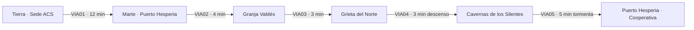

# CAPÍTULO 1 — COSECHA NEGRA (Marte)

## Ficha
| Campo | Valor |
|---|---|
| Mundo | Tierra (inicio) → Marte |
| Duración objetivo | 80–95 min |
| Caso | Doscientos muertos en la Tierra por fruta envenenada exportada desde Marte. Si no se resuelve en seis semanas, se cortan las importaciones y la Tierra pasa hambre. |
| Culpable | **Dr. Silas Brenner**, agrónomo de la Granja Valdés. Cómplice: **Odran Hask**, capataz. |
| Giro | Bajo Marte viven los **Silentes**, seres de energía. Le dan a Lune el **Velo de fase**. |
| Objetivo emocional | Conocer a GOLIAT y sellar el pacto entre los dos. |
| Fuente analítica | `analisis/ANALISIS_POR_LIBRO.md` §L1 (estructura: envenenamiento → infiltración → mundo subterráneo → disfraz → reunión de sospechosos) |

## Personajes del capítulo
| Personaje | Rol | Voz |
|---|---|---|
| Odran Hask | Capataz de la Granja Valdés. Cómplice. | Ronco, autoritario, impaciente |
| Dr. Silas Brenner | Agrónomo. Culpable. | Amable, didáctico, demasiado servicial |
| Ramón Valdés | Dueño de la granja. Inocente. | Patriarcal, orgulloso, cansado |
| Kurt Zell | Peón y matón de Hask | Burlón, nervioso |
| Gorski | Peón violento | Pocas palabras, agresivo |
| Dra. Noor Saleh | Delegada de la ACS en Marte | Escéptica, precisa |
| Silente Joven | Ser de energía, curiosa | Voz femenina, juvenil, con eco |
| Silente Anciano | Ser de energía | Voz grave, lenta, con eco |

## Pistas (inventario de deducción)
| ID | Pista | Dónde se obtiene | Uso |
|---|---|---|---|
| P1-01 | Informe de víctimas: todas comieron fruta de la misma cooperativa | C1_BRF01 | Contexto |
| P1-02 | Registro dañado de GOLIAT: tractor de Hask hacia el desierto a medianoche | C1_LOC02 | Cómplice |
| P1-03 | Cartas de compra de granjas con matasellos «Cinturón» | C1_LOC03 | Móvil (extorsión) |
| P1-04 | Arpón tomamuestras de Brenner con residuo gomoso | C1_LOC03 / C1_LOC06 | **Método (clave)** |
| P1-05 | Contrapesos del vehículo de inspección retirados | C1_LOC04 | Intento de homicidio |
| P1-06 | Guantes bicolores (blanco y negro) en la grabación nocturna de GOLIAT | C1_LOC06 (registro restaurado) | **Identidad (clave)** |

## Mapa de ruta

| Nodo | Nombre | Tipo | Condición de acceso |
|---|---|---|---|
| N1 | Torre Meridiana, Ciudad Concordia (Tierra) | Sede | Inicio |
| N2 | Puerto Hesperia, ciudad bajo cúpula (Marte) | Ciudad | Tras C1_BRF01 |
| N3 | Granja Valdés, Valle Ares | Granja | `F_GOLIAT_RECLUTADO` |
| N4 | Grieta del Norte | Exterior | Tras C1_INT03 |
| N5 | Cavernas de los Silentes | Subterráneo | Tras C1_LOC04 |
| N6 | Puerto Hesperia, sala de la cooperativa | Ciudad | `F_VELO` |

---

## ESCENAS

### C1_BRF01 — Sesión informativa · Torre Meridiana
**Trigger de inicio:** nueva partida. **Duración:** 3 min. **Cámara:** despacho de Corvo; ventanal sobre la ciudad.

| ID | Trigger | Personaje | Línea | Dirección |
|---|---|---|---|---|
| C1_BRF01_010 | INICIO | CORVO | Doscientas catorce personas en cuatro meses, Darío. Comieron fruta marciana y murieron antes del postre. | Grave, sin mirarlo |
| C1_BRF01_020 | CONT | LUNE | ¿Y la fruta? ¿Qué dicen los análisis? | Concentrado |
| C1_BRF01_030 | CONT | FERRÁN | Nada. Ninguna toxina conocida. Ninguna bacteria que sepamos cultivar. Mata y desaparece. | Pausado, pipa en mano |
| C1_BRF01_040 | CONT | CORVO | La Tierra come gracias a Marte y a las lunas de Júpiter. Si cerramos las importaciones, en seis semanas tenemos hambre. Si no las cerramos, seguimos enterrando gente. | Tensa |
| C1_BRF01_050 | CONT | LUNE | Entonces voy a Marte. | Decidido |
| C1_BRF01_060 | CONT | CORVO | Vas al laboratorio lunar, con el equipo de análisis. Es seguro, es útil y es una orden. | Firme |
| C1_BRF01_070 | CONT | FERRÁN | Helena… | Conciliador |
| C1_BRF01_080 | CONT | CORVO | No, Ismael. Tiene veinticuatro años y una placa recién estrenada. | Cortante |
| C1_BRF01_090A | ELECCIÓN | LUNE (A) | Entendido, directora. Laboratorio lunar. | Neutro: la mentira se nota |
| C1_BRF01_090B | ELECCIÓN | LUNE (B) | Por todas las órbitas, Helena, ya no tengo doce años. | Respetuoso pero firme |
| C1_BRF01_100 | CONT | CORVO | Retírese, inspector. | Seca. Se gira al ventanal |
| C1_BRF01_110 | SALIDA | FERRÁN | (en voz baja, en la puerta) Su hangar está abierto. Yo no te dije nada. | Cómplice, susurro |
| C1_BRF01_120 | CONT | LUNE | Ya lo sabía. Por eso dejé una nota en su escritorio. | Sonrisa contenida |

### C1_VIA01 — Viaje: Tierra → Marte
**Tramo:** 12 min. **Hitos:** 0 % despegue de la órbita terrestre · 25 % · 50 % llamada de Corvo · 75 % lluvia de micrometeoritos (EVT) · 95 % aproximación a Marte. **Sin GOLIAT:** el diálogo lo sostienen *ERRANTE*, Corvo, Ferrán y los monólogos de Lune.

| ID | Trigger | Personaje | Línea | Dirección |
|---|---|---|---|---|
| C1_VIA01_010 | RUTA 0% | ERRANTE | Despegue autorizado. Destino: Marte, Puerto Hesperia. Tiempo estimado: cuarenta y una horas comprimidas. | Sintético |
| C1_VIA01_020 | CONT | LUNE | Gracias, *Errante*. Un día de estos vas a decir «buen viaje». | Ironía cariñosa |
| C1_VIA01_030 | CONT | ERRANTE | Expresión no registrada. | Sintético |
| C1_VIA01_040 | RUTA 10% | LUNE | (para sí) Cuatro meses de muertes y ni un patrón. Fruta de doce granjas distintas… pero todas pasan por la misma cooperativa de Hesperia. | Pensativo, voz en off |
| C1_VIA01_050 | RUTA 25% | ERRANTE | Mensaje entrante. Prioridad: personal. Remitente: H. Corvo. | Sintético |
| C1_VIA01_060 | CONT | LUNE | Ahí viene. | Resignado |
| C1_VIA01_070 | CONT | CORVO | «Laboratorio lunar», ¿eh? Leí tu nota. «Me llevé la nave. Vuelvo con el culpable. No se enfade». ¿Eso es una broma? | Furiosa, contenida |
| C1_VIA01_080 | CONT | LUNE | Es una cita textual de lo que usted iba a pensar dentro de una semana. | Sereno |
| C1_VIA01_090 | CONT | CORVO | (suspira) Ismael dice que te estábamos empujando a ir. Que te prohibí ir para que fueras. | Más bajo |
| C1_VIA01_100 | CONT | LUNE | Lo sé. Me di cuenta en la segunda frase. | Divertido |
| C1_VIA01_110 | CONT | CORVO | Entonces trabaja de incógnito. Ni placa ni nombre. En Marte, la ACS es «esa gente de la Tierra». No te van a abrir ni una puerta. | Profesional |
| C1_VIA01_120 | CONT | LUNE | Me llamaré Leo Varga. Peón de granja, sin papeles y con ganas de trabajar. | Probando la voz |
| C1_VIA01_130 | CONT | CORVO | Darío… vuelve. | Quiebre breve |
| C1_VIA01_140 | CONT | LUNE | Siempre vuelvo. | Cálido |
| C1_VIA01_150 | RUTA 50% | FERRÁN | Inspector, una sola cosa científica antes de que llegues. Si el veneno no está en la fruta cuando sale de Marte… | Llamada de voz |
| C1_VIA01_160 | CONT | LUNE | …alguien lo pone en algún momento del camino. O lo pone sabiendo que va a desaparecer. | Completa la idea |
| C1_VIA01_170 | CONT | FERRÁN | Exacto. Busca a alguien que sepa de bacterias marcianas. No hay tantos. | Satisfecho |
| C1_VIA01_180 | EVT(micrometeoritos) | ERRANTE | Alerta: lluvia de micrometeoritos. Se recomienda maniobra evasiva. | Alerta |
| C1_VIA01_190 | CONT | LUNE | Arena del espacio. Vamos, *Errante*, baila conmigo. | Concentrado, con humor |
| C1_VIA01_200 | EVT fin | ERRANTE | Integridad del casco: noventa y ocho por ciento. | Sintético |
| C1_VIA01_210 | CONT | LUNE | Lo dejamos en «impecable». | Alivio |
| C1_VIA01_220 | RUTA 75% | LUNE | (para sí) Mis padres viajaban a Venus cuando los atacaron. Nunca pensé que el primer caso me iba a llevar hacia el otro lado del Sol. | Íntimo; establece el trasfondo |
| C1_VIA01_230 | RUTA 95% | ERRANTE | Marte a la vista. Gravedad: treinta y ocho por ciento de la estándar. Respire por el filtro en el exterior. | Sintético |
| C1_VIA01_240 | CONT | LUNE | Hola, granero de la Tierra. Veamos quién te está pudriendo. | Determinado |
| C1_VIA01_R01 | IDLE ≥15 s | LUNE | (para sí) Fruta que mata y no deja rastro. O es magia o es alguien muy listo. Y no creo en la magia. | Relleno |
| C1_VIA01_R02 | IDLE ≥15 s | ERRANTE | Consumo de combustible: nominal. | Relleno |
| C1_VIA01_R03 | IDLE ≥15 s | LUNE | (silba dos notas, se detiene) Debería poner música aquí dentro. O conseguir compañía. | Relleno; anticipa a GOLIAT |
| C1_VIA01_R04 | IDLE ≥15 s | LUNE | (para sí) Leo Varga. Leo Varga. Tiene que sonar como si lo hubiera dicho toda la vida. | Relleno |

### C1_LOC02 — Puerto Hesperia · Bolsa de trabajo y desguace
**Llegada:** hangar público. **Objetivo:** conseguir trabajo en la Granja Valdés. **Evento:** GOLIAT está a punto de entrar en la prensa de desguace.

| ID | Trigger | Personaje | Línea | Dirección |
|---|---|---|---|---|
| C1_LOC02_010 | LLEGADA | ERRANTE | Aterrizaje completado. Nave registrada a nombre de Leo Varga. | Sintético |
| C1_LOC02_020 | CONT | LUNE | Bienvenido a casa, Leo. | Se pone el filtro |
| C1_LOC02_030 | EXPLORAR | PNJ PEÓN | Si buscas trabajo, la cola es ahí. Si buscas trabajo bueno, vuelve a la Tierra. | Ambiente |
| C1_LOC02_040 | EXPLORAR | PNJ CAJERA | ¿Granja Valdés? Pagan bien. Lo que no pagan es la gente que se les va. | Ambiente; pista suave |
| C1_LOC02_050 | INTERACT(desguace) | HASK | ¡A la prensa con esa chatarra! Tiene la memoria podrida. Ve cosas que no existen. | Gritando a un operario |
| C1_LOC02_060 | CONT | GOLIAT | ¡No tengo la memoria podrida! ¡Tengo la memoria EXCELENTE! ¡Y le exijo que me suelte, gorila de invernadero! | Indignación enorme, voz grave |
| C1_LOC02_070 | CONT | OPERARIO | Es un GL-7, capataz. Treinta años picando roca. Vale más como piezas que entero. | Indiferente |
| C1_LOC02_080A | ELECCIÓN | LUNE (A) | Yo me lo llevo. Lo pago a precio de chatarra. | Tranquilo |
| C1_LOC02_080B | ELECCIÓN | LUNE (B) | ¿Qué es lo que vio, exactamente? | Curioso, mirando a Hask |
| C1_LOC02_090 | COND(B) | HASK | Vio lo que vio un cerebro de lata quemado. ¿Y tú quién eres? | Amenazante |
| C1_LOC02_100 | CONT | LUNE | Leo Varga. Busco trabajo. Y por lo visto, también un robot. | Sereno |
| C1_LOC02_110 | CONT | HASK | Treinta créditos y te lo llevas. Si te da problemas, la prensa sigue aquí. | Desprecio; se aleja |
| C1_LOC02_120 | CONT | GOLIAT | ¿Treinta? ¿TREINTA? Mi chasis sólo ya vale cuarenta. ¡Exijo una tasación justa! | Ofendido |
| C1_LOC02_130 | CONT | LUNE | ¿Prefieres la prensa? | Divertido |
| C1_LOC02_140 | CONT | GOLIAT | …Treinta está bien. Treinta es un precio de amigo. | Cambio inmediato |
| C1_LOC02_150 | CONT | LUNE | ¿Tienes nombre, o te llamo «unidad»? | Probándolo |
| C1_LOC02_160 | CONT | GOLIAT | Si me llama «unidad», le pico los tobillos. Me llamo GOLIAT. Designación GL-7. Un metro diez de pura ingeniería marciana. | Orgulloso, saca pecho |
| C1_LOC02_170 | CONT | LUNE | ¿Goliat? | Contiene la risa |
| C1_LOC02_180 | CONT | GOLIAT | Sí. ¿Algún problema con el nombre, terrícola? | Desafiante |
| C1_LOC02_190 | CONT | LUNE | Ninguno. Te queda… grande. | Seco |
| C1_LOC02_200 | CONT | GOLIAT | Ja. Ja. Se me van a fundir los circuitos de la risa. | Sarcasmo |
| C1_LOC02_210 | CONT | GOLIAT | Gracias, por cierto. Te debo una. Los GL-7 pagamos nuestras deudas. | Más bajo, sincero |
| C1_LOC02_220 | CONT | LUNE | Entonces págamela ahora: ¿qué viste? | Directo |
| C1_LOC02_230 | CONT | GOLIAT | El tractor de arena de Hask, saliendo hacia el desierto a medianoche. Tres noches seguidas. Lo registré. Al día siguiente me declararon «averiado». | Bajo, confidencial |
| C1_LOC02_240 | CONT | GOLIAT | El archivo está dañado. Alguien lo borró a medias. Me queda el rumbo… y un manchón de colores. | Frustrado |
| C1_LOC02_250 | CONT | LUNE | Guárdalo. Vale más que treinta créditos. | Serio. **Pista P1-02** |
| C1_LOC02_260 | CONT | GOLIAT | ¿Ves? Te lo dije: memoria EXCELENTE. | Triunfal. **Flag `F_GOLIAT_RECLUTADO`** |
| C1_LOC02_270 | EXPLORAR | GOLIAT | El contratista de la Granja Valdés es aquel de la gorra. No le digas que vienes de la Tierra. Se te nota en el andar. | Ayuda contextual |
| C1_LOC02_280 | INTERACT(contratista) | PNJ CONTRATISTA | ¿Experiencia? | Aburrido |
| C1_LOC02_290 | CONT | LUNE | Cuatro años en hidroponía. Y traigo mi propio robot. | Mentira tranquila |
| C1_LOC02_300 | CONT | PNJ CONTRATISTA | ¿Esa cosa? Bueno. Empiezas mañana. Sales hacia el Valle Ares esta tarde. | Firma |
| C1_LOC02_310 | SALIDA | GOLIAT | Primer viaje juntos. Te advierto que mareo a los pilotos malos. | Fanfarrón |

### C1_VIA02 — Viaje: Puerto Hesperia → Granja Valdés (vuelo rasante)
**Tramo:** 4 min, a baja altura sobre los cañones. **Hitos:** 0 % · 25 % · 50 % paso por el cañón estrecho (EVT) · 75 % · 95 %.

| ID | Trigger | Personaje | Línea | Dirección |
|---|---|---|---|---|
| C1_VIA02_010 | RUTA 0% | GOLIAT | Bonita nave. ¿Cuánto costó? ¿Más que yo? Seguro que más que yo. | Curioso, celoso |
| C1_VIA02_020 | CONT | LUNE | *Errante*, saluda a GOLIAT. | Divertido |
| C1_VIA02_030 | CONT | ERRANTE | Pasajero no humano registrado. | Sintético |
| C1_VIA02_040 | CONT | GOLIAT | «Pasajero no humano». Qué conversación tan rica tiene tu nave. ¿Habláis mucho por las noches? | Sarcasmo |
| C1_VIA02_050 | RUTA 25% | GOLIAT | Por cierto, «Leo Varga»… Te reconocí en el desguace. Saliste en las noticias cuando te graduaste. Eres de la ACS. | Bajo, cómplice |
| C1_VIA02_060 | CONT | LUNE | ¿Y qué vas a hacer con esa información? | Tenso |
| C1_VIA02_070 | CONT | GOLIAT | Archivarla en la sección «secretos de amigos». Es una sección nueva. Tú eres el primero. | Solemne y cómico |
| C1_VIA02_080 | CONT | LUNE | Me llamo Darío. Darío Lune. | Le confía el nombre |
| C1_VIA02_090 | EVT(cañón estrecho) | GOLIAT | ¡Pared a la izquierda! ¡Pared a la derecha! ¡Paredes por todas partes! | Pánico cómico |
| C1_VIA02_100 | CONT | LUNE | Lo estoy viendo, GOLIAT. | Concentrado |
| C1_VIA02_110 | EVT fin | GOLIAT | Bien. Bien pilotado. Para ser terrícola. | Recupera la compostura |
| C1_VIA02_120 | RUTA 75% | GOLIAT | En la Granja Valdés, cuidado con Gorski. Pega primero y pregunta nunca. Y con Zell, que es la sombra de Hask. | Informativo |
| C1_VIA02_130 | CONT | LUNE | ¿Y el agrónomo? | Interesado |
| C1_VIA02_140 | CONT | GOLIAT | ¿Brenner? Un señor encantador. Me aceitaba las juntas los domingos. Cree que hay marcianos de verdad bajo tierra. Nadie le hace caso. | Afecto sincero (ironía dramática) |
| C1_VIA02_150 | RUTA 95% | ERRANTE | Granja Valdés a dos kilómetros. Pista de tierra. | Sintético |
| C1_VIA02_160 | CONT | GOLIAT | Hogar, dulce hogar. Que me echó a la basura. | Agridulce |
| C1_VIA02_R01 | IDLE ≥15 s | GOLIAT | ¿Sabes que la arena de Marte se mete en todos lados? En TODOS. No preguntes. | Relleno |
| C1_VIA02_R02 | IDLE ≥15 s | GOLIAT | Esa formación de ahí la llamamos «la Muela». La de al lado, «la Otra Muela». Los mineros no somos poetas. | Relleno |
| C1_VIA02_R03 | IDLE ≥15 s | GOLIAT | Si vas a seguir callado, voy a empezar a contar rocas. Una. Dos. Esa es grande. Tres… | Relleno |

### C1_LOC03 — Granja Valdés
**Llegada:** pista de tierra; invernaderos presurizados. **Objetivos:** hablar con Valdés, Brenner y Zell (INT01–INT03). **Pistas:** P1-03, P1-04.

| ID | Trigger | Personaje | Línea | Dirección |
|---|---|---|---|---|
| C1_LOC03_010 | LLEGADA | GOLIAT | Esos invernaderos de ahí. Doscientos kilómetros a la redonda son de Valdés. Hasta el aire tiene dueño. | Ambiente |
| C1_LOC03_020 | EXPLORAR | ZELL | Mira quién volvió de la prensa. ¿Te armaron con piezas nuevas, enano? | Burlón |
| C1_LOC03_030 | CONT | GOLIAT | Vuelve a llamarme «enano» y te armo yo a ti, con piezas sueltas. | Amenaza grave y ridícula |
| C1_LOC03_040 | CONT | LUNE | GOLIAT. | Freno |
| C1_LOC03_050 | CONT | GOLIAT | …Estaba siendo diplomático. | Contrariado |

#### C1_INT01 — Interrogatorio: Ramón Valdés

| ID | Trigger | Personaje | Línea | Dirección |
|---|---|---|---|---|
| C1_INT01_010 | INTERACT(Valdés) | VALDÉS | Nuevo, ¿verdad? Aquí se trabaja de sol a sol. Y en Marte el sol se toma su tiempo. | Cansado |
| C1_INT01_020A | ELECCIÓN | LUNE (A) | He oído que hay compradores interesados en su granja. | Indagador |
| C1_INT01_020B | ELECCIÓN | LUNE (B) | ¿Le preocupa lo que se dice en la Tierra de su fruta? | Directo |
| C1_INT01_030 | COND(A) | VALDÉS | Cartas. Todos los meses. Ofrecen la mitad de lo que vale. Con matasellos del Cinturón, ni siquiera de Marte. | Despectivo. **Pista P1-03** |
| C1_INT01_040 | COND(B) | VALDÉS | Mi fruta es limpia. Mi padre la cultivó y mi abuelo cavó estas cúpulas con las manos. Si alguien la envenena, no es un Valdés. | Herido en el orgullo |
| C1_INT01_050 | CONT | VALDÉS | Y aquí los marcianos no llamamos a la policía. Lo resolvemos nosotros. | Advertencia |
| C1_INT01_060 | SALIDA | GOLIAT | (bajo) No le muestres la placa a este. Te tira al pozo de abono. | Comentario |

#### C1_INT02 — Interrogatorio: Dr. Silas Brenner

| ID | Trigger | Personaje | Línea | Dirección |
|---|---|---|---|---|
| C1_INT02_010 | INTERACT(Brenner) | BRENNER | ¡GOLIAT! Viejo amigo. Me dijeron que te habían llevado al desguace. Lo lamenté muchísimo. | Cálido (actuado) |
| C1_INT02_020 | CONT | GOLIAT | Casi me desguazan, doctor. Pero llegó Leo. | Contento |
| C1_INT02_030 | CONT | BRENNER | Un placer, Leo. Si te interesa la ciencia, pásate por el laboratorio. Aquí nadie quiere escuchar. | Amable |
| C1_INT02_040A | ELECCIÓN | LUNE (A) | ¿Qué cree usted que está envenenando la fruta? | Curioso |
| C1_INT02_040B | ELECCIÓN | LUNE (B) | ¿Para qué sirve ese arpón? | Señala el instrumento |
| C1_INT02_050 | COND(A) | BRENNER | ¿De verdad quieres saberlo? Hay vida bajo Marte. Antigua, inteligente. Y creo que nos está atacando con bacterias. Guerra biológica. | Apasionado. Pista falsa deliberada |
| C1_INT02_060 | COND(B) | BRENNER | ¿Esto? Un tomamuestras. Disparo, perforo la cáscara, extraigo un núcleo. Controlo la calidad fruta por fruta. | Didáctico. **Pista P1-04 (registrar)** |
| C1_INT02_070 | CONT | LUNE | ¿Fruta por fruta? Es mucha fruta. | Neutro |
| C1_INT02_080 | CONT | BRENNER | Soy un hombre minucioso. | Sonrisa |
| C1_INT02_090 | SALIDA | GOLIAT | ¿A que es encantador? | Ingenuo |
| C1_INT02_100 | CONT | LUNE | Mucho. | Pensativo; no comparte la sospecha |

#### C1_INT03 — Comedor de peones (aviso de GOLIAT)

| ID | Trigger | Personaje | Línea | Dirección |
|---|---|---|---|---|
| C1_INT03_010 | INTERACT(comedor) | GORSKI | Siéntate en otro lado, nuevo. | Hostil |
| C1_INT03_020A | ELECCIÓN | LUNE (A) | Hay sitio de sobra. | Calma |
| C1_INT03_020B | ELECCIÓN | LUNE (B) | (se levanta sin decir nada) | Evita el conflicto |
| C1_INT03_030 | COND(A) | GORSKI | Mañana hay inspección en la Grieta del Norte. Vienes tú. Ya veremos cuánto sitio te queda. | Amenaza |
| C1_INT03_040 | CONT | GOLIAT | (bajo) Darío, escuché a Zell en el taller. Le quitaron los contrapesos al vehículo de inspección. Quieren que «el nuevo» se caiga a la grieta. | Urgente, susurro |
| C1_INT03_050 | CONT | LUNE | Entonces mañana no me voy a caer. | Frío |
| C1_INT03_060 | CONT | GOLIAT | ¿Y si te caes? | Preocupado |
| C1_INT03_070 | CONT | LUNE | Me atrapas. | Medio en broma |
| C1_INT03_080 | CONT | GOLIAT | Con un metro diez. Claro. Sin problema. | Seco |

### C1_VIA03 — Viaje: Granja → Grieta del Norte (convoy de inspección)
**Tramo:** 3 min en convoy; Lune pilota el vehículo saboteado (control inestable).

| ID | Trigger | Personaje | Línea | Dirección |
|---|---|---|---|---|
| C1_VIA03_010 | RUTA 0% | GOLIAT | (por radio) Te sigo en la *Errante* a baja altura. Si el vehículo hace algo raro, grita. | Radio |
| C1_VIA03_020 | RUTA 25% | LUNE | Se va a la derecha. Le falta peso atrás. Tenías razón. | Esfuerzo |
| C1_VIA03_030 | RUTA 50% | ZELL | (radio del convoy) ¿Todo bien, nuevo? Esos vehículos son caprichosos. | Falsa amabilidad |
| C1_VIA03_040 | CONT | LUNE | Muy bien, Zell. Gracias por preguntar. | Helado |
| C1_VIA03_050 | RUTA 75% | GOLIAT | Gorski se está quedando atrás. Ojo con él. | Alerta |
| C1_VIA03_060 | RUTA 95% | GOLIAT | La grieta está ahí delante. Desde aquí parece una sonrisa. Una sonrisa muy fea. | Inquieto |
| C1_VIA03_R01 | IDLE ≥15 s | GOLIAT | Te lo digo como amigo: tu manera de conducir le da miedo hasta a mi giroscopio. | Relleno |
| C1_VIA03_R02 | IDLE ≥15 s | LUNE | Un vehículo sin contrapeso y un hombre que espera que me caiga. Qué mañana tan tranquila. | Relleno |

### C1_LOC04 — Grieta del Norte
**Evento:** pelea con Gorski al borde de la grieta. Gorski cae. **Deducción:** ninguna grieta corta una caverna → hay una entrada.

| ID | Trigger | Personaje | Línea | Dirección |
|---|---|---|---|---|
| C1_LOC04_010 | LLEGADA | GORSKI | Bájate, nuevo. Vamos a ver si sabes caminar sin filtro. | Se quita el filtro, provocación |
| C1_LOC04_020 | CONT | LUNE | Si me lo quito, nos ahogamos los dos. | Calma |
| C1_LOC04_030 | CIN (pelea) | GORSKI | ¡Aquí no hay inspectores que te salven! | Golpe |
| C1_LOC04_040 | CONT | GOLIAT | ¡Darío! ¡Atrás, que está el borde! | Grito |
| C1_LOC04_050 | CONT | GORSKI | (cae) ¡Noooo…! | Grito que se aleja |
| C1_LOC04_060 | CONT | LUNE | (jadeando) Lo intenté agarrar. Lo intenté. | Afectado |
| C1_LOC04_070 | CONT | GOLIAT | Lo vi. Lo registré. Nadie va a decir que lo empujaste. | Firme, protector |
| C1_LOC04_080 | EXPLORAR | PNJ HORTICULTOR | Buena pelea, chaval. Gorski se lo buscó. | Respeto rudo |
| C1_LOC04_090 | INTERACT(vehículo) | GOLIAT | Mira: los anclajes de los contrapesos, limpios. Aquí había algo y lo quitaron. | **Pista P1-05** |
| C1_LOC04_100 | INTERACT(borde) | LUNE | Esta grieta baja recta durante kilómetros… y nunca corta una caverna. Ninguna grieta de Marte corta una. Como si las cavernas las esquivaran. | Pensando en voz alta |
| C1_LOC04_110 | CONT | GOLIAT | O como si alguien las protegiera. | Bajo, inquieto |
| C1_LOC04_120 | CONT | LUNE | Brenner dice que hay alguien ahí abajo. Vamos a comprobarlo. | Decidido |
| C1_LOC04_130 | CONT | GOLIAT | Claro. ¿Por qué no? Bajemos a la casa de los monstruos subterráneos. Es martes. | Resignado |

### C1_VIA04 — Viaje: Grieta → Cavernas (descenso vertical)
**Tramo:** 3 min de pilotaje vertical por el pozo con luz de focos. **Hitos:** 0 % · 30 % estrechamiento · 60 % luz azul · 100 % cámara de entrada.

| ID | Trigger | Personaje | Línea | Dirección |
|---|---|---|---|---|
| C1_VIA04_010 | RUTA 0% | ERRANTE | Descenso vertical. Profundidad: doscientos metros. | Sintético |
| C1_VIA04_020 | CONT | GOLIAT | Mis sensores de mineral están contentísimos. Mis sensores de supervivencia, no tanto. | Nervioso |
| C1_VIA04_030 | RUTA 30% | LUNE | Se estrecha. Si fuera más grande, no pasaríamos. | Concentrado |
| C1_VIA04_040 | CONT | GOLIAT | ¿Ves? Por fin alguien entiende las ventajas de ser compacto. | Orgulloso |
| C1_VIA04_050 | RUTA 60% | GOLIAT | Darío… hay luz ahí abajo. Azul. Y no viene de ninguna fuente que yo pueda medir. | Asombro |
| C1_VIA04_060 | CONT | LUNE | ¿Nada? ¿Ni calor? | Intrigado |
| C1_VIA04_070 | CONT | GOLIAT | Nada. Es como mirar un pensamiento. | Asombro, bajo |
| C1_VIA04_080 | RUTA 100% | ERRANTE | Profundidad: seis kilómetros. Cámara estable. Atmósfera respirable. | Sintético |
| C1_VIA04_090 | CONT | LUNE | ¿Respirable? A seis kilómetros bajo Marte. | Incrédulo |
| C1_VIA04_R01 | IDLE ≥15 s | GOLIAT | Si nos morimos aquí, quiero que conste que fue idea tuya. | Relleno |
| C1_VIA04_R02 | IDLE ≥15 s | GOLIAT | Profundidad nueva. Récord personal. No lo celebro. | Relleno |

### C1_LOC05 — Cavernas de los Silentes (CIN01)
**Cinemática interactiva.** Los Silentes hablan dentro de la mente de Lune. **No pueden leer a GOLIAT** (se anticipa el capítulo 3).

| ID | Trigger | Personaje | Línea | Dirección |
|---|---|---|---|---|
| C1_LOC05_010 | LLEGADA | SILENTE JOVEN | ¡Un visitante! Hace tanto que nadie baja. Tienes la mente llena de ruido, viajero. | Curiosa, eco, alegre |
| C1_LOC05_020 | CONT | LUNE | ¿Quiénes son ustedes? | Asombro controlado |
| C1_LOC05_030 | CONT | SILENTE JOVEN | Los que se quedaron. Los que eligieron la quietud. Hace medio millón de vueltas al Sol dejamos los cuerpos. | Soñadora |
| C1_LOC05_040 | CONT | GOLIAT | Darío, ¿con quién hablas? Yo no oigo nada. ¿Me estoy perdiendo una fiesta? | Desconcertado |
| C1_LOC05_050 | CONT | SILENTE JOVEN | Qué curioso. El pequeño no tiene mente que pueda tocar. Es todo silencio por dentro. | Intrigada |
| C1_LOC05_060 | CONT | GOLIAT | ¿«Todo silencio»? ¡Oiga! Tengo opiniones. ¡Muchas! | Ofendido (aunque no la oye: reacciona a Lune) |
| C1_LOC05_070 | CONT | SILENTE ANCIANO | Basta. La joven abre mentes que no debe. Viajero: tu gente envenena, mata y corre entre los mundos. Nosotros nos bastamos. | Grave, frío |
| C1_LOC05_080A | ELECCIÓN | LUNE (A) | No vengo a molestarlos. Vengo a detener a un asesino. | Sincero |
| C1_LOC05_080B | ELECCIÓN | LUNE (B) | ¿Ustedes son los que envenenan la fruta? | Firme |
| C1_LOC05_090 | COND(B) | SILENTE ANCIANO | No tocamos vuestra comida. No tocamos nada. Esa es nuestra elección, y nuestro peso. | Herido, lento |
| C1_LOC05_100 | CONT | SILENTE ANCIANO | He mirado dentro de ti. Hay más que ruido. Llévate esto. | Decisión |
| C1_LOC05_110 | CIN | ERRANTE | Instalación de módulo desconocido en el casco. Designación sugerida: «Velo». | Sintético. **Flag `F_VELO`** |
| C1_LOC05_120 | CONT | SILENTE JOVEN | Bebe la luz del Sol y te envuelve en humo y luz. Nadie podrá ver tu rostro ni atravesarte. Que te llamen el **Espectro**. | Entusiasta |
| C1_LOC05_130 | CONT | SILENTE ANCIANO | Úsalo para defender, no para conquistar. Y no vuelvas. | Final, severo |
| C1_LOC05_140 | SALIDA | SILENTE JOVEN | (eco lejano, sólo para Lune) No temas, Espectro. | Tierna |
| C1_LOC05_150 | CONT | GOLIAT | ¿Me puedes explicar por qué la nave tiene un escudo nuevo y tú cara de haber visto a tu abuela? | Desconcertado |
| C1_LOC05_160 | CONT | LUNE | En el viaje. Te lo cuento todo en el viaje. | Conmovido |

### C1_VIA05 — Viaje: Cavernas → Puerto Hesperia (tormenta de polvo)
**Tramo:** 5 min. **EVT:** tormenta eléctrica de polvo al 40 %; el jugador activa el Velo (tutorial).

| ID | Trigger | Personaje | Línea | Dirección |
|---|---|---|---|---|
| C1_VIA05_010 | RUTA 0% | GOLIAT | Bueno. Estamos en la superficie. Te escucho. ¿Quiénes eran? | Impaciente |
| C1_VIA05_020 | CONT | LUNE | Marcianos. Los de verdad. Hechos de energía. No quieren nada de nosotros. | Todavía impresionado |
| C1_VIA05_030 | CONT | GOLIAT | ¿Y Brenner tenía razón? ¡Lo sabía! ¡Es un genio incomprendido! | Contento |
| C1_VIA05_040 | CONT | LUNE | Tenía razón en que existen. No en lo que hacen. | Cauto |
| C1_VIA05_050 | RUTA 25% | GOLIAT | Dijeron que no me podían leer, ¿no? «Todo silencio por dentro». | Más bajo, herido |
| C1_VIA05_060 | CONT | LUNE | Dijeron que no tenías una mente que *ellos* pudieran tocar. No que no tuvieras una. | Lo consuela sin dramatizar |
| C1_VIA05_070 | CONT | GOLIAT | …Eso suena mejor. Lo voy a archivar así. | Reconfortado |
| C1_VIA05_080 | EVT(tormenta) | ERRANTE | Tormenta de polvo con carga eléctrica. Visibilidad: cero. Riesgo de impacto: crítico. | Alerta |
| C1_VIA05_090 | CONT | GOLIAT | ¡Polvo de Marte! ¡Esto es una tormenta de las que se comen granjas enteras! | Pánico |
| C1_VIA05_100 | CONT | LUNE | Probemos el regalo. *Errante*, activa el Velo. | Firme |
| C1_VIA05_110 | CONT | ERRANTE | Velo activo. Absorción de energía: total. | Sintético |
| C1_VIA05_120 | CONT | GOLIAT | …Los rayos nos atraviesan. No: los rayos se mueren en el escudo. Darío, desde fuera debemos parecer un fantasma de humo. | Maravillado |
| C1_VIA05_130 | CONT | LUNE | Un espectro. | Sonrisa |
| C1_VIA05_140 | RUTA 70% | LUNE | Escúchame bien. En Hesperia, Leo Varga desaparece. Quien aparezca con el Velo es «el Espectro». Nadie puede saber que somos el mismo. | Plan |
| C1_VIA05_150 | CONT | GOLIAT | ¿Ni Corvo? | Pícaro |
| C1_VIA05_160 | CONT | LUNE | Corvo sobre todo. Se moriría de un infarto. | Divertido |
| C1_VIA05_170 | RUTA 95% | GOLIAT | Hesperia a la vista. Darío… antes de que bajemos: sea lo que sea que hagas, yo voy contigo. | Serio, nuevo tono |
| C1_VIA05_180 | CONT | LUNE | Lo sé. | Breve, cálido |
| C1_VIA05_R01 | IDLE ≥15 s | GOLIAT | Un escudo de energía marciano. Si se lo cuento a los otros GL-7 en el desguace, se ríen. Bueno, ya no queda ninguno. | Relleno, agridulce |
| C1_VIA05_R02 | IDLE ≥15 s | GOLIAT | ¿Puedo llamarlo «Velo de GOLIAT»? Aunque sea de forma no oficial. | Relleno |

### C1_LOC06 — Puerto Hesperia: el Espectro entra en acción
**Secuencia en dos partes:** (a) Zell intenta matar a Lune en la cantina por orden de Hask y GOLIAT lo frena; (b) el Espectro visita a Hask. **Durante la escena, GOLIAT restaura su registro y obtiene la pista P1-06.** La Dra. Saleh llega con la autoridad de la ACS.

| ID | Trigger | Personaje | Línea | Dirección |
|---|---|---|---|---|
| C1_LOC06_010 | LLEGADA | GOLIAT | Cantina «La Polvareda». Zell está en la barra. Tiene la mano debajo de la bandeja. | Alerta, bajo |
| C1_LOC06_020 | CONT | ZELL | Leo Varga. Creíamos que te había tragado la tormenta. | Nervioso, mano oculta |
| C1_LOC06_030 | CIN | GOLIAT | ¡Arma! | Grito; golpea la bandeja |
| C1_LOC06_040 | CONT | ZELL | ¡Me lo mandó Hask! ¡No es nada personal! | Aterrado |
| C1_LOC06_050 | CONT | GOLIAT | Para mí sí es personal. Era mi único amigo y casi me lo agujereas. | Furioso, grave |
| C1_LOC06_060 | CONT | DRA. SALEH | Nadie se mueve. Agencia Científica Solar. Esta cooperativa queda bajo control federal desde este momento. | Autoridad, entra |
| C1_LOC06_070 | CONT | LUNE | (bajo) ¿Doctora Saleh? | Sorprendido |
| C1_LOC06_080 | CONT | DRA. SALEH | Corvo me pidió que lo vigilara, Varga. No me gusta que me pidan vigilar a nadie. | Seca |
| C1_LOC06_090 | INTERACT(registro) | GOLIAT | Darío. Con el escudo marciano junto a mi cabeza se me reordenaron los sectores. Recuperé un trozo del archivo. | Sorprendido |
| C1_LOC06_100 | CONT | GOLIAT | Medianoche. Tractor de Hask. Junto a él, alguien con guantes blancos y negros. Bicolores. | Lento, reproduciendo. **Pista P1-06** |
| C1_LOC06_110 | CONT | LUNE | ¿Quién en esta granja usa guantes de dos colores? | Grave |
| C1_LOC06_120 | CONT | GOLIAT | Nadie. Sólo… nadie. No quiero decirlo. | Dolido; se resiste |
| C1_LOC06_130 | INTERACT(despacho de Hask) | ESPECTRO (LUNE, voz filtrada) | Odran Hask. | Voz con eco metálico, figura de humo |
| C1_LOC06_140 | CONT | HASK | ¿Qué demonios…? (dispara) ¡No…! ¡La bala no lo toca! | Pánico |
| C1_LOC06_150 | CONT | ESPECTRO | Sé lo de los viajes de medianoche. Sé lo del Cinturón. Mañana habrá una reunión en la cooperativa. Irás. | Implacable |
| C1_LOC06_160 | CONT | HASK | ¿Quién eres? | Aterrado |
| C1_LOC06_170 | CONT | ESPECTRO | El Espectro de Marte. | Se disuelve |
| C1_LOC06_180 | SALIDA | GOLIAT | «El Espectro de Marte». Qué dramático. Me encanta. | Entusiasmo |

### C1_DED01 — Reunión en la cooperativa (tablero de deducción)
**Presentes:** Valdés, Brenner, Hask, Zell, Dra. Saleh, GOLIAT. Lune entra como el Espectro.
**Combinación correcta:** Culpable **Brenner** + Método **inyección con el arpón tomamuestras** (P1-04) + Prueba **guantes bicolores en el registro** (P1-06).

| ID | Trigger | Personaje | Línea | Dirección |
|---|---|---|---|---|
| C1_DED01_010 | INICIO | ESPECTRO | Alguien en esta sala envenenó a doscientas catorce personas para hundir el precio de las granjas y comprarlas desde el Cinturón. | Solemne |
| C1_DED01_020 | CONT | VALDÉS | ¿Mi granja? ¿Hundirla para comprarla? | Indignado |
| C1_DED01_030 | CONT | ESPECTRO | Busqué a alguien que se sintiera pequeño. Que necesitara que el mundo le diera la razón. | Grave |
| C1_DED01_040 | CONT | ZELL | ¡Entonces es el robot! ¡Es el más pequeño de todos! | Acusa a GOLIAT |
| C1_DED01_050 | CONT | GOLIAT | ¡Repite eso más cerca, que no te oigo desde aquí abajo! | Furioso |
| C1_DED01_060 | CONT | ESPECTRO | No se mide la pequeñez en centímetros. | Sentencia; tema del capítulo |
| C1_DED01_070 | ACUSACIÓN errónea: Hask | ESPECTRO | Hask hizo los viajes, sí. Pero Hask no sabe cultivar ni una lechuga. | Respuesta al error |
| C1_DED01_080 | ACUSACIÓN errónea: Valdés | GOLIAT | ¿Valdés? Prefiere morirse antes que envenenar algo con su apellido. Prueba otra vez. | Respuesta al error |
| C1_DED01_090 | ACUSACIÓN errónea: Zell | ZELL | ¡Yo sólo hago lo que me dicen! ¡Nadie me cuenta nada! | Respuesta al error; es verdad |
| C1_DED01_100 | ACUSACIÓN correcta | ESPECTRO | Doctor Brenner. Usted cultivó una bacteria marciana que muere al llegar a la Tierra y no deja rastro. Y la inyectó con su arpón tomamuestras, fruta por fruta. «Soy un hombre minucioso». | Firme |
| C1_DED01_110 | CONT | BRENNER | Eso es ridículo. Yo defendí que había vida en Marte. ¡Nadie me escuchó! | Pierde la calma |
| C1_DED01_120 | CONT | ESPECTRO | Por eso quería que creyéramos que nos atacaban los marcianos. Para tener razón por fin. GOLIAT, el registro. | Seco |
| C1_DED01_130 | CONT | GOLIAT | (voz quebrada) Medianoche. Hask. Y unos guantes blancos y negros. Usted me aceitaba las juntas con esos guantes, doctor. Los domingos. | Dolido; momento emocional |
| C1_DED01_140 | CONT | BRENNER | Eras un robot. Los robots no tienen domingos. | Frío; se le cae la máscara |
| C1_DED01_150 | CONT | DRA. SALEH | Brenner es un enfermo. No va a confesar nada útil. Necesitamos saber a quién le pasaba la fruta Hask en el Cinturón. | Profesional |

#### C1_CIN02 — La falsa píldora

| ID | Trigger | Personaje | Línea | Dirección |
|---|---|---|---|---|
| C1_CIN02_010 | INICIO | ESPECTRO | Hask. Esta cápsula lleva el cultivo de Brenner. Trágatela. Si eres inocente, no tienes nada que temer. | Helado |
| C1_CIN02_020 | CONT | HASK | ¡No! ¡No, por favor! ¡Hablo! ¡Llevaba los cajones a un carguero en el desierto! ¡Gente del Cinturón! ¡Piratas! | Derrumbe total |
| C1_CIN02_030 | CONT | ESPECTRO | Era gelatina, Hask. Pero gracias. | Calma |
| C1_CIN02_040 | CONT | GOLIAT | (bajo) Eso fue cruel. | Impresionado |
| C1_CIN02_050 | CONT | LUNE | Fue necesario. Y me va a costar dormir igual. | Honesto |

#### C1_CIN03 — Epílogo: el pacto

| ID | Trigger | Personaje | Línea | Dirección |
|---|---|---|---|---|
| C1_CIN03_010 | INICIO | DRA. SALEH | La ACS le ofrece un puesto de técnico de campo a este… robot. Dice que su registro vale más que un laboratorio entero. | A Lune, ya sin disfraz |
| C1_CIN03_020 | CONT | GOLIAT | ¿Un puesto? ¿Con placa? | Ilusión |
| C1_CIN03_030 | CONT | GOLIAT | …No. Lo rechazo. | Firme, sorprende |
| C1_CIN03_040 | CONT | LUNE | ¿Por qué? | Sorprendido |
| C1_CIN03_050 | CONT | GOLIAT | Porque se me ha ocurrido algo mejor. Donde vaya tu nave, voy yo. Si me aceptas. | Solemne |
| C1_CIN03_060 | CONT | LUNE | ¿Y si te digo que no? | Bromeando |
| C1_CIN03_070 | CONT | GOLIAT | Me cuelo en la bodega. Mido un metro diez. No me vas a encontrar nunca. | Serio-cómico |
| C1_CIN03_080 | CONT | LUNE | (le tiende la mano) Donde vaya la nave, entonces. | Cálido. **Flag `F_PACTO`** |
| C1_CIN03_090 | CONT | GOLIAT | (le estrecha la mano con cuidado exagerado) Donde vaya la nave. | Emoción contenida |
| C1_CIN03_100 | CONT | CORVO | (llamada) Darío. Me dicen que en Marte apareció un «Espectro». Que no existe ningún informe. Y que tú tienes un robot. | Sospecha |
| C1_CIN03_110 | CONT | LUNE | Lo del robot es verdad. | Inocente |
| C1_CIN03_120 | CONT | GOLIAT | ¡Encantado, directora! ¡Me llamo GOLIAT! | Efusivo |
| C1_CIN03_130 | CONT | CORVO | …Que Dios nos ayude. Vuelvan a casa. | Exasperada, con cariño. **FIN DEL CAPÍTULO 1** |

## Flags del capítulo
`F_GOLIAT_RECLUTADO` (C1_LOC02_260) · `F_VELO` (C1_LOC05_110) · `F_PACTO` (C1_CIN03_080). Gancho al capítulo 2: Hask confiesa que hay **piratas del Cinturón** (C1_CIN02_020).
