# CAPÍTULO 2 — EL CINTURÓN (Asteroides · corona solar · Ganímedes)

## Ficha
| Campo | Valor |
|---|---|
| Mundos | Luna → Cinturón de asteroides → Ceres → Zona Prohibida → corona solar → Ganímedes |
| Duración objetivo | 90–100 min |
| Caso | Los piratas del Cinturón saquean cargueros y ahora tienen naves demasiado buenas para ser suyas. |
| Culpable | **Abel Hollis**, «el ermitaño»: jefe de los piratas y capitán de la nave que mató a los padres de Lune. |
| Antagonistas visibles | Capitán **Isandro Varek** (pirata elegante y de palabra), **Dunn «Cicatriz»** |
| Presencia de Vega | **Primera aparición:** naves de diseño vegano y motores hiperatómicos vendidos a los piratas |
| Mejora obtenida | Módulo de remolque magnético |
| Objetivo emocional | El pasado de Lune: la venganza frente al deber. Primera separación del dúo. |
| Fuente analítica | `analisis/ANALISIS_POR_LIBRO.md` §L2 |

## Personajes del capítulo
| Personaje | Rol | Voz |
|---|---|---|
| Cap. Isandro Varek | Pirata dandi, con código de honor | Teatral, culto, cínico |
| Dunn «Cicatriz» | Lugarteniente violento | Áspero, rencoroso |
| Tobías Rue | Pirata amable, con familia | Cálido, sencillo |
| Abel Hollis | Ermitaño, jefe secreto | Anciano afable; frío al final |
| Cmdte. Inés Paredes | Controladora del observatorio de Ceres | Militar, eficiente |

## Pistas
| ID | Pista | Dónde | Uso |
|---|---|---|---|
| P2-01 | Las naves piratas tienen diseño vegano | C2_VIA01 (abordaje) | Vega como proveedor |
| P2-02 | Un tripulante de Varek dice: «el Jefe vive solo y no sale nunca» | C2_LOC02 | **Identidad (clave)** |
| P2-03 | La casa de Hollis: lujos que un ermitaño no puede pagar | C2_LOC03 | Sospecha |
| P2-04 | El asteroide-base se mueve: motores hiperatómicos veganos | C2_LOC05 | **Método (clave)** |
| P2-05 | La nave de Hollis lleva el transpondedor de la base | C2_LOC06 | **Prueba (clave)** |

## Mapa de ruta

```mermaid
flowchart LR
  N1[Luna · Base ACS Selene] -->|VIA01 · en el Señuelo| N2[Nave pirata Medianoche]
  N2 -->|VIA02 · lanzadera pirata| N3[Asteroide de Hollis]
  N3 -->|VIA03 · Errante recuperada| N4[Ceres · Observatorio]
  N4 -->|VIA04 · campo de asteroides| N5[Asteroide móvil · Zona Prohibida]
  N5 -->|VIA05 · atajo por la corona solar · requiere F_VELO| N6[Ganímedes]
```

---

## ESCENAS

### C2_BRF01 — Base ACS Selene (Luna)

| ID | Trigger | Personaje | Línea | Dirección |
|---|---|---|---|---|
| C2_BRF01_010 | INICIO | FERRÁN | Treinta cargueros saqueados en un año. Los piratas aparecen, desaparecen y nadie sabe dónde tienen la base. | Expositivo |
| C2_BRF01_020 | CONT | CORVO | La idea de Darío es el *Señuelo*: un carguero automático, sin tripulación, cargado de explosivos. Que lo asalten y que vuele con ellos dentro. | Escéptica |
| C2_BRF01_030 | CONT | FERRÁN | Últimamente todos lo llaman «el Afortunado». Dicen que siempre sale bien parado. | Con humor |
| C2_BRF01_040 | CONT | CORVO | Lo que me preocupa es su próxima idea brillante. Seguramente, asaltar él solo el consulado de Vega. | Seca |
| C2_BRF01_050 | CONT | GOLIAT | ¿Vega? ¿Qué es Vega? | Curioso |
| C2_BRF01_060 | CONT | FERRÁN | Una excolonia a veinticinco años luz. Pocos habitantes, muchos robots y demasiado orgullo. | Breve. Siembra el antagonista |
| C2_BRF01_070 | CONT | GOLIAT | ¿Muchos robots? Me caen bien. | Ingenuo |
| C2_BRF01_080 | CONT | FERRÁN | No te caerían bien, créeme. | Sombrío |
| C2_BRF01_090 | SALIDA | LUNE | (aparte, a GOLIAT) El *Señuelo* sale en una hora. Tú y yo vamos dentro, en el cajón de carga número cuatro. | Susurro |
| C2_BRF01_100 | CONT | GOLIAT | ¿Dentro de la bomba? | Horrorizado |
| C2_BRF01_110 | CONT | LUNE | Desactivé la carga. Corvo no lo sabe. Le dejé un mensaje. | Tranquilo |
| C2_BRF01_120 | CONT | GOLIAT | Un día la vas a matar de un disgusto. Y después nos va a matar a nosotros. | Resignado |

### C2_VIA01 — Viaje: Luna → Cinturón (a bordo del *Señuelo*)
**Tramo:** 8 min. El jugador pilota el *Señuelo* con controles limitados (debe parecer una nave automática: sin maniobras bruscas). **EVT al 70 %:** abordaje pirata.

| ID | Trigger | Personaje | Línea | Dirección |
|---|---|---|---|---|
| C2_VIA01_010 | RUTA 0% | GOLIAT | Para que conste: hay sitio para un robot en el cajón cuatro. Para un robot y medio, no. Y tú eres el medio. | Apretado, molesto |
| C2_VIA01_020 | CONT | LUNE | Pilota suave. Tiene que parecer una nave automática. | Bajo |
| C2_VIA01_030 | RUTA 15% | CORVO | (mensaje grabado) Darío. Acabo de leer tu nota. «No se enfade». ¿Sabes lo que voy a hacer cuando vuelvas? Nada. Voy a abrazarte y después te voy a cortar la cabeza. | Furia y miedo |
| C2_VIA01_040 | CONT | GOLIAT | Me cae bien tu jefa. | Divertido |
| C2_VIA01_050 | RUTA 30% | LUNE | Cuando nos aborden, soy Leo Varga, fugitivo de Marte. Busco trabajo con ellos. Tú te quedas en el cajón. | Plan |
| C2_VIA01_060 | CONT | GOLIAT | ¿Y si te disparan? | Serio |
| C2_VIA01_070 | CONT | LUNE | Entonces sales del cajón. | Ligero |
| C2_VIA01_080 | CONT | GOLIAT | Eso no es un plan. Es una esperanza con botas. | Seco |
| C2_VIA01_090 | RUTA 50% | LUNE | (para sí, mirando el Cinturón) Mis padres pasaron por aquí rumbo a Venus. Yo tenía cuatro años. Me metieron en una cápsula y me dijeron que no llorara. | Íntimo |
| C2_VIA01_100 | CONT | GOLIAT | …¿Y lloraste? | Suave |
| C2_VIA01_110 | CONT | LUNE | No. Por eso los recuerdo tan bien. | Contenido |
| C2_VIA01_120 | EVT(abordaje) | ERRANTE | (repetidor) Contacto: nave no identificada. Perfil del casco: diseño no federal. | Alerta |
| C2_VIA01_130 | CONT | GOLIAT | Darío, mira esas líneas. Esas naves no las hicieron en el Cinturón. Son demasiado elegantes. | Bajo. **Pista P2-01** |
| C2_VIA01_140 | CONT | DUNN | (altavoz) ¡Carguero! ¡Motores apagados o te abrimos como una lata! | Agresivo |
| C2_VIA01_150 | CONT | LUNE | (abre la escotilla, manos en alto) No hace falta abrir nada. Vengo a pedir trabajo. | Calmado |
| C2_VIA01_R01 | IDLE ≥15 s | GOLIAT | El cajón huele a lubricante viejo. No, espera, ese soy yo. | Relleno |
| C2_VIA01_R02 | IDLE ≥15 s | GOLIAT | Si nos aburrimos mucho, podemos jugar a adivinar asteroides. Empiezo yo: es gris. | Relleno |
| C2_VIA01_R03 | IDLE ≥15 s | LUNE | (para sí) Cincuenta mil rocas sin ley. Es el sitio perfecto para esconder cualquier cosa. | Relleno |

### C2_LOC02 — Nave pirata *Medianoche*
**Eventos:** presentación de Varek; duelo en gravedad cero contra Dunn con pistolas de impulso (minijuego); obtención de P2-02.

| ID | Trigger | Personaje | Línea | Dirección |
|---|---|---|---|---|
| C2_LOC02_010 | LLEGADA | VAREK | Un polizón que pide trabajo. Qué refinado. ¿Nombre? | Divertido, mirándose las uñas |
| C2_LOC02_020 | CONT | LUNE | Leo Varga. En Marte me buscan por un asunto de una granja. | Tranquilo |
| C2_LOC02_030 | CONT | VAREK | Aquí no somos piratas, Varga. Somos gente del Cinturón. Los piratas son los que cobran impuestos en la Tierra. | Teatral |
| C2_LOC02_040 | CONT | VAREK | Te advierto algo: miento, robo y hago trampas a las cartas. Pero mi palabra no la rompo nunca. Si te doy un puesto, es tuyo. | Solemne |
| C2_LOC02_050 | CONT | DUNN | Capitán, este huele a Tierra. Déjame comprobar de qué está hecho. | Amenaza |
| C2_LOC02_060 | CONT | VAREK | Un duelo, entonces. Pistolas de impulso, gravedad cero. Quien toque la pared pierde. | Entusiasmado |
| C2_LOC02_070 | CONT | GOLIAT | (canal subvocal) ¡Polvo de Marte! Darío, ¿qué es una pistola de impulso? | Alarmado, susurro |
| C2_LOC02_080 | CONT | LUNE | (subvocal) Un chorro de gas. El que mejor sepa frenar, gana. | Concentrado |
| C2_LOC02_090 | EVT(duelo) fin, victoria | DUNN | (contra la pared) ¡Me hiciste trampa! | Humillado |
| C2_LOC02_100 | CONT | VAREK | No, Dunn. Te hizo física. Bienvenido, Varga. | Complacido |
| C2_LOC02_110 | EXPLORAR | TOBÍAS RUE | Bien hecho. Dunn llevaba un año sin perder. Soy Tobías. Tengo mujer e hijos en un pedrusco cerca de Palas. Aquí no somos todos monstruos. | Cálido |
| C2_LOC02_120 | INTERACT(Rue) | LUNE | ¿Quién manda de verdad aquí? ¿Varek? | Casual |
| C2_LOC02_130 | CONT | TOBÍAS RUE | Varek manda en esta nave. Por encima está el Jefe. Nadie lo ve. Dicen que vive solo y que no sale nunca de su roca. | Bajo. **Pista P2-02** |
| C2_LOC02_140 | CONT | VAREK | Varga, te dejo con un viejo amigo que necesita un peón. Un ermitaño. Si te portas bien, vuelvo a buscarte. | Ligero, sospechoso |
| C2_LOC02_150 | SALIDA | GOLIAT | (subvocal) Sigo en el cajón. Me lo han cargado en la lanzadera, contigo. Esto empieza a parecerme un hogar. | Sarcástico |

### C2_VIA02 — Viaje: *Medianoche* → Asteroide de Hollis (lanzadera pirata)
**Tramo:** 3 min. Pilota Tobías Rue; el jugador controla la cámara y conversa.

| ID | Trigger | Personaje | Línea | Dirección |
|---|---|---|---|---|
| C2_VIA02_010 | RUTA 0% | TOBÍAS RUE | El viejo Hollis lleva veinte años en su roca. Cultiva levadura y no molesta a nadie. | Distendido |
| C2_VIA02_020 | RUTA 30% | LUNE | ¿Y los piratas lo dejan en paz? | Casual |
| C2_VIA02_030 | CONT | TOBÍAS RUE | Los piratas lo quieren. Le traen cosas. Raro, ¿verdad? | Sin malicia |
| C2_VIA02_040 | RUTA 60% | GOLIAT | (subvocal) «Le traen cosas». Apúntalo. | Susurro |
| C2_VIA02_050 | RUTA 90% | TOBÍAS RUE | Ahí está. Cuatro kilómetros de roca y una casita. Suerte, Varga. | Despedida |
| C2_VIA02_R01 | IDLE ≥15 s | TOBÍAS RUE | Mi hija quiere ser piloto. Le digo que primero aprenda a esquivar a su madre. | Relleno |
| C2_VIA02_R02 | IDLE ≥15 s | GOLIAT | (subvocal) Me pica una junta y no puedo rascármela. Es una tortura. | Relleno |

### C2_LOC03 — Asteroide de Abel Hollis
**Objetivos:** inspeccionar la casa (P2-03) y la conversación con Hollis. Hollis reconoce el parecido de Lune con su padre.

| ID | Trigger | Personaje | Línea | Dirección |
|---|---|---|---|---|
| C2_LOC03_010 | LLEGADA | HOLLIS | Pasa, muchacho. No tengo visitas desde hace meses. ¿Té? | Afable |
| C2_LOC03_020 | INTERACT(despensa) | GOLIAT | (sale del cajón) Darío, mira esto. Alfombras de Venus. Vino de la Tierra. Esta levadura no es la que él cultiva. Este «ermitaño» vive como un ministro. | Bajo. **Pista P2-03** |
| C2_LOC03_030 | CONT | HOLLIS | Vaya. Un robot. Hacía años que no veía uno en el Cinturón. | Sorprendido, demasiado interesado |
| C2_LOC03_040 | CONT | GOLIAT | GOLIAT. No «un robot». | Ofendido |
| C2_LOC03_050A | ELECCIÓN | LUNE (A) | Vive muy bien para ser un ermitaño. | Directo |
| C2_LOC03_050B | ELECCIÓN | LUNE (B) | ¿Conoce al Jefe de los piratas? | Arriesgado |
| C2_LOC03_060 | COND(A) | HOLLIS | Los piratas me pagan bien la levadura. Y nadie pregunta. | Tranquilo |
| C2_LOC03_070 | COND(B) | HOLLIS | El Jefe es una leyenda que los piratas se cuentan para dormir. | Sonrisa |
| C2_LOC03_080 | CONT | HOLLIS | Cuando te enfadas frunces el ceño igual que un hombre que conocí. Un tal Lune. Viajaba a Venus. | Pausado, inquietante |
| C2_LOC03_090 | CONT | LUNE | (silencio de tres segundos) Darío Lune. Ése es mi nombre. Era mi padre. | Contenido, tenso |
| C2_LOC03_100 | CONT | HOLLIS | Lo sospechaba. Entonces no eres un fugitivo. Toma mi lanzadera, hijo. Vete antes de que vuelva Varek. | Aparentemente generoso |
| C2_LOC03_110 | CONT | GOLIAT | (bajo) ¿Nos regala la nave? Qué amable. Qué sospechoso. | Desconfiado |
| C2_LOC03_120 | SALIDA | LUNE | *Errante*, ¿me oyes? Ven a buscarme. Coordenadas adjuntas. | Llamada remota |
| C2_LOC03_130 | CONT | ERRANTE | Siguiendo al *Señuelo* a distancia, según instrucciones previas. Llegada: seis minutos. | Sintético |
| C2_LOC03_140 | CONT | GOLIAT | ¿Nos venía siguiendo? ¿Todo el tiempo? ¿Y yo en un cajón? | Indignado |

### C2_VIA03 — Viaje: Asteroide de Hollis → Ceres
**Tramo:** 6 min. Conversación sobre el padre de Lune y la sospecha.

| ID | Trigger | Personaje | Línea | Dirección |
|---|---|---|---|---|
| C2_VIA03_010 | RUTA 0% | GOLIAT | Por fin, asientos. Asientos de verdad. Te perdono un cuarenta por ciento. | Aliviado |
| C2_VIA03_020 | RUTA 20% | GOLIAT | Darío… lo de tu padre. ¿Estás bien? | Torpe, sincero |
| C2_VIA03_030 | CONT | LUNE | Un hombre que vive solo en una roca, que conocía a mi padre y que recibe regalos de los piratas. No, no estoy bien. Estoy pensando. | Frío, controlado |
| C2_VIA03_040 | RUTA 45% | CORVO | (llamada) ¡Darío! ¡El *Señuelo* llegó vacío a la base pirata y no explotó! ¿Qué hiciste? | Al borde del grito |
| C2_VIA03_050 | CONT | LUNE | Lo desactivé. Si explotaba, perdíamos la única pista. Nos vemos en Ceres. Le explico todo. | Sereno |
| C2_VIA03_060 | CONT | CORVO | Me lo vas a explicar despacio, con dibujos. | Amenaza cariñosa |
| C2_VIA03_070 | RUTA 70% | GOLIAT | Ceres. La roca más grande del Cinturón. ¿Es verdad que ahí se pesa casi nada? | Curioso |
| C2_VIA03_080 | CONT | LUNE | Pesarás un kilo, más o menos. | Divertido |
| C2_VIA03_090 | CONT | GOLIAT | Por fin un sitio donde nadie me va a llamar «pesado». | Contento |
| C2_VIA03_100 | RUTA 95% | ERRANTE | Ceres. Observatorio federal. Pista de aterrizaje tres. | Sintético |
| C2_VIA03_R01 | IDLE ≥15 s | GOLIAT | Dicen que Júpiter no dejó que estas rocas formaran un planeta. Júpiter es el matón del barrio. | Relleno |
| C2_VIA03_R02 | IDLE ≥15 s | LUNE | (para sí) «Frunces el ceño igual que él». ¿Cómo de cerca hay que estar para recordar el ceño de alguien? | Relleno, clave dramática |

### C2_LOC04 — Ceres: observatorio federal
**Eventos:** Corvo en persona; Lune confiesa que filtró el plan a un espía vegano conocido; telescopio; comedia de GOLIAT con un estibador. **Flag `F_VEGA_CONOCIDA`.**

| ID | Trigger | Personaje | Línea | Dirección |
|---|---|---|---|---|
| C2_LOC04_010 | LLEGADA | CMDTE. PAREDES | Bienvenido a Ceres, inspector. La directora lo espera en la cúpula. Y no está contenta. | Militar |
| C2_LOC04_020 | CONT | ESTIBADOR | ¡Eh, chiquitín! ¿Te perdiste de la guardería? | Burla |
| C2_LOC04_030 | CONT | GOLIAT | (lo empuja: con un kilo de peso, el estibador sale flotando) Aquí todos pesamos lo mismo, amigo. Casi nada. | Triunfal |
| C2_LOC04_040 | CONT | LUNE | GOLIAT. | Freno |
| C2_LOC04_050 | CONT | GOLIAT | Fue la física. Yo no hice nada. | Inocente |
| C2_LOC04_060 | INTERACT(Corvo) | CORVO | Habla. | Brazos cruzados |
| C2_LOC04_070 | CONT | LUNE | Hay un espía de Vega en nuestra base lunar. Sé quién es desde hace un mes. Le dejé ver el plan del *Señuelo*. Si los piratas sabían que era una trampa, alguien se lo contó. | Calmado |
| C2_LOC04_080 | CONT | CORVO | …Usaste al espía como cartero. | Comprende |
| C2_LOC04_090 | CONT | LUNE | Y las naves piratas tienen diseño vegano. Vega les da las naves; los piratas desangran nuestras rutas. Vega no dispara ni un tiro. | Firme. **`F_VEGA_CONOCIDA`** |
| C2_LOC04_100 | CONT | CORVO | No tenemos flota propia, Darío. Si queremos que la Armada actúe, necesitamos la base. | Preocupada |
| C2_LOC04_110 | INTERACT(telescopio) | CMDTE. PAREDES | Espejo de veinticinco metros. Desde aquí vemos cualquier destello en el Cinturón. | Orgullo profesional |
| C2_LOC04_120 | CONT | LUNE | ¿Cualquier destello? Recuérdelo. Puede que le pida que mire hacia un sitio concreto. | Plan en marcha |
| C2_LOC04_130 | SALIDA | GOLIAT | ¿Adónde vamos? | Listo |
| C2_LOC04_140 | CONT | LUNE | Adonde nadie va: a la Zona Prohibida. | Serio |
| C2_LOC04_150 | CONT | GOLIAT | Me encantan los nombres que no prometen nada bueno. | Sarcástico |

### C2_VIA04 — Viaje: Ceres → Zona Prohibida (campo de asteroides)
**Tramo:** 7 min de navegación en un campo denso. **EVT al 80 %:** emboscada; la *Errante* queda enganchada por un cable magnético.

| ID | Trigger | Personaje | Línea | Dirección |
|---|---|---|---|---|
| C2_VIA04_010 | RUTA 0% | ERRANTE | Entrando en la zona de resonancia con Júpiter. Densidad de objetos: alta. Tráfico civil: prohibido. | Sintético |
| C2_VIA04_020 | CONT | GOLIAT | Nadie viene aquí porque Júpiter tira de las rocas y las vuelve locas. Es el escondite perfecto. | Comprende |
| C2_VIA04_030 | RUTA 20% | GOLIAT | Roca a las dos. Roca a las cuatro. Roca… en todas partes. ¿Te había dicho que odio las rocas? | Tenso |
| C2_VIA04_040 | CONT | LUNE | Fuiste minero treinta años. | Divertido |
| C2_VIA04_050 | CONT | GOLIAT | Por eso las odio. Las conozco. | Seco |
| C2_VIA04_060 | RUTA 40% | LUNE | Si me pasa algo, vuelves a Ceres con la *Errante* y le cuentas todo a Corvo. | Grave |
| C2_VIA04_070 | CONT | GOLIAT | No. | Inmediato |
| C2_VIA04_080 | CONT | LUNE | GOLIAT, te necesito vivo y en Ceres más de lo que te necesito valiente. Si no vuelves tú, nadie sabrá lo que encontramos. Prométemelo. | Firme; momento clave de la relación |
| C2_VIA04_090 | CONT | GOLIAT | (pausa larga) …Eso ha sido un golpe bajo. Lo haré. Pero no me va a gustar. | Herido, obediente |
| C2_VIA04_100 | RUTA 65% | GOLIAT | Detecto una masa metálica. Grande. Se está… moviendo. Los asteroides no se mueven así. | Alarmado |
| C2_VIA04_110 | EVT(cable magnético) | ERRANTE | Impacto: cable magnético en el casco. Nave remolcada. | Alerta |
| C2_VIA04_120 | CONT | DUNN | (radio) Hola, Varga. ¿O debería decir «inspector»? Bienvenido a casa. | Satisfacción cruel |
| C2_VIA04_R01 | IDLE ≥15 s | GOLIAT | Sigo odiando las rocas. Por si había alguna duda. | Relleno |
| C2_VIA04_R02 | IDLE ≥15 s | ERRANTE | Proximidad: objeto a ciento veinte metros. | Relleno de sistema |

### C2_LOC05 — Asteroide móvil (base pirata)
**Secuencia:** (a) Dunn lanza a Lune al espacio («que parezca un accidente»); (b) minijuego de EVA: Lune usa un cilindro de oxígeno como propulsor; (c) GOLIAT defiende la *Errante*; (d) Lune funde con el rayo térmico el vertedero de latas del valle y lo convierte en un espejo visible desde Ceres; (e) alarma: Ceres está siendo atacado. **Pista P2-04.** Se obtiene el **remolque magnético**.

| ID | Trigger | Personaje | Línea | Dirección |
|---|---|---|---|---|
| C2_LOC05_010 | LLEGADA | DUNN | El capitán dice que debe parecer un accidente. Un inspector que sale a pasear sin nave. | Burlón |
| C2_LOC05_020 | INTERACT(sala de máquinas) | GOLIAT | (radio) Darío, antes de que te echen: aquí hay motores. Motores enormes. Las etiquetas están en vegano. Esta roca es una nave. | **Pista P2-04** |
| C2_LOC05_030 | CIN | DUNN | Adiós, inspector. | Lo empuja por la esclusa |
| C2_LOC05_040 | EVT(EVA) | LUNE | (respirando fuerte) Bien. Tengo veinte minutos de aire y un cilindro de oxígeno. Ésa es mi nave ahora. | Controlado |
| C2_LOC05_050 | CONT | GOLIAT | (radio) ¡Darío! ¡Están intentando entrar en la *Errante*! ¡Les he cerrado las compuertas! ¡Le estoy mordiendo la mano a uno! ¡Metafóricamente! | Caos, combate |
| C2_LOC05_060 | CONT | LUNE | Aguanta. Dirige el rayo térmico de la nave hacia el valle del vertedero. | Concentrado |
| C2_LOC05_070 | CONT | GOLIAT | ¿El vertedero? ¿Las latas? ¿Ahora te interesa el reciclaje? | Desconcertado |
| C2_LOC05_080 | CONT | LUNE | Funde las latas. Un valle de metal fundido es un espejo. Y Ceres tiene un telescopio de veinticinco metros que ve cualquier destello. | Revela el plan |
| C2_LOC05_090 | CONT | GOLIAT | …Eres un genio insoportable. Disparando. | Admiración |
| C2_LOC05_100 | CIN | CMDTE. PAREDES | (radio) Ceres a ACS: tenemos un destello en la Zona Prohibida. Posición fijada. | Profesional |
| C2_LOC05_110 | CONT | LUNE | (sube a bordo, jadeando) Hola, GOLIAT. | Agotado |
| C2_LOC05_120 | CONT | GOLIAT | Hola. Hueles a vacío. Nunca lo vuelvas a hacer. | Aliviado, regañando |
| C2_LOC05_130 | CONT | CMDTE. PAREDES | (alarma) ¡Ataque a Ceres! ¡Treinta naves! ¡Diseño no federal! | Urgente |
| C2_LOC05_140 | CONT | ERRANTE | Firma de Varek detectada. Rumbo: Ganímedes. Rumbo directo: once días. | Sintético |
| C2_LOC05_150 | CONT | LUNE | Si escapa a Ganímedes, los veganos lo esperan allí y perdemos todo. Hay un camino más corto. | Decidido |
| C2_LOC05_160 | CONT | GOLIAT | ¿Cuál? | Temiéndose lo peor |
| C2_LOC05_170 | CONT | LUNE | Por el Sol. | Seco |
| C2_LOC05_180 | CONT | GOLIAT | …Por el Sol. Claro. Es lunes. ¿Por qué no? | Resignación absoluta |

### C2_VIA05 — Viaje: el atajo por la corona solar (requiere `F_VELO`)
**Tramo:** 9 min. El más espectacular del capítulo: maniobra de asistencia gravitatoria rozando la corona con el Velo activo. **Hitos:** 0 % · 25 % · 50 % paso por la corona (EVT, control del Velo) · 75 % la Tierra a la vista · 100 % Ganímedes.

| ID | Trigger | Personaje | Línea | Dirección |
|---|---|---|---|---|
| C2_VIA05_010 | RUTA 0% | ERRANTE | Advertencia: la trayectoria atraviesa la corona solar a ocho millones de kilómetros. Supervivencia sin protección: nula. | Alerta |
| C2_VIA05_020 | CONT | LUNE | Con protección. *Errante*, prepara el Velo. | Firme |
| C2_VIA05_030 | RUTA 20% | GOLIAT | ¿Sabes qué? Si me fundo, quiero que mis piezas vuelvan a Marte. Y que alguien diga algo bonito. Algo largo. | Medio en broma |
| C2_VIA05_040 | CONT | LUNE | «Aquí yace GOLIAT. Era más grande de lo que medía». | Cariñoso |
| C2_VIA05_050 | CONT | GOLIAT | …Corto, pero lo acepto. | Conmovido |
| C2_VIA05_060 | EVT(corona) | ERRANTE | Velo al ciento doce por ciento. Temperatura exterior: dos millones de grados. | Alerta |
| C2_VIA05_070 | CONT | GOLIAT | ¡Todo es blanco! ¡Darío, todo es blanco y está vivo! ¡Las llamas se mueven como algas! | Asombro y terror |
| C2_VIA05_080 | CONT | LUNE | Mantén los ojos en los instrumentos. | Tenso |
| C2_VIA05_090 | CONT | GOLIAT | ¡No tengo ojos, tengo sensores, y los sensores están GRITANDO! | Pánico cómico |
| C2_VIA05_100 | EVT fin | ERRANTE | Salida de la corona. Velo: catorce por ciento. Velocidad: récord de la nave. | Sintético |
| C2_VIA05_110 | CONT | GOLIAT | Estamos vivos. Estamos vivos y somos rapidísimos. | Euforia |
| C2_VIA05_120 | RUTA 75% | LUNE | Mira. Ahí atrás. Ese puntito azul es la Tierra. Desde ella salió toda la gente que hoy vive en las estrellas. Incluida Vega. | Contemplativo |
| C2_VIA05_130 | CONT | GOLIAT | Es pequeñita. | Sorprendido |
| C2_VIA05_140 | CONT | LUNE | Sí. No hace falta ser grande para importar. | Mira a GOLIAT |
| C2_VIA05_150 | CONT | GOLIAT | …¿Eso iba por mí? | Emocionado |
| C2_VIA05_160 | CONT | LUNE | Iba por la Tierra. Pero si quieres, quédatelo. | Sonrisa |
| C2_VIA05_170 | RUTA 95% | ERRANTE | Ganímedes a la vista. Firma de Varek: aterrizando en el sector norte. | Sintético |
| C2_VIA05_R01 | IDLE ≥15 s | GOLIAT | ¿Cuánta gente ha pasado tan cerca del Sol y lo ha podido contar? Para que lo ponga en mi currículum. | Relleno |
| C2_VIA05_R02 | IDLE ≥15 s | GOLIAT | Ganímedes es más grande que Mercurio. ¿Lo sabías? Yo tampoco. Me lo acaba de decir tu nave. Es lo más largo que ha dicho nunca. | Relleno |

### C2_LOC06 — Ganímedes (desenlace)
**Secuencia:** enfrentamiento con Varek; llega Hollis «para ayudar» y mata a Varek por la espalda; deducción.

| ID | Trigger | Personaje | Línea | Dirección |
|---|---|---|---|---|
| C2_LOC06_010 | LLEGADA | VAREK | ¡Varga! ¿Cómo llegaste antes que yo? ¿Viniste volando por el infierno? | Asombrado, admirativo |
| C2_LOC06_020 | CONT | LUNE | Por el Sol. Es más rápido. | Seco |
| C2_LOC06_030 | CONT | VAREK | Qué estilo. Casi me da pena. ¿Ahora me vas a leer mis derechos con esa cara de colegial? | Burla elegante |
| C2_LOC06_040 | CONT | HOLLIS | (entra, armado) Tranquilo, muchacho. Vine a ayudarte. | Afable |
| C2_LOC06_050 | CIN | VAREK | Hollis, viejo, ¿qué haces…? | Dispara por la espalda; Varek cae |
| C2_LOC06_060 | CONT | GOLIAT | ¡Le disparó por la espalda! ¡A un hombre que estaba de su lado! | Horrorizado |
| C2_LOC06_070 | CONT | HOLLIS | Te salvé la vida, hijo. Un pirata menos. | Sereno, demasiado sereno |

### C2_DED01 — Deducción
**Combinación correcta:** Culpable **Hollis** + Método **base dentro de un asteroide movido por motores veganos** (P2-04) + Prueba **transpondedor de la base en la nave de Hollis** (P2-05), apoyada por P2-02.

| ID | Trigger | Personaje | Línea | Dirección |
|---|---|---|---|---|
| C2_DED01_010 | INTERACT(nave de Hollis) | GOLIAT | Darío. El transpondedor de su nave tiene el mismo código que la roca de los motores. Su nave sabe ir a casa. A la base. | **Pista P2-05** |
| C2_DED01_020 | ACUSACIÓN errónea: Varek | GOLIAT | Varek está muerto, Darío, y era un mandado. Los mandados no viven en alfombras de Venus. | Respuesta al error |
| C2_DED01_030 | ACUSACIÓN errónea: Dunn | LUNE | Dunn obedece. No piensa. Este plan lo pensó alguien con mucha paciencia. | Respuesta al error |
| C2_DED01_040 | ACUSACIÓN correcta | LUNE | Usted es el Jefe, Hollis. El que «vive solo y no sale nunca». Su roca no cultiva levadura: cobra el botín. Y mató a Varek porque Varek sabía demasiado. | Firme |
| C2_DED01_050 | CONT | HOLLIS | Eres listo. Como tu padre. Él también se negó a rendirse aquella vez. Por eso tuve que disparar a la cabina. | Confesión cruel |
| C2_DED01_060 | CONT | GOLIAT | …Darío. | Muy bajo, alarmado |
| C2_DED01_070 | CONT | LUNE | (pausa de cuatro segundos; el arma tiembla) | Silencio actuado: respiración |
| C2_DED01_080A | ELECCIÓN | LUNE (A) | Abel Hollis, queda detenido por la Agencia Científica Solar. | La única opción válida; la (B) está bloqueada |
| C2_DED01_080B | ELECCIÓN BLOQUEADA | LUNE (B) | [Disparar] | Se muestra en gris: «Lune no es así» |
| C2_DED01_090 | CONT | HOLLIS | ¿No me matas? | Desconcertado |
| C2_DED01_100 | CONT | LUNE | Me sirve más vivo. Usted sabe con quién habla Vega. | Helado |

#### C2_CIN01 — Epílogo (restaurante en la Luna)

| ID | Trigger | Personaje | Línea | Dirección |
|---|---|---|---|---|
| C2_CIN01_010 | INICIO | FERRÁN | Llegamos a las bases antes que la Armada. Si hubieran entrado disparando, el Cinturón tendría piratas nuevos dentro de un año. | Satisfecho |
| C2_CIN01_020 | CONT | LUNE | La mayoría no sabía que trabajaba para Vega. Si les damos agua, energía y créditos para sus granjas de levadura, ya no necesitarán piratas. Así se hace la paz. | Convencido |
| C2_CIN01_030 | CONT | GOLIAT | Paz. Hasta que Vega mande la factura. | Escéptico; anuncia el arco |
| C2_CIN01_040 | CONT | CORVO | Hollis irá a la prisión de por vida. Darío… era el hombre que mató a tus padres. Y no disparaste. | Conmovida |
| C2_CIN01_050 | CONT | LUNE | Si disparaba, ganaba él. Otra vez. | Bajo |
| C2_CIN01_060 | CONT | GOLIAT | Mis Protocolos no me dejan hacerle daño. Pero un pisotón leve… creo que un pisotón leve entra en la letra pequeña. | Indignado y cariñoso |
| C2_CIN01_070 | CONT | LUNE | Por eso la letra pequeña la leo yo. | Sonrisa cansada. **FIN DEL CAPÍTULO 2** |

## Flags del capítulo
`F_VEGA_CONOCIDA` (C2_LOC04_090) · remolque magnético (C2_LOC05). Gancho al capítulo 3: un amigo de la academia de Lune, destinado en Venus, es acusado de corrupción.
