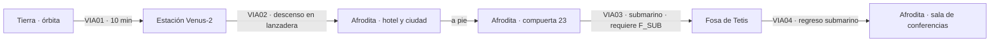

# CAPÍTULO 3 — MAREAS DE VENUS (Venus)

## Ficha
| Campo | Valor |
|---|---|
| Mundos | Tierra → Estación orbital Venus-2 → Afrodita (ciudad submarina) → Fosa de Tetis → Afrodita |
| Duración objetivo | 80–90 min |
| Caso | **Marco Ibsen**, agente de la ACS y amigo de academia de Lune, es acusado de vender secretos. Envía un mensaje: «¡No vengas!». En Afrodita la gente hace cosas que no recuerda haber decidido. |
| Culpable | **Ing. Lyle Tanner**, ingeniero jefe de la cúpula. Con su «calculadora» portátil amplifica a las **ondinas** y las usa para controlar mentes. |
| Sospechoso falso | **Dov Mercer**, jefe de la ACS en Venus (los veganos como coartada: «es cosa de Vega») |
| Giro de GOLIAT | Las ondinas **no pueden leer ni controlar a GOLIAT**. Lo que en el capítulo 1 lo hirió («todo silencio por dentro») ahora salva la ciudad. |
| Mejora obtenida | **Modo submarino** (`F_SUB`) |
| Fuente analítica | `analisis/ANALISIS_POR_LIBRO.md` §L3 |

## Personajes del capítulo
| Personaje | Rol | Voz |
|---|---|---|
| Marco Ibsen | Amigo de academia, controlado | Simpático, atormentado, frases cortadas |
| Dov Mercer | Jefe de la sección venusiana de la ACS | Corpulento, desconfiado, brusco |
| Ing. Lyle Tanner | Ingeniero jefe. Culpable. | Nervioso, técnico, humilde en apariencia |
| Ana Tanner | Esposa de Tanner | Joven, aturdida, inocente |
| Pim Duarte | Operario controlado en la compuerta 23 | Monótono, en trance |
| Pilotos Reval y Okoro | Lanzadera de descenso | Profesionales |
| VOZ DE LAS ONDINAS | Voz colectiva (en realidad, Tanner) | Plana, sin emoción, en coro |

## Pistas
| ID | Pista | Dónde | Uso |
|---|---|---|---|
| P3-01 | Los pilotos pierden la conciencia a la vez; GOLIAT no | C3_VIA02 | Control mental; inmunidad de GOLIAT |
| P3-02 | Las ondinas se vuelven locas por el lubricante de GOLIAT (hidrocarburos) | C3_LOC02 | **Distracción (clave para el plan)** |
| P3-03 | Tanner lleva siempre su «calculadora» y nunca la suelta | C3_LOC03 | **Método (clave)** |
| P3-04 | La «voz de las ondinas» amenaza con «apagarlos como velas»; en Venus no hay fuego | C3_LOC04 | **Prueba: la voz es humana (clave)** |
| P3-05 | Ana Tanner durmió doce horas el día del incidente; el laboratorio de Tanner tiene blindaje y su casa, no | C3_LOC05 | **Prueba: Tanner sabía y protegió sólo su laboratorio (clave)** |

## Mapa de ruta

---

## ESCENAS

### C3_VIA01 — Viaje: Tierra → Estación Venus-2 (con sesión informativa en ruta)
**Tramo:** 10 min. La sesión informativa ocurre en vuelo, por holograma.

| ID | Trigger | Personaje | Línea | Dirección |
|---|---|---|---|---|
| C3_VIA01_010 | RUTA 0% | CORVO | (holograma) Marco Ibsen. Tu compañero de cuarto en la academia. Venus lo acusa de vender datos de los cultivos de levadura. | Grave |
| C3_VIA01_020 | CONT | LUNE | Marco no vende ni su almuerzo. Le cuesta hasta prestar un lápiz. | Incrédulo |
| C3_VIA01_030 | CONT | CORVO | Te mandó un mensaje antes de desaparecer de las comunicaciones. Dos palabras. | Inquieta |
| C3_VIA01_040 | CONT | MARCO (grabación) | ¡No vengas! | Desesperado, ruido de fondo |
| C3_VIA01_050 | CONT | GOLIAT | Bueno, ya sabemos adónde vamos. | Inmediato |
| C3_VIA01_060 | CONT | CORVO | (casi sonríe) Ese robot te conoce demasiado bien. | Resignada |
| C3_VIA01_070 | RUTA 25% | FERRÁN | Datos de Venus: un océano global bajo nubes de dióxido de carbono. Ni una gota de oxígeno libre en el aire. Las ciudades viven bajo cúpulas en el fondo del mar. | Didáctico. **Siembra P3-04** |
| C3_VIA01_080 | CONT | GOLIAT | ¿Ni oxígeno? ¿Y los bichos de allí cómo respiran? | Curioso |
| C3_VIA01_090 | CONT | FERRÁN | No respiran como nosotros. Y nada se quema en Venus, GOLIAT. Nunca. No hay fuego natural. | Didáctico; remarcarlo |
| C3_VIA01_100 | RUTA 50% | GOLIAT | Darío, ¿cómo era Marco? En la academia. | Interesado |
| C3_VIA01_110 | CONT | LUNE | Roncaba como un reactor averiado. Me enseñó a jugar al ajedrez tridimensional y a perder sin enfadarme. Es de las personas más honradas que conozco. | Cariñoso |
| C3_VIA01_120 | CONT | GOLIAT | Entonces ya me cae bien. Salvo por lo de los ronquidos. | Ligero |
| C3_VIA01_130 | RUTA 75% | GOLIAT | ¿Qué crees que pasa? | Serio |
| C3_VIA01_140 | CONT | LUNE | Que alguien le hizo hacer algo que él no quería hacer. Y que él lo sabe. Por eso dijo «no vengas». | Grave |
| C3_VIA01_150 | RUTA 95% | ERRANTE | Estación orbital Venus-2. Altitud: tres mil kilómetros. Una órbita cada tres horas. | Sintético |
| C3_VIA01_R01 | IDLE ≥15 s | GOLIAT | Venus desde aquí parece una perla. Una perla con muy mal carácter. | Relleno |
| C3_VIA01_R02 | IDLE ≥15 s | LUNE | (para sí) Marco, ¿en qué te metiste? | Relleno |
| C3_VIA01_R03 | IDLE ≥15 s | GOLIAT | ¿Las ciudades en el fondo del mar tienen ventanas? Pregunto por la vista. Y por las goteras. | Relleno |

### C3_LOC01 — Estación Venus-2
**Breve.** Transbordo a la lanzadera de descenso (la *Errante* queda acoplada).

| ID | Trigger | Personaje | Línea | Dirección |
|---|---|---|---|---|
| C3_LOC01_010 | LLEGADA | PILOTO REVAL | Bienvenidos. Bajamos en la *Marea Alta*. La *Errante* se queda aquí: no está hecha para el agua. | Profesional |
| C3_LOC01_020 | CONT | PILOTO OKORO | Primera vez en Venus, ¿no? Les va a encantar. Todo el mundo tiene una mascota. | Afable |
| C3_LOC01_030 | EXPLORAR | GOLIAT | Mira ese tipo: bigote enorme. Y ese otro. Y ése. ¿Aquí el bigote es obligatorio? | Divertido |
| C3_LOC01_040 | CONT | PILOTO OKORO | Es la moda. Venus es un planeta de gente con bigote. | Ríe |
| C3_LOC01_050 | SALIDA | LUNE | (bajo, a GOLIAT) Cuidado. Aquí todo es demasiado amable. | Alerta |

### C3_VIA02 — Viaje: Estación → Afrodita (descenso en la *Marea Alta*)
**Tramo:** 5 min. **EVT al 60 %:** los dos pilotos quedan en blanco a la vez; **GOLIAT es el único que no se ve afectado** y avisa. Lune toma los mandos (pilotaje de emergencia; amerizaje). **Pista P3-01.**

| ID | Trigger | Personaje | Línea | Dirección |
|---|---|---|---|---|
| C3_VIA02_010 | RUTA 0% | PILOTO REVAL | Atravesamos las nubes en cuatro minutos. Abróchense. | Rutina |
| C3_VIA02_020 | RUTA 30% | GOLIAT | Nubes. Más nubes. Venus es una almohada gigante con olor a azufre. | Ambiente |
| C3_VIA02_030 | RUTA 50% | LUNE | (de pronto, aturdido) ¿GOLIAT…? Tengo… sueño. Qué raro… | Voz pastosa (también lo afecta, levemente) |
| C3_VIA02_040 | EVT(pilotos en blanco) | GOLIAT | ¡Darío! ¡Los dos pilotos tienen la mirada vacía! ¡Las manos sueltas! ¡Vamos en picado hacia el mar! | Alarma máxima |
| C3_VIA02_050 | CONT | GOLIAT | ¡DARÍO! ¡DESPIERTA! (golpe metálico) | Grito; le da una palmada |
| C3_VIA02_060 | CONT | LUNE | ¡Ya estoy! ¡Ya estoy! Dame los mandos. | Recupera el control |
| C3_VIA02_070 | CONT | GOLIAT | ¿Por qué a mí no me pasa nada? Yo estoy perfectamente. Bueno, aterrado, pero perfectamente. | Desconcertado. **Pista P3-01** |
| C3_VIA02_080 | EVT fin (amerizaje) | LUNE | Agua. Estamos en el agua. Seguimos flotando. | Alivio |
| C3_VIA02_090 | CONT | PILOTO REVAL | (despertando) ¿Qué…? ¿Qué pasó? Yo estaba… no me acuerdo. | Confuso, asustado |
| C3_VIA02_100 | RUTA 100% | ERRANTE | (repetidor) Remolque de superficie en camino. Afrodita: ochocientos metros por debajo. | Sintético |
| C3_VIA02_110 | CONT | LUNE | (bajo) Alguien apagó a tres personas al mismo tiempo. A ti no. Recuérdalo. | Grave |
| C3_VIA02_R01 | IDLE ≥15 s | GOLIAT | Floto. No me gusta flotar. Los GL-7 no flotamos: nos hundimos con dignidad. | Relleno |

### C3_LOC02 — Afrodita: hotel, Mercer y las ondinas
**Objetivos:** reunión con Mercer (INT01); conocer a las ondinas (P3-02).

| ID | Trigger | Personaje | Línea | Dirección |
|---|---|---|---|---|
| C3_LOC02_010 | LLEGADA | GOLIAT | Una ciudad bajo el mar. Peces mirándome por la ventana. Eso de ahí… me está mirando mal. | Asombro |
| C3_LOC02_020 | EXPLORAR | PNJ CAMARERA | ¿Mesa para uno… y medio? Perdón: para dos. | Torpe |
| C3_LOC02_030 | CONT | GOLIAT | Uno y medio. Lo he oído. Lo he archivado. | Rencoroso |
| C3_LOC02_040 | INTERACT(ondina) | GOLIAT | ¡Qué bicho tan feo! Tiene seis patas, un pico… y me está mirando con amor. Darío, creo que le gusto. | Enternecido |
| C3_LOC02_050 | CONT | GOLIAT | ¡Eh! ¡Me está lamiendo la rodilla! ¡Se está bebiendo mi lubricante! ¡Vienen más! ¡Vienen TODAS! | Caos cómico. **Pista P3-02** |
| C3_LOC02_060 | CONT | LUNE | Los hidrocarburos. En Venus son rarísimos. Para ellas eres un postre. | Divertido, tomando nota |
| C3_LOC02_070 | CONT | LUNE | Dime una cosa: ¿te gustaron cuando las viste, o te gustaron porque sí? | Serio de golpe |
| C3_LOC02_080 | CONT | GOLIAT | …Me parecieron horribles. Me gustaron porque me lamían. | Honesto |
| C3_LOC02_090 | CONT | LUNE | A mí me gustaron sin motivo. Y eso no me gusta nada. | Inquietud |

#### C3_INT01 — Dov Mercer

| ID | Trigger | Personaje | Línea | Dirección |
|---|---|---|---|---|
| C3_INT01_010 | INTERACT(Mercer) | MERCER | Lune. Me dijeron que eras amigo de Ibsen. Lo siento. Robó los datos de la levadura y se esfumó. | Brusco |
| C3_INT01_020A | ELECCIÓN | LUNE (A) | ¿Tiene pruebas, o sólo una acusación? | Firme |
| C3_INT01_020B | ELECCIÓN | LUNE (B) | ¿Quién gana con esos datos? | Analítico |
| C3_INT01_030 | COND(A) | MERCER | Tengo los registros de acceso con su código. A las tres de la madrugada. | Seguro |
| C3_INT01_040 | COND(B) | MERCER | Vega. Siempre Vega. Llevan siglos esperando que la Federación tropiece. | Convencido; pista falsa |
| C3_INT01_050 | CONT | MERCER | Y ese robot, fuera de mi despacho. No me fío de las máquinas que piensan. | Desprecio |
| C3_INT01_060 | CONT | GOLIAT | Y yo no me fío de los hombres con tanto bigote. Estamos empatados. | Digno |
| C3_INT01_070 | EVT(alarma) | ALTAVOZ | ¡Alerta! ¡Compuerta veintitrés! ¡Un operario amenaza con abrir el mar! ¡Evacuen el sector! | Alarma |

### C3_LOC03 — Compuerta 23 (crisis)
**Secuencia:** Pim Duarte, en trance, va a abrir la compuerta. Tanner advierte que la barrera no aguantará. **GOLIAT entra por el conducto de ventilación** (sólo él cabe y sólo él es inmune) y aísla el relé. En la confusión, Marco escapa en un submarino. Mercer entrega el modo submarino (`F_SUB`). **Pista P3-03.**

| ID | Trigger | Personaje | Línea | Dirección |
|---|---|---|---|---|
| C3_LOC03_010 | LLEGADA | PIM DUARTE | Tengo… que abrir. Tengo que abrir. Es la hora de abrir. | Monótono |
| C3_LOC03_020 | CONT | TANNER | (aferrado a su «calculadora») ¡Si abre, la barrera de esta sección no aguanta la presión! ¡Hay que cortar el relé desde dentro! | Pánico técnico |
| C3_LOC03_030 | CONT | MERCER | El conducto de ventilación llega al relé. Pero es demasiado estrecho para cualquiera. | Desesperado |
| C3_LOC03_040 | CONT | GOLIAT | (pausa; le cuesta decirlo) Yo… no soy muy alto. A lo mejor quepo. | Orgullo herido y valor |
| C3_LOC03_050 | CONT | LUNE | GOLIAT, ahí dentro te puede afectar lo mismo que a Pim. | Preocupado |
| C3_LOC03_060 | CONT | GOLIAT | En la lanzadera no me afectó. Ni en Marte. «Todo silencio por dentro», ¿te acuerdas? Por fin me sirve de algo. | Decidido |
| C3_LOC03_070 | EVT(conducto, GOLIAT jugable) | GOLIAT | Estrecho. Oscuro. Y huele a calcetín de buzo. Avanzando. | Esfuerzo, radio |
| C3_LOC03_080 | CONT | GOLIAT | Hay algo empujándome en la cabeza… como si alguien llamara a una puerta. Pero no entra. ¡No entra! | Triunfal |
| C3_LOC03_090 | CONT | GOLIAT | Relé a la vista. Lo aíslo… ¡Hecho! | Esfuerzo |
| C3_LOC03_100 | CONT | PIM DUARTE | (despierta, cae) ¿Qué hago aquí? ¿Por qué tengo la mano en la palanca? | Aterrado |
| C3_LOC03_110 | CONT | MERCER | ¡El submarino de patrulla! ¡Alguien acaba de salir con él! ¡Es Ibsen! | Grita |
| C3_LOC03_120 | INTERACT(Tanner) | LUNE | Ingeniero, ¿qué es ese aparato que no suelta? | Casual, atento |
| C3_LOC03_130 | CONT | TANNER | ¿Esto? Una calculadora de presiones. Sin ella, esta ciudad se inunda en una tarde. Nunca me separo de ella. | Lo aprieta contra el pecho. **Pista P3-03** |
| C3_LOC03_140 | CONT | GOLIAT | (sale del conducto, cubierto de polvo) ¿Me he perdido algo? ¿Alguien me va a dar las gracias, o tengo que pedirlas? | Fanfarrón |
| C3_LOC03_150 | CONT | LUNE | Gracias, GOLIAT. | Sincero |
| C3_LOC03_160 | CONT | GOLIAT | …Ah. Pues gracias a ti por las gracias. No me lo esperaba. | Descolocado |
| C3_LOC03_170 | CONT | MERCER | Lune. Te asigno el submarino *Hilda*. Encuentra a tu amigo antes de que se ahogue o ahogue a alguien. | Cede. **Flag `F_SUB`** |
| C3_LOC03_180 | SALIDA | GOLIAT | Un submarino. Si llego a saber que la ACS daba juguetes, me hago agente antes. | Entusiasmo |

### C3_VIA03 — Viaje: Afrodita → Fosa de Tetis (submarino)
**Tramo:** 8 min de navegación submarina entre bosques de algas. **EVT al 50 %:** ataque del **Manto Escarlata**, un organismo de kilómetros (combate/evasión). **EVT al 85 %:** el submarino de Marco a la vista.

| ID | Trigger | Personaje | Línea | Dirección |
|---|---|---|---|---|
| C3_VIA03_010 | RUTA 0% | GOLIAT | Profundidad: cien metros. Doscientos. Darío, mis juntas hacen un ruido que no me gusta. | Nervioso |
| C3_VIA03_020 | CONT | LUNE | Es la presión. La *Hilda* aguanta. Tú también. | Calma |
| C3_VIA03_030 | RUTA 20% | GOLIAT | Mira eso. Peces con forma de flecha. Botones gigantes en el suelo. ¿Venus siempre fue tan rara o se esfuerza? | Maravillado |
| C3_VIA03_040 | RUTA 35% | LUNE | Piensa una cosa. Si las ondinas pueden meter ideas en la cabeza, ¿por qué esperaron tanto? Hace siglos que viven con nosotros. | Analítico |
| C3_VIA03_050 | CONT | GOLIAT | ¿Porque son tímidas? | Sin convicción |
| C3_VIA03_060 | CONT | LUNE | O porque alguien les dio un megáfono. | Revelador |
| C3_VIA03_070 | EVT(Manto Escarlata) | ERRANTE | (sonar de la *Hilda*) Masa biológica gigante. Longitud: tres kilómetros. En aproximación. | Alerta |
| C3_VIA03_080 | CONT | GOLIAT | ¡Eso no es un pez! ¡Eso es un barrio entero con hambre! | Pánico |
| C3_VIA03_090 | CONT | LUNE | Busca el centro de calor. Si le damos ahí, se detiene. | Concentrado |
| C3_VIA03_100 | EVT fin (Manto abatido) | GOLIAT | Se… detuvo. Se está hundiendo. | Sobrecogido |
| C3_VIA03_110 | CONT | LUNE | Debía de tener millones de años. Y lo matamos en dos minutos. A Ferrán le va a romper el corazón. | Pesar científico |
| C3_VIA03_120 | CONT | GOLIAT | Nos quería comer, Darío. | Pragmático |
| C3_VIA03_130 | CONT | LUNE | Ya. Igual me pesa. | Bajo |
| C3_VIA03_140 | RUTA 85% · EVT(Marco a la vista) | MARCO | (radio) Darío… Te dije que no vinieras. No puedo hablar de ellas. No me dejan. | Angustiado, entrecortado |
| C3_VIA03_150 | RUTA 95% | LUNE | Marco, sube a la superficie conmigo. | Firme y suave |
| C3_VIA03_R01 | IDLE ≥15 s | GOLIAT | Cada vez que cruje el casco, envejezco un año. Ya tengo ciento doce. | Relleno |
| C3_VIA03_R02 | IDLE ≥15 s | GOLIAT | Si salgo vivo de esta, me pinto un pez en el pecho. Uno pequeño. Elegante. | Relleno |
| C3_VIA03_R03 | IDLE ≥15 s | LUNE | (para sí) Pilotos, Pim, Marco… gente buena haciendo cosas malas sin saber por qué. | Relleno |

### C3_LOC04 — Fosa de Tetis (confrontación con la «voz»)
**Secuencia:** los submarinos se acoplan; Marco, controlado, apunta a Lune; la VOZ habla a través de él. Lune necesita distraer a las ondinas: **GOLIAT vacía su depósito de lubricante por el desagüe** (usa P3-02). **Pista P3-04.**

| ID | Trigger | Personaje | Línea | Dirección |
|---|---|---|---|---|
| C3_LOC04_010 | LLEGADA | MARCO | (apuntando) Perdóname. No soy yo. Te lo juro, no soy yo. | Lágrimas, mano firme |
| C3_LOC04_020 | CONT | VOZ DE LAS ONDINAS | (por boca de Marco, voz plana) Nosotras hablamos ahora. Vosotros, los que coméis carne, os vais de Venus. | Coro sin emoción |
| C3_LOC04_030 | CONT | LUNE | ¿Y si no nos vamos? | Calma estudiada |
| C3_LOC04_040 | CONT | VOZ DE LAS ONDINAS | Abriremos todas las compuertas. Os apagaremos como velas. Una a una. Hasta que no quede ninguna llama. | Amenaza plana. **Pista P3-04** |
| C3_LOC04_050 | CONT | GOLIAT | (radio privado) Darío… «velas». «Llamas». En Venus no hay fuego. Lo dijo Ferrán. | Bajo, rápido |
| C3_LOC04_060 | CONT | LUNE | (radio privado) Lo sé. Una ondina nunca vio una llama. Esa frase la pensó un humano. | Revelación contenida |
| C3_LOC04_070 | CONT | LUNE | GOLIAT, ¿cuánto lubricante tienes en el depósito? | Plan |
| C3_LOC04_080 | CONT | GOLIAT | Litro y medio. Es mi sangre, Darío. Mi sangre de lujo. | Comprende y se espanta |
| C3_LOC04_090 | CONT | LUNE | Al mar. Todo. | Firme |
| C3_LOC04_100 | CONT | GOLIAT | (suspiro mecánico) Por la Federación. Y por los ronquidos de Marco. | Sacrificio cómico |
| C3_LOC04_110 | EVT(lubricante) | VOZ DE LAS ONDINAS | Nosotras… hay algo… dulce… | La voz se desarma |
| C3_LOC04_120 | CONT | MARCO | (baja el arma) Darío. Se fueron. Se fueron de mi cabeza. | Llanto, alivio |
| C3_LOC04_130 | CONT | LUNE | *Hilda*, emite a todas las frecuencias de Afrodita: «Esparzan petróleo en los conductos». | Ordena |
| C3_LOC04_140 | CONT | MARCO | Me obligaron a entrar en los archivos. Me hicieron creer que era idea mía. Pero algo empujaba desde fuera. Algo con… una máquina detrás. Un zumbido. | Testimonio |
| C3_LOC04_150 | SALIDA | GOLIAT | Estoy seco. Me chirría todo. Cuando volvamos quiero un baño de aceite de los caros. | Débil, cómico |

### C3_VIA04 — Viaje: Fosa → Afrodita (regreso)
**Tramo:** 5 min. Lune, GOLIAT y Marco a bordo.

| ID | Trigger | Personaje | Línea | Dirección |
|---|---|---|---|---|
| C3_VIA04_010 | RUTA 0% | MARCO | Así que éste es el famoso GOLIAT. Darío habla de ti en los informes. | Agradecido |
| C3_VIA04_020 | CONT | GOLIAT | ¿Habla de mí? ¿Qué dice? ¿Cosas buenas? ¿Cosas largas? | Ansioso |
| C3_VIA04_030 | CONT | LUNE | Marco. | Le pide discreción |
| C3_VIA04_040 | CONT | MARCO | Dice que eres «impredecible, pero imprescindible». | Sonríe |
| C3_VIA04_050 | CONT | GOLIAT | …Lo voy a tatuar en mi chasis. | Emocionado |
| C3_VIA04_060 | RUTA 40% | LUNE | Marco, el zumbido. ¿Lo oíste alguna vez en la ciudad? | Investigando |
| C3_VIA04_070 | CONT | MARCO | En reuniones técnicas. En la sala de presiones. Siempre que Tanner hacía cálculos. | Pensativo |
| C3_VIA04_080 | RUTA 70% | GOLIAT | Una máquina que hace de megáfono a las ondinas. Y alguien que no la suelta nunca. | Uniendo cabos |
| C3_VIA04_090 | CONT | LUNE | No lo digas todavía. Necesito que lo diga él. | Estratégico |
| C3_VIA04_100 | RUTA 95% | ERRANTE | (repetidor) Afrodita. Atraque autorizado. Mercer convoca una reunión urgente. | Sintético |
| C3_VIA04_R01 | IDLE ≥15 s | GOLIAT | Chirrío. Chirrío al hablar. Chirrío al pensar. Esto es humillante. | Relleno |
| C3_VIA04_R02 | IDLE ≥15 s | MARCO | Sigo oyendo el mar dentro de la cabeza. Pero ahora es sólo mar. | Relleno |

### C3_LOC05 — Afrodita: sala de conferencias
**Exploración previa:** Lune visita el apartamento de Tanner (P3-05).

| ID | Trigger | Personaje | Línea | Dirección |
|---|---|---|---|---|
| C3_LOC05_010 | INTERACT(Ana Tanner) | ANA TANNER | ¿El día de la compuerta? Dormí doce horas. Me desperté y Lyle ya estaba en casa, muy nervioso. | Inocente |
| C3_LOC05_020 | INTERACT(laboratorio) | GOLIAT | Darío: el laboratorio de Tanner tiene un blindaje de malla en las paredes. Su apartamento, que está al lado, no. | **Pista P3-05** |
| C3_LOC05_030 | CONT | LUNE | Se protegió él. A ella no. Para no levantar sospechas. | Asqueado |

### C3_DED01 — Deducción
**Presentes:** Mercer, Tanner, Marco, Pim, Ana Tanner. **Combinación correcta:** Culpable **Tanner** + Método **«calculadora» amplificadora** (P3-03) + Prueba **«velas» en un mundo sin fuego** (P3-04) o **blindaje sólo en el laboratorio** (P3-05).

| ID | Trigger | Personaje | Línea | Dirección |
|---|---|---|---|---|
| C3_DED01_010 | INICIO | LUNE | Las ondinas no son amos. Son como perros: sienten, leen lo que pensamos con fuerza. Pero alguien les puso una correa. | Expositivo |
| C3_DED01_020 | ACUSACIÓN errónea: Mercer | MERCER | ¿Yo? ¡Yo fui quien lo acusó a él! | Furioso |
| C3_DED01_030 | CONT | LUNE | (si se eligió a Mercer) Es cierto. Y además, usted es biofísico, no ingeniero. No sabría construir el aparato. | Corrige |
| C3_DED01_040 | ACUSACIÓN errónea: Marco | GOLIAT | ¡Marco era la víctima! ¡Roncar no es un delito! | Indignado |
| C3_DED01_050 | ACUSACIÓN errónea: Vega | LUNE | No hay una sola nave vegana en Venus. Echarle la culpa a Vega es cómodo. Y alguien lo sabía. | Sobrio |
| C3_DED01_060 | ACUSACIÓN correcta | LUNE | Ingeniero Tanner. La voz de las ondinas amenazó con apagarnos «como velas». En Venus nunca se encendió una vela. Esa voz era humana. Era la suya, a través de esa «calculadora». | Firme |
| C3_DED01_070 | CONT | TANNER | ¡Es una calculadora de presiones! ¡Sin ella la ciudad se inunda! | Aterrado |
| C3_DED01_080 | CONT | LUNE | GOLIAT. | Orden |
| C3_DED01_090 | CONT | GOLIAT | Con mucho gusto. (la aplasta con la mano) | Satisfacción |
| C3_DED01_100 | CONT | PIM DUARTE | El zumbido… se calló. | Asombrado |
| C3_DED01_110 | CONT | LUNE | Y protegió su laboratorio con una malla, pero no la habitación donde dormía su esposa. Ella durmió doce horas, señor Tanner. | Duro |
| C3_DED01_120 | CONT | ANA TANNER | …Lyle. | Rota |
| C3_DED01_130 | CONT | TANNER | ¡Venus merece ser libre! ¡La Tierra nos chupa la comida y nos manda inspectores! ¡Las ondinas eran la llave! | Estalla |

#### C3_CIN01 — Epílogo

| ID | Trigger | Personaje | Línea | Dirección |
|---|---|---|---|---|
| C3_CIN01_010 | INICIO | CORVO | (llamada) Tanner no será ejecutado. La ACS pide tratamiento. Quiero que reconstruya su máquina para estudiarla, y que después se cure. | Firme |
| C3_CIN01_020 | CONT | GOLIAT | ¿Curarlo? Casi inunda una ciudad. | Incrédulo |
| C3_CIN01_030 | CONT | LUNE | Ejecutarlo no le devuelve nada a nadie. Curarlo, quizás sí. | Convencido |
| C3_CIN01_040 | CONT | MARCO | Darío. Gracias por no hacerme caso. | Emocionado |
| C3_CIN01_050 | CONT | LUNE | Nunca te hice caso. Ni en el ajedrez. | Cálido |
| C3_CIN01_060 | CONT | GOLIAT | (en la *Errante*, rumbo a casa) ¿Sabes qué, Darío? En Marte me dijeron que era «todo silencio por dentro». Y hoy ese silencio salvó una ciudad. | Reflexivo |
| C3_CIN01_070 | CONT | LUNE | No es silencio, GOLIAT. Es que nadie te manda por dentro. | Suave |
| C3_CIN01_080 | CONT | GOLIAT | …Necesito más lubricante. Se me está empañando algo. | Emocionado, lo disimula. **FIN DEL CAPÍTULO 3** |

## Flags del capítulo
`F_SUB` (C3_LOC03_170). Gancho al capítulo 4: un senador acusa a la ACS de corrupción y su investigador viaja a Mercurio.
