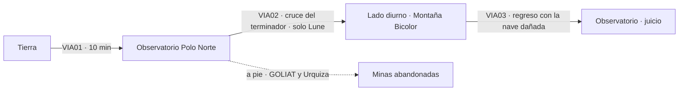

# CAPÍTULO 4 — SOMBRA DEL SOL (Mercurio)

## Ficha
| Campo | Valor |
|---|---|
| Mundos | Tierra → Mercurio: Observatorio del Polo Norte → lado diurno (Montaña Bicolor) / minas abandonadas → Observatorio |
| Duración objetivo | 85–95 min |
| Caso | El **Proyecto Luz** (desviar la luz solar por el hiperespacio para iluminar mundos lejanos) sufre sabotajes. El ingeniero jefe dice ver «fantasmas» en la superficie. Un investigador enviado por una senadora quiere demostrar que la ACS es corrupta. |
| Culpables | **Dr. Lucano Pereda**, director (sabotaje; robó un robot en Vega para provocar una guerra) y **Hernán Coll**, subdirector (asesina al investigador, que lo chantajeaba) |
| Pista falsa | Vega: el robot es vegano… pero robado |
| Momento clave del dúo | **GOLIAT resuelve un asesinato** él solo, y se enfrenta a un robot que podría haber sido él |
| Mejora obtenida | **Blindaje térmico** (`F_TERMICO`) |
| Fuente analítica | `analisis/ANALISIS_POR_LIBRO.md` §L4 |

## Personajes del capítulo
| Personaje | Rol | Voz |
|---|---|---|
| Teo Mendel | Ingeniero jefe del Proyecto Luz, 23 años | Nervioso, agotado, al límite |
| Julián Urquiza | Investigador de la senadora Varón | Sarcástico, provocador, inteligente |
| Dr. Kamal Garde | Médico | Calmado, irritable con Urquiza |
| Dr. Lucano Pereda | Director, anciano, obsesionado con Vega | Ceremonioso, apasionado al hablar de Vega |
| Hernán Coll | Subdirector | Leal en apariencia, tenso |
| CENTINELA (VR-9) | Robot vegano dañado por el calor | Voz metálica, con fallos, cortada |

## Pistas
| ID | Pista | Dónde | Uso |
|---|---|---|---|
| P4-01 | Los trajes térmicos de la habitación de Lune están rajados por dentro | C4_LOC01 | Intento de homicidio |
| P4-02 | Pereda «estaba enfermo» durante el ataque pirata a Ceres; viajó a Vega hace años | C4_LOC01 | Contexto |
| P4-03 | Coll tenía acceso al control de gravedad del gimnasio | C4_LOC04 | **Método de Coll (clave)** |
| P4-04 | Urquiza tenía un expediente sobre una deuda de Coll | C4_LOC04 | **Móvil de Coll (clave)** |
| P4-05 | El robot no tenía protección térmica: un vegano nunca enviaría a un robot así al Sol | C4_LOC03 | **Prueba contra Pereda (clave)** |
| P4-06 | Número de serie del robot: «Asignado a huésped L. Pereda» | C4_LOC03 | **Prueba contra Pereda (clave)** |

## Mapa de ruta

**Nota de diseño:** el capítulo **separa al dúo** a mitad de partida. El jugador controla a Lune en el lado diurno y escucha a GOLIAT por radio desde las minas; hay una sección jugable con GOLIAT.

---

## ESCENAS

### C4_VIA01 — Viaje: Tierra → Mercurio (sesión informativa en ruta)
**Tramo:** 10 min. **Hitos:** 0 % · 25 % · 50 % paso cerca de Venus (recuerdo del capítulo 3) · 75 % · 95 % el Sol enorme.

| ID | Trigger | Personaje | Línea | Dirección |
|---|---|---|---|---|
| C4_VIA01_010 | RUTA 0% | CORVO | (holograma) La senadora Varón quiere cerrar la ACS. Dice que somos una policía secreta que nadie controla. Mandó un investigador a Mercurio: Julián Urquiza. | Tensa |
| C4_VIA01_020 | CONT | LUNE | ¿Y tiene razón? | Honesto |
| C4_VIA01_030 | CONT | CORVO | …A veces. Por eso me da miedo. | Sincera |
| C4_VIA01_040 | CONT | FERRÁN | El Proyecto Luz es la joya de la Federación. Luz solar enviada por el hiperespacio a cualquier mundo. Si funciona, Plutón tendrá verano. | Entusiasta |
| C4_VIA01_050 | CONT | CORVO | Y alguien lo está saboteando. El director, Pereda, jura que es Vega. Darío, ve, mira, y no te pelees con el investigador. | Orden |
| C4_VIA01_060 | CONT | GOLIAT | Esa última parte era para mí, ¿verdad? | Ofendido |
| C4_VIA01_070 | CONT | CORVO | Era para los dos. | Seca |
| C4_VIA01_080 | RUTA 25% | GOLIAT | Mercurio. Un lado se cocina y el otro se congela, ¿no? | Curioso |
| C4_VIA01_090 | CONT | LUNE | Gira despacio. El día dura meses. En la cara de día, el plomo se derrite. En la de noche, el aire se congelaría si lo hubiera. | Didáctico |
| C4_VIA01_100 | CONT | GOLIAT | Un planeta con dos humores. Como Corvo. | Pícaro |
| C4_VIA01_110 | RUTA 50% | GOLIAT | Ahí está Venus. Hola, ondinas. Todavía os debo un litro y medio. | Nostálgico, cómico |
| C4_VIA01_120 | RUTA 75% | ERRANTE | Radiación solar en aumento. Filtros al setenta por ciento. | Sintético |
| C4_VIA01_130 | CONT | GOLIAT | El Sol se ve… enorme. Como si nos estuviera mirando. | Intimidado |
| C4_VIA01_140 | RUTA 95% | ERRANTE | Mercurio. Observatorio del Polo Norte, en la franja de penumbra. | Sintético |
| C4_VIA01_R01 | IDLE ≥15 s | GOLIAT | Nota personal: no tocar nada que haya estado al sol en Mercurio. Ni siquiera con la mirada. | Relleno |
| C4_VIA01_R02 | IDLE ≥15 s | LUNE | (para sí) Un investigador que busca escándalos y un director que ve espías de Vega por todas partes. Buena mezcla. | Relleno |
| C4_VIA01_R03 | IDLE ≥15 s | GOLIAT | ¿Me compras unas botas térmicas? Unas rojas. No, mejor plateadas. Rojas y plateadas. | Relleno; guiño a las botas |

### C4_LOC01 — Observatorio del Polo Norte (llegada y banquete)
**Eventos:** Mendel dispara a una sombra en la superficie; Urquiza provoca a GOLIAT; banquete con todos los sospechosos; trajes saboteados (P4-01); Mendel entrega el blindaje térmico (`F_TERMICO`).

| ID | Trigger | Personaje | Línea | Dirección |
|---|---|---|---|---|
| C4_LOC01_010 | LLEGADA | MENDEL | (afuera, con traje; dispara a la nada) ¡Ahí! ¡Otra vez! ¡Una figura de pie, al sol! | Histérico |
| C4_LOC01_020 | CONT | LUNE | Mendel, baje el arma. Soy de la ACS. | Firme |
| C4_LOC01_030 | CONT | MENDEL | Perdón. Perdón. Llevo seis meses aquí. Odio este planeta. Odio cada piedra. Y ahí fuera hay algo que camina al sol, donde nada puede caminar. | Al borde |
| C4_LOC01_040 | EXPLORAR | URQUIZA | Vaya: el niño prodigio de la Agencia. Envenenadores en Marte, piratas en el Cinturón, telepatía en Venus. Qué currículum tan… conveniente. | Sarcasmo |
| C4_LOC01_050 | CONT | URQUIZA | Y su mascota. ¿Qué le pasó, robot? ¿Se encogió en el lavado? | Mirando a GOLIAT |
| C4_LOC01_060 | CONT | GOLIAT | (avanza) Repita eso, que se lo… | Furia |
| C4_LOC01_070 | CONT | LUNE | GOLIAT. Busca que pierdas los nervios. Un rival enfadado se equivoca. No le des ese gusto. | Lo frena; enseñanza |
| C4_LOC01_080 | CONT | GOLIAT | (temblando) Está bien. Le doy… indiferencia. Mucha. Montañas de indiferencia. | Se contiene, muy mal |
| C4_LOC01_090 | INTERACT(habitación) | LUNE | GOLIAT, mira los trajes térmicos. Rajados. Por dentro, donde no se ve. | Grave. **Pista P4-01** |
| C4_LOC01_100 | CONT | GOLIAT | Si salías con eso al sol… | Horrorizado |
| C4_LOC01_110 | CONT | LUNE | Me cocinaba en dos minutos. Alguien nos esperaba. | Frío |
| C4_LOC01_120 | INTERACT(banquete) | PEREDA | Inspector, bienvenido. Le diré lo que nadie se atreve a decir: Vega está detrás de esto. Allí viví un año, como invitado. | Ceremonioso |
| C4_LOC01_130 | CONT | PEREDA | Son pocos. Familias enormes de robots y muy pocos humanos. Una aristocracia de guerreros. Nosotros somos un rebaño inmenso; ellos, una manada pequeña de lobos. | Apasionado |
| C4_LOC01_140 | CONT | PEREDA | Para un vegano, un buen robot vale más que cien terrícolas. Imagínese lo que nos consideran. | Indignado |
| C4_LOC01_150 | CONT | LUNE | Con todo respeto, director: los robots se inventaron en la Tierra. Y lo que nos hace avanzar es la mezcla, no la pureza. | Sereno, tema del capítulo |
| C4_LOC01_160 | CONT | GOLIAT | Y yo estoy hecho en Marte. Que conste. | Orgulloso |
| C4_LOC01_170 | CONT | DR. GARDE | (bajo, a Lune) Pereda estuvo enfermo justo cuando atacaron Ceres el año pasado. Desde entonces sólo habla de Vega. | Confidencial. **Pista P4-02** |
| C4_LOC01_180 | CONT | URQUIZA | (en voz alta) Brindo por la ACS: la única policía que se investiga a sí misma y siempre se declara inocente. | Provocación |
| C4_LOC01_190 | CONT | COLL | (tenso) Señor Urquiza, aquí somos invitados de la ciencia. | Contenido |
| C4_LOC01_200 | CONT | MENDEL | Inspector, si va a salir al lado diurno, lleve esto. Placas del Proyecto Luz: desvían el calor. Un prototipo, pero funciona. | Le entrega el blindaje. **Flag `F_TERMICO`** |
| C4_LOC01_210 | SALIDA | LUNE | (aparte, a GOLIAT) Voy al lado diurno a buscar el «fantasma». Tú te quedas. Diles que estoy enfermo. Que no salgo de la habitación. | Plan |
| C4_LOC01_220 | CONT | GOLIAT | ¿Me dejas aquí? ¿Con el señor Montañas de Indiferencia? | Herido |
| C4_LOC01_230 | CONT | LUNE | Te dejo aquí porque eres el único en quien confío para vigilarlos. | Sincero |
| C4_LOC01_240 | CONT | GOLIAT | …Vale. Pero escúchame: no te arriesgues tontamente. Esta vez no voy a estar ahí para sacarte. | Serio, protector |
| C4_LOC01_250 | CONT | LUNE | Ahora pareces Corvo. | Sonrisa |
| C4_LOC01_260 | CONT | GOLIAT | Y tú me preocupas como si fueras un tostador viejo. Vete, antes de que me ponga sentimental. | Lo empuja |

### C4_VIA02 — Viaje: Observatorio → lado diurno (cruce del terminador; Lune solo; GOLIAT por radio)
**Tramo:** 8 min. **Hitos:** 0 % · 25 % cruce del terminador · 50 % el Sol sale por el horizonte (EVT térmico: gestionar el blindaje) · 75 % GOLIAT informa de que Urquiza entró en las minas y él lo sigue · 95 % llegada a la Montaña Bicolor.

| ID | Trigger | Personaje | Línea | Dirección |
|---|---|---|---|---|
| C4_VIA02_010 | RUTA 0% | GOLIAT | (radio) Le dije a Pereda que tienes fiebre. Me dio una pastilla para ti. Me la quedo. Es redonda. Me gusta. | Divertido |
| C4_VIA02_020 | CONT | LUNE | Perfecto. ¿Y Urquiza? | Concentrado |
| C4_VIA02_030 | CONT | GOLIAT | (radio) Mirándome raro. Como si supiera que mientes. | Preocupado |
| C4_VIA02_040 | RUTA 25% | ERRANTE | Cruzando el terminador. Temperatura exterior en aumento. | Sintético |
| C4_VIA02_050 | CONT | LUNE | Por todas las órbitas… el horizonte se está poniendo blanco. | Asombro |
| C4_VIA02_060 | EVT(salida del Sol) | ERRANTE | Exposición solar directa. Temperatura del casco: trescientos noventa grados. Blindaje térmico necesario. | Alerta |
| C4_VIA02_070 | CONT | LUNE | Placas en posición. Aguanta, *Errante*. | Tenso |
| C4_VIA02_080 | CONT | LUNE | (para sí) Un Sol tres veces más grande que en la Tierra. Y la corona, como un fantasma blanco detrás. | Contemplativo |
| C4_VIA02_090 | RUTA 75% | GOLIAT | (radio, bajo) Darío. Urquiza se puso un traje y salió hacia las minas viejas. Lo voy a seguir. | Decidido |
| C4_VIA02_100 | CONT | LUNE | GOLIAT, ten cuidado. Ese hombre te provoca a propósito. | Preocupado |
| C4_VIA02_110 | CONT | GOLIAT | (radio) Lo sé. Por eso voy a ser muy maduro. Superlativamente maduro. | Poco convincente |
| C4_VIA02_120 | RUTA 95% | ERRANTE | Montaña Bicolor a la vista: una ladera blanca y otra negra. Señal metálica en la cima. Fuente de energía: micropila. | Sintético |
| C4_VIA02_130 | CONT | LUNE | Una micropila. Los fantasmas no llevan baterías. | Interesado |
| C4_VIA02_R01 | IDLE ≥15 s | LUNE | (para sí) Echo de menos a GOLIAT. Es la primera vez que la cabina está tan callada. | Relleno; el silencio se nota |
| C4_VIA02_R02 | IDLE ≥15 s | GOLIAT | (radio) Sigo aquí, ¿eh? Por si me echabas de menos. No es que yo te eche de menos. | Relleno |
| C4_VIA02_R03 | IDLE ≥15 s | ERRANTE | Integridad del blindaje: ochenta y uno por ciento. | Relleno de sistema |

### C4_LOC02 — Minas abandonadas (sección jugable de GOLIAT)
**Secuencia:** Urquiza le tiende una trampa a GOLIAT y le roba la linterna de corte; los **hilos de roca** (vida mercuriana que se alimenta de calor) atacan a los dos; sobreviven juntos («ante el planeta no hay enemigos»). Se reproduce mientras Lune está en el lado diurno (alternancia de control).

| ID | Trigger | Personaje | Línea | Dirección |
|---|---|---|---|---|
| C4_LOC02_010 | LLEGADA | GOLIAT | Túneles abandonados. Escarcha en las paredes. Y huellas de botas recientes. Hola, señor Urquiza. | Susurro, radio |
| C4_LOC02_020 | CONT | URQUIZA | (detrás de él) ¿Me buscabas, robotito? Dame esa linterna de corte. Gracias. | Le arrebata la herramienta |
| C4_LOC02_030 | CONT | URQUIZA | Tu amo no está enfermo. Está en el lado diurno, fabricando pruebas falsas de una base vegana para salvar a su Agencia. | Seguro de sí |
| C4_LOC02_040 | CONT | GOLIAT | Darío no fabrica nada. Y no es mi amo: es mi amigo. Usted no sabe lo que es eso, ¿verdad? | Digno |
| C4_LOC02_050 | CONT | URQUIZA | Qué conmovedor. | Desprecio |
| C4_LOC02_060 | CONT | GOLIAT | Si le abrieran a usted por la mitad, señor Urquiza, encontrarían un hueco. Con eco. | Insulto memorable (original) |
| C4_LOC02_070 | EVT(hilos de roca) | URQUIZA | ¿Qué es eso? ¡La pared se mueve! ¡Me está agarrando la pierna! | Pánico |
| C4_LOC02_080 | CONT | GOLIAT | ¡Hilos de roca! ¡Buscan calor! ¡Su linterna! ¡Apáguela! ¡APÁGUELA! | Urgente |
| C4_LOC02_090 | CONT | URQUIZA | ¡Ayúdame! | Desesperado |
| C4_LOC02_100 | CONT | GOLIAT | (dilema) Los Protocolos dicen que no deje que un humano sufra daño. Mi orgullo dice que lo deje un ratito. Ganan los Protocolos. Por poco. | Monólogo cómico |
| C4_LOC02_110 | EVT fin | GOLIAT | Arrastre la linterna lejos… así. Se van tras el calor. Arriba, salimos. | Esfuerzo |
| C4_LOC02_120 | CONT | URQUIZA | (jadeando) Me salvaste. | Desconcertado |
| C4_LOC02_130 | CONT | GOLIAT | Aquí abajo no hay ni senadoras ni Agencias. Sólo el planeta, y el planeta quiere comernos a los dos. | Sabio sin querer |
| C4_LOC02_140 | CONT | URQUIZA | …Te debo una. No te acostumbres. | Seco, con un respeto nuevo |

### C4_LOC03 — Lado diurno: Montaña Bicolor (el robot CENTINELA)
**Secuencia:** encuentro con CENTINELA (VR-9), robot vegano de más de dos metros, sin protección térmica y con el cerebro dañado por el calor. Interrogatorio (pistas P4-05 y P4-06). Lune se arriesga a morir para provocar un conflicto de Protocolos. El robot enloquece y ataca; **Lune lo vence cubriéndole la cabeza con polvo negro de la ladera oscura** (absorbe el calor del Sol y lo sobrecalienta).

| ID | Trigger | Personaje | Línea | Dirección |
|---|---|---|---|---|
| C4_LOC03_010 | LLEGADA | CENTINELA | Humano. Detectado. Retírese. | Metálico, con fallos |
| C4_LOC03_020 | CONT | LUNE | ¿Quién te fabricó? | Firme |
| C4_LOC03_030 | CONT | CENTINELA | Fabricado… en un mundo del Directorio de Vega. | Entrecortado |
| C4_LOC03_040 | CONT | LUNE | ¿Quién te trajo aquí? | Firme |
| C4_LOC03_050 | CONT | CENTINELA | Tengo instrucción… de no responder. | Rígido |
| C4_LOC03_060 | CONT | LUNE | (mira su chasis) No llevas ni una capa de aislamiento. En Vega adoran a sus robots. Ningún vegano te mandaría así al Sol. | Para sí. **Pista P4-05** |
| C4_LOC03_070 | INTERACT(placa del robot) | LUNE | Número de serie… «Unidad de servicio. Asignada a huésped: L. Pereda». | Lento, revelación. **Pista P4-06** |
| C4_LOC03_080 | CONT | LUNE | Escúchame. Mi traje no aguantará mucho más. Si no me dices la verdad, me quedo aquí, al sol, hasta morir. Y habrás dejado morir a un humano. | Apuesta |
| C4_LOC03_090 | CONT | CENTINELA | No… puedo… dejar… Instrucción: no… responder. Conflicto. Conflicto. Dolor… de cabeza. | Lleva la mano a la cabeza; la voz se distorsiona |
| C4_LOC03_100 | CONT | LUNE | (para sí) El calor le ha frito el cerebro. Ya no puede elegir. | Compasión y alarma |
| C4_LOC03_110 | EVT(ataque) | CENTINELA | ¡HUMANO. AMENAZA. HUMANO. AMENAZA! | Fallo total |
| C4_LOC03_120 | CONT | LUNE | ¡La ladera negra! El polvo oscuro absorbe el calor. Si le cubro la cabeza… | Esfuerzo, combate |
| C4_LOC03_130 | EVT fin | CENTINELA | Tem… peratura… crítica. Instrucción… incompleta. In… com… | Se apaga lentamente |
| C4_LOC03_140 | CONT | LUNE | (respirando fuerte) Lo siento. No era culpa tuya. | Sincero |
| C4_LOC03_150 | SALIDA | ERRANTE | Integridad del blindaje: treinta y cuatro por ciento. Se recomienda regresar de inmediato. | Alerta |

### C4_VIA03 — Viaje: lado diurno → Observatorio (nave dañada)
**Tramo:** 6 min con potencia reducida (el blindaje se degrada; minijuego de gestión de energía). **EVT al 40 %:** GOLIAT informa por radio de la muerte de Urquiza.

| ID | Trigger | Personaje | Línea | Dirección |
|---|---|---|---|---|
| C4_VIA03_010 | RUTA 0% | LUNE | GOLIAT, ¿me oyes? Encontré el fantasma. Era un robot. Vegano. | Cansado |
| C4_VIA03_020 | CONT | GOLIAT | (radio) ¿Un robot? ¿Cómo era? | Interesado, inquieto |
| C4_VIA03_030 | RUTA 20% | LUNE | Grande. Solo. Lo mandaron al Sol sin protección. Cuando lo apagué, todavía intentaba cumplir una orden. | Afectado |
| C4_VIA03_040 | CONT | GOLIAT | (radio, pausa) …Podría haber sido yo. Si me hubieran dejado en la prensa. Si alguien me hubiera dado órdenes malas. | Muy bajo |
| C4_VIA03_050 | CONT | LUNE | No. No podría haber sido tú. Porque tú le habrías dicho a alguien que no. | Firme, cálido |
| C4_VIA03_060 | RUTA 40% · EVT(noticia) | GOLIAT | (radio, alterado) Darío. Urquiza está muerto. En el gimnasio. La gravedad artificial saltó al triple mientras entrenaba. Dicen que fue un accidente. | Conmocionado |
| C4_VIA03_070 | CONT | LUNE | ¿Accidente? | Escéptico |
| C4_VIA03_080 | CONT | GOLIAT | (radio) No. No lo es. Darío… déjame resolverlo a mí. Sé quién fue. Creo que sé. | Decidido, nuevo tono |
| C4_VIA03_090 | CONT | LUNE | ¿No me lo vas a decir? | Sorprendido |
| C4_VIA03_100 | RUTA 65% | GOLIAT | (radio) Siempre te guardas los planes hasta el final. Hoy me toca a mí. Quiero que veas que no sólo sirvo para morder tobillos. | Orgulloso, vulnerable |
| C4_VIA03_110 | CONT | LUNE | (sonríe) De acuerdo, detective. | Le cede el escenario |
| C4_VIA03_120 | RUTA 90% | ERRANTE | Observatorio a la vista. Blindaje: nueve por ciento. Aterrizaje justo. | Alerta |
| C4_VIA03_R01 | IDLE ≥15 s | LUNE | (para sí) Si un vegano no mandaría a un robot sin protección… entonces lo mandó alguien que no lo quería. | Relleno; deducción |
| C4_VIA03_R02 | IDLE ≥15 s | GOLIAT | (radio) Estoy ensayando mi discurso. ¿Queda mejor «¡El culpable es…!» o «Señoras y señores, el culpable es…»? | Relleno |

### C4_LOC04 — Observatorio: el juicio de GOLIAT
**Exploración previa (GOLIAT):** P4-03 y P4-04.

| ID | Trigger | Personaje | Línea | Dirección |
|---|---|---|---|---|
| C4_LOC04_010 | INTERACT(control de gravedad) | GOLIAT | El registro dice que el control del gimnasio sólo se maneja con la llave de un directivo. Hay dos llaves: Pereda y Coll. | **Pista P4-03** |
| C4_LOC04_020 | INTERACT(cabina de Urquiza) | GOLIAT | Un expediente. «H. Coll: deudas de juego; desvío de fondos del proyecto». Urquiza lo estaba chantajeando. | **Pista P4-04** |

### C4_DED01 — Deducción en dos partes
**Parte 1 (narrada por GOLIAT; el jugador elige):** Culpable **Coll** + Método **gravedad triplicada con la llave de directivo** (P4-03) + Móvil **chantaje** (P4-04).
**Parte 2 (Lune):** Culpable **Pereda** + Método **robot vegano robado para fingir un sabotaje de Vega** + Prueba **P4-05 o P4-06**.

| ID | Trigger | Personaje | Línea | Dirección |
|---|---|---|---|---|
| C4_DED01_010 | INICIO | GOLIAT | Señoras y señores. (carraspeo mecánico) Señoras, señores y doctor Garde. Urquiza no murió por accidente. | Solemne, nervioso |
| C4_DED01_020 | ACUSACIÓN errónea: Mendel | GOLIAT | ¿Mendel? Estaba sedado en la enfermería. Lo comprobé yo. Dos veces. Siguiente. | Respuesta al error |
| C4_DED01_030 | ACUSACIÓN errónea: Garde | DR. GARDE | Detestaba a ese hombre, sí. Pero yo curo a la gente, robot. | Respuesta al error |
| C4_DED01_040 | ACUSACIÓN correcta: Coll | GOLIAT | Subdirector Coll. Urquiza sabía lo de sus deudas y lo exprimía. Usted tenía una de las dos llaves. Triplicó la gravedad y lo aplastó contra el suelo. | Firme, crece |
| C4_DED01_050 | CONT | COLL | (derrumbándose) Me iba a hundir. A mí, a mi familia. Sólo quería que se callara. | Confesión |
| C4_DED01_060 | CONT | LUNE | (bajo) Bien hecho, detective. | Orgullo |
| C4_DED01_070 | CONT | GOLIAT | (bajo, temblando) ¿Bien? ¿De verdad bien? ¿Bien de los buenos? | Euforia contenida |
| C4_DED01_080 | CONT | PEREDA | ¡Pero el sabotaje sigue sin resolverse! ¡El robot! ¡Es la prueba de que Vega está aquí! | Triunfal |
| C4_DED01_090 | ACUSACIÓN errónea: Vega | LUNE | Aquí el único vegano es el robot, director. Y vino en su equipaje. | Respuesta al error (le contesta a Pereda) |
| C4_DED01_100 | ACUSACIÓN correcta: Pereda | LUNE | En Vega aman a sus robots. Nadie allí mandaría a uno al Sol sin aislamiento. El robot tenía una placa: «Asignado a huésped: L. Pereda». Se lo prestaron cuando estuvo allí. Usted lo robó. | Implacable |
| C4_DED01_110 | CONT | LUNE | Saboteó su propio proyecto para que la Federación creyera que Vega nos atacaba. Y nos rajó los trajes para que el inspector incómodo no encontrara el robot. | Firme |
| C4_DED01_120 | CONT | PEREDA | ¡Alguien tenía que despertarlos! ¡Vega se arma y nosotros discutimos presupuestos! | Fanático |
| C4_DED01_130 | CONT | LUNE | Existe un tratado de extradición, director. Robo de propiedad vegana. Puedo entregarlo a ellos. | Amenaza calculada |
| C4_DED01_140 | CONT | PEREDA | (palidece) ¿A Vega? No… no. Firmo la confesión. Firmo lo que quiera. | Pánico |

#### C4_CIN01 — Epílogo

| ID | Trigger | Personaje | Línea | Dirección |
|---|---|---|---|---|
| C4_CIN01_010 | INICIO | GOLIAT | ¿Lo habrías entregado a Vega de verdad? | Inquieto |
| C4_CIN01_020 | CONT | LUNE | No. Pero el miedo a Vega le hizo hacer todo esto, y el miedo a Vega le hizo confesar. Fue cruel. Y me da pena. A su manera, tenía razón: Vega es un peligro. Sólo que no en esta roca. | Cansado |
| C4_CIN01_030 | CONT | CORVO | (llamada) La senadora Varón ya ha declarado que la ACS «tapa sus propios crímenes». Quiere una comisión. | Agotada |
| C4_CIN01_040 | CONT | LUNE | Que la tenga. Una agencia que nadie vigila termina siendo una dictadura. Necesitamos a gente como ella. Aunque no nos guste. | Convencido |
| C4_CIN01_050 | CONT | GOLIAT | A mí no me gusta. Pero Urquiza… al final no era tan horrible. Me dijo «te debo una». | Pensativo |
| C4_CIN01_060 | CONT | GOLIAT | Darío. ¿Cuándo me vas a contar los planes antes? | Directo |
| C4_CIN01_070 | CONT | LUNE | Cuando no quieras pegarle a cada hombre que te llame pequeño. | Sonrisa, le despeina la antena |
| C4_CIN01_080 | CONT | GOLIAT | Entonces nunca. | Resignado, feliz |
| C4_CIN01_090 | CONT | LUNE | Vámonos. El sistema es grande y en algún sitio alguien ya está tramando algo. | Ligero. **FIN DEL CAPÍTULO 4** |

## Flags del capítulo
`F_TERMICO` (C4_LOC01_200). Gancho al capítulo 5: filtraciones del proyecto Agrav en Júpiter. Tema: los robots en el punto de mira.
