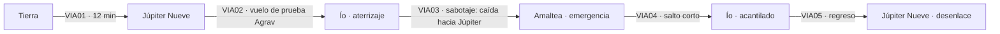

# CAPÍTULO 5 — LAS LUNAS DEL GIGANTE (satélites de Júpiter)

## Ficha
| Campo | Valor |
|---|---|
| Mundos | Tierra → Júpiter Nueve (base del proyecto Agrav) → Ío → caída hacia Júpiter → Amaltea → Ío → Júpiter Nueve |
| Duración objetivo | 90–100 min |
| Caso | Los secretos del proyecto **Agrav** (antigravedad) llegan a Vega. Hay un espía en la base. |
| Culpables | **BRUNO**, el perro guía del ingeniero ciego Hal Nordin, que es un **robot espía vegano**. **Rusty Calder**, técnico, saboteador a sueldo de Vega. |
| Giro del dúo | Cuando Lune deduce que el espía es un robot, **la tripulación acusa a GOLIAT**. GOLIAT pasa medio capítulo esposado y tiene que demostrar su inocencia junto a Lune. |
| Presencia de Vega | **Culpable directa** por primera vez |
| Mejora obtenida | **Propulsor Agrav** (`F_AGRAV`) |
| Fuente analítica | `analisis/ANALISIS_POR_LIBRO.md` §L5 |

## Personajes del capítulo
| Personaje | Rol | Voz |
|---|---|---|
| Comandante Elsa Reyes | Jefa de la base | Dura, orgullosa, desconfía de los robots |
| Rusty Calder | Técnico pelirrojo, mastica chicle. Traidor. | Burlón, amargo |
| Olaf Brann | Mecánico gigante, campeón de lucha Agrav | Grave, noble, lento |
| Hal Nordin | Ingeniero ciego, héroe de un accidente | Amable, sabio, cálido |
| BRUNO | «Perro» pastor de Nordin. Robot espía. | Sólo ladridos y gruñidos (sonido) |
| Jefa de ingenieros Sasha Pann | Ingeniera jefe | Práctica, pesimista |
| Teniente Ivo Nesta | Oficial de enlace | Joven, servicial |
| ONDINA | Traída de Venus para detectar emociones | Sin voz; GOLIAT «traduce» lo que transmite |

## Pistas
| ID | Pista | Dónde | Uso |
|---|---|---|---|
| P5-01 | La ondina no capta ninguna emoción en Bruno cuando «defiende» a su dueño | C5_LOC01 | **Clave (pasada por alto)** |
| P5-02 | Mataron a la ondina sin que diera la alarma: el asesino no sentía nada | C5_LOC02 | El espía es un robot |
| P5-03 | Calder consiguió a Bruno en el mercado negro, cuando murió el perro anterior | C5_LOC01 | Conexión Calder–Bruno |
| P5-04 | Bruno rescata a Nordin del río de amoníaco con el casco cerrado y sin aire, diez minutos | C5_LOC03 | **Prueba (clave)** |
| P5-05 | Calder confiesa por radio: Vega le prometió emigrar a «mundos limpios» | C5_LOC05 | Móvil de Calder |

## Mapa de ruta

---

## ESCENAS

### C5_VIA01 — Viaje: Tierra → Júpiter Nueve (sesión informativa en ruta)
**Tramo:** 12 min. La ondina viaja en un terrario. **Hitos:** 0 % · 25 % · 50 % Júpiter crece en la pantalla · 75 % · 95 %.

| ID | Trigger | Personaje | Línea | Dirección |
|---|---|---|---|---|
| C5_VIA01_010 | RUTA 0% | CORVO | (holograma) Agrav. Antigravedad. Si Vega lo tiene antes que nosotros, sus naves maniobran como pájaros y las nuestras como ladrillos. Y alguien en Júpiter Nueve les está mandando los planos. | Grave |
| C5_VIA01_020 | CONT | CORVO | Darío… sé que abuso. Siempre te mando a ti. Te convertiste en mi carta escondida. | Cansada, sincera |
| C5_VIA01_030 | CONT | LUNE | Para eso están las cartas escondidas. | Tranquilo |
| C5_VIA01_040 | CONT | GOLIAT | ¿Y yo qué soy? ¿El comodín? | Celoso |
| C5_VIA01_050 | CONT | CORVO | Tú eres el que muerde. | Seca, con cariño |
| C5_VIA01_060 | CONT | GOLIAT | …Lo acepto. | Satisfecho |
| C5_VIA01_070 | RUTA 25% | GOLIAT | ¿Y por qué llevamos una ondina? La última vez se bebió mi sangre. | Desconfiado |
| C5_VIA01_080 | CONT | LUNE | Porque siente emociones a distancia. En una base con mil personas, el espía estará nervioso. Ella lo notará. | Plan |
| C5_VIA01_090 | CONT | GOLIAT | Me está mirando. Me mira con hambre. Darío, dile que mi lubricante ya no está en el menú. | Inquieto |
| C5_VIA01_100 | RUTA 50% | GOLIAT | Júpiter… Darío, mira eso. Es tan grande que parece que se va a caer encima de la nave. | Sobrecogido |
| C5_VIA01_110 | CONT | LUNE | Cabrían mil Tierras dentro. Y esa mancha roja es una tormenta más grande que nuestro planeta. | Contemplativo |
| C5_VIA01_120 | CONT | GOLIAT | Y yo me quejaba de las tormentas de Marte. | Humilde |
| C5_VIA01_130 | RUTA 75% | FERRÁN | (llamada) Un aviso: en Júpiter Nueve hay mucha gente con un pasado complicado. Y casi ninguno ha visto un robot de cerca. Los rumores sobre los robots de Vega los tienen asustados. | Advertencia |
| C5_VIA01_140 | CONT | GOLIAT | Genial. Voy a ser el más popular de la fiesta. | Sarcástico |
| C5_VIA01_150 | RUTA 95% | ERRANTE | Júpiter Nueve. Ciento cuarenta kilómetros de roca, a veintitrés millones de kilómetros de Júpiter. Pista de atraque dos. | Sintético |
| C5_VIA01_R01 | IDLE ≥15 s | GOLIAT | (a la ondina) No me mires así. Soy un robot con principios. Y con juntas selladas. | Relleno |
| C5_VIA01_R02 | IDLE ≥15 s | LUNE | (para sí) Un espía en una base aislada. Todo el mundo vigila a todo el mundo. Ahí es fácil esconderse. | Relleno |
| C5_VIA01_R03 | IDLE ≥15 s | GOLIAT | Si Júpiter tiene sesenta lunas, ¿cuál es la más bonita? Pregunto para la postal. | Relleno |

### C5_LOC01 — Júpiter Nueve: recibimiento y pelea Agrav
**Eventos:** la comandante Reyes los recibe con hostilidad; el «comité de bienvenida» de la tripulación; pelea en el pasillo Agrav contra Brann (minijuego), con Calder saboteando los mandos de Lune; GOLIAT hace trampa con la ondina; presentación de Nordin y Bruno (P5-01, P5-03). **Flag `F_AGRAV`.**

| ID | Trigger | Personaje | Línea | Dirección |
|---|---|---|---|---|
| C5_LOC01_010 | LLEGADA | REYES | Inspector Lune. Le pedí a la Agencia que no viniera. Mis hombres no quieren espías de la Tierra. Y menos con una máquina. | Fría |
| C5_LOC01_020 | CONT | GOLIAT | GOLIAT. «La máquina» tiene nombre. | Seco |
| C5_LOC01_030 | CONT | REYES | Aquí nadie confía en lo que piensa sin sangre, robot. | Desprecio |
| C5_LOC01_040 | CONT | LUNE | Comandante, tengo autoridad federal sobre esta base. Puedo relevarla con una sola llamada. Preferiría no tener que hacerla. | Duro de golpe, actuado |
| C5_LOC01_050 | CONT | REYES | (tensa) …Entendido. | Cede |
| C5_LOC01_060 | CONT | GOLIAT | (bajo) ¿Desde cuándo das miedo? | Impresionado |
| C5_LOC01_070 | CONT | LUNE | (bajo) Desde hace diez segundos. Quería ver qué captaba la ondina cuando yo me enfadara. Captó mi furia, ¿no? Entonces funciona. Ahora iré a pedirle disculpas. | Sonrisa |
| C5_LOC01_080 | EXPLORAR | CALDER | (masticando chicle) Bienvenido, inspector. Le hemos preparado un recibimiento en el pasillo Agrav. Es tradición. | Burlón |
| C5_LOC01_090 | CONT | BRANN | Lucha Agrav. Sin gravedad, sólo con los mandos del cinturón. No es personal, inspector. | Grave, respetuoso |
| C5_LOC01_100 | EVT(pelea Agrav) | LUNE | ¡Los mandos no responden! ¡Alguien los tocó! | Esfuerzo |
| C5_LOC01_110 | CONT | GOLIAT | (gritando desde fuera) ¡Calder! ¡Vi tu mano en el cinturón! ¡Te voy a…! | Furioso |
| C5_LOC01_120 | EVT fin, victoria | BRANN | (en el suelo) Por las lunas… este chico tiene muelles en vez de huesos. | Admirado |
| C5_LOC01_130 | CONT | LUNE | Aquí no ha pasado nada. Fue un recibimiento. Mañana, todos a trabajar. | Generoso |
| C5_LOC01_140 | CONT | GOLIAT | Claro, Darío. Lo que tú digas, Darío. | Demasiado inocente |
| C5_LOC01_150 | CONT | LUNE | Cuando dices «claro» con esa voz, es que has roto algo. ¿Qué hiciste? | Sospecha |
| C5_LOC01_160 | CONT | GOLIAT | Nada. Le acerqué la ondina a Brann. Ella le pasaba lo que tú sentías. Y tú tenías tantas ganas de ganar… | Inocente |
| C5_LOC01_170 | CONT | LUNE | O sea que le llenaste la cabeza a mi rival con mis ganas de ganar. Eso no es ayudar, GOLIAT. Es hacer trampa. | Reprende, divertido a su pesar |
| C5_LOC01_180 | CONT | GOLIAT | Técnicamente, ganaste tú. Yo sólo te ayudé con la técnica. | Defensa |
| C5_LOC01_190 | CONT | SASHA PANN | Inspector. Ya que sabe moverse en Agrav, le instalamos un propulsor experimental en la nave. Si va a volar aquí, lo va a necesitar. | Práctica. **Flag `F_AGRAV`** |
| C5_LOC01_200 | INTERACT(Nordin) | NORDIN | Así que ustedes son la tormenta de la que todos hablan. Siéntense. Éste es Bruno. No muerde a los amigos. | Cálido |
| C5_LOC01_210 | CONT | GOLIAT | Hola, Bruno. Eres precioso. Mucho más que la ondina. | Encantado |
| C5_LOC01_220 | CONT | NORDIN | Perdí la vista en un accidente del reactor, hace años. Bruno me cuida. El perro anterior se murió. A éste me lo consiguió Rusty Calder. Por medios… poco oficiales. | Agradecido. **Pista P5-03** |
| C5_LOC01_230 | CONT | LUNE | ¿Es muy protector? | Casual |
| C5_LOC01_240 | CONT | NORDIN | Haz la prueba. Amenázame. | Divertido |
| C5_LOC01_250 | CONT | GOLIAT | (levanta el brazo, en broma) ¡Arrr! | Teatral |
| C5_LOC01_260 | CONT | BRUNO | (gruñido grave, se interpone) | SFX |
| C5_LOC01_270 | CONT | GOLIAT | ¡Vale, vale! ¡Bruno, era broma! Darío, qué perro tan leal. | Impresionado |
| C5_LOC01_280 | CONT | GOLIAT | (bajo, mirando el terrario) Qué raro. La ondina sintió mi broma y tu curiosidad. Pero de Bruno… nada. Como si no estuviera. | Comentario de pasada; Lune no reacciona. **Pista P5-01** |

### C5_LOC02 — Júpiter Nueve: la noche de la ondina
**Eventos:** la ondina aparece muerta, con la cerradura del terrario fundida. Lune deduce que el asesino no sintió nada: un robot. **Reyes acusa a GOLIAT y lo arresta** (`F_GOLIAT_DETENIDO`).

| ID | Trigger | Personaje | Línea | Dirección |
|---|---|---|---|---|
| C5_LOC02_010 | LLEGADA | GOLIAT | Darío. Despierta. La ondina… está muerta. La cerradura está fundida. | Conmocionado |
| C5_LOC02_020 | CONT | LUNE | Estaba a medio metro de mi cama y no me despertó. Si alguien se acerca con odio, con miedo, con cualquier cosa, ella lo transmite. | Analítico |
| C5_LOC02_030 | CONT | LUNE | La mató alguien que no sentía nada. Nada en absoluto. | Grave. **Pista P5-02** |
| C5_LOC02_040 | CONT | GOLIAT | Un robot. | Muy bajo |
| C5_LOC02_050 | CONT | LUNE | Un robot que no puede dañar a un humano, pero sí a una ondina. Y que tiene órdenes de alguien que sí siente: Vega. | Firme |
| C5_LOC02_060 | CONT | REYES | (entra con guardias) Ya lo he oído, inspector. Un robot. Y en esta base hay uno solo. | Fría |
| C5_LOC02_070 | CONT | GOLIAT | ¿Yo? ¡Yo estaba en modo de reposo! ¡Al lado de su cama! | Pánico |
| C5_LOC02_080 | CONT | REYES | Exacto. Al lado. Esposas magnéticas. Queda bajo custodia. | Orden |
| C5_LOC02_090A | ELECCIÓN | LUNE (A) | Comandante, se está equivocando. GOLIAT viene conmigo. | Defiende (Reyes cede a medias) |
| C5_LOC02_090B | ELECCIÓN | LUNE (B) | Está bien. Que lo custodien. Pero viene en el vuelo de prueba, donde yo pueda verlo. | Estratégico |
| C5_LOC02_100 | COND(A) | REYES | Viene con usted. Esposado. En una jaula de carga. O no viene nadie. | Compromiso |
| C5_LOC02_110 | COND(B) | REYES | Aceptable. En una jaula de carga. | Fría |
| C5_LOC02_120 | CONT | GOLIAT | (mientras lo esposan) Darío… tú no crees que fui yo, ¿verdad? | Vulnerable |
| C5_LOC02_130 | CONT | LUNE | Ni un segundo. | Inmediato, firme. **Flag `F_GOLIAT_DETENIDO`** |
| C5_LOC02_140 | CONT | GOLIAT | Vale. Entonces aguanto. Pero que conste: la jaula es de mala calidad. | Recupera el humor |

### C5_VIA02 — Viaje: Júpiter Nueve → Ío (vuelo de prueba de la nave Agrav *Ícaro*)
**Tramo:** 10 min. Dieciséis tripulantes más GOLIAT en la jaula. El jugador pilota el *Ícaro* (controles Agrav). **Hitos:** 0 % · 25 % · 50 % eclipse de Júpiter por Ganímedes · 75 % Ío a la vista · 95 % descenso.

| ID | Trigger | Personaje | Línea | Dirección |
|---|---|---|---|---|
| C5_VIA02_010 | RUTA 0% | REYES | *Ícaro*, despegue. Primer vuelo tripulado con Agrav. Inspector, no me lo estrelle. | Tensa |
| C5_VIA02_020 | CONT | LUNE | Haré lo posible por estrellarlo poco. | Seco |
| C5_VIA02_030 | RUTA 15% | GOLIAT | (desde la jaula) Desde aquí no se ve nada. Sólo la espalda de Brann. Tiene una espalda muy expresiva. | Aburrido |
| C5_VIA02_040 | CONT | BRANN | (se aparta) Mira, robot. Ahí tienes la ventana. | Gesto amable inesperado |
| C5_VIA02_050 | CONT | GOLIAT | …Gracias, Brann. | Sorprendido |
| C5_VIA02_060 | CONT | BRANN | Peleaste por tu amigo en el pasillo. Yo respeto eso. Aunque seas de metal. | Grave |
| C5_VIA02_070 | RUTA 30% | NORDIN | Inspector, cuénteme qué ve. Yo me imagino Júpiter, pero quiero saber si me lo imagino bien. | Dulce |
| C5_VIA02_080 | CONT | LUNE | Franjas de colores que se mueven como ríos. Naranja, crema, marrón. Y una mancha roja, como un ojo. | Le describe con cuidado |
| C5_VIA02_090 | CONT | NORDIN | Me lo imaginaba más azul. Me gusta más así. | Sonrisa |
| C5_VIA02_100 | EVT(eclipse) | ERRANTE | (repetidor) Ganímedes en tránsito. Eclipse parcial de Júpiter. | Sintético |
| C5_VIA02_110 | CONT | GOLIAT | Una sombra redonda sobre Júpiter. Parece una moneda en una mesa enorme. | Asombro |
| C5_VIA02_120 | RUTA 75% | LUNE | Ío a la vista. Volcanes de azufre. Ríos de amoníaco. Nadie ha pisado esa luna jamás. | Concentrado |
| C5_VIA02_130 | CONT | CALDER | (mascando) Habrá que hacerse famoso. | Sombrío |
| C5_VIA02_140 | RUTA 95% | LUNE | (para sí, contando por la ventanilla) Dieciséis humanos. Y un solo robot, que yo sepa. | Ironía: cuenta a GOLIAT, y se equivoca sin saberlo |
| C5_VIA02_R01 | IDLE ≥15 s | GOLIAT | (jaula) Si me dejáis salir, os enseño a jugar al «adivina la roca». Es muy divertido. Bueno, no mucho. | Relleno |
| C5_VIA02_R02 | IDLE ≥15 s | SASHA PANN | Los relés gravitatorios aguantan. Por ahora. No me hagan caso, soy pesimista por contrato. | Relleno |
| C5_VIA02_R03 | IDLE ≥15 s | BRUNO | (gimotea suavemente, apoyado en Nordin) | Relleno SFX |

### C5_LOC03 — Ío: primer paso y el río de amoníaco
**Eventos:** aterrizaje histórico; Nordin resbala y cae al río de amoníaco; **Bruno se lanza, lo saca y le cierra el casco**: el perro pasa diez minutos sin aire (P5-04). Lune no conecta la pista todavía. Calder se aleja del grupo.

| ID | Trigger | Personaje | Línea | Dirección |
|---|---|---|---|---|
| C5_LOC03_010 | LLEGADA | REYES | Federación Solar, aquí el *Ícaro*. Primeros humanos en Ío. | Emocionada, solemne |
| C5_LOC03_020 | EXPLORAR | NORDIN | Los primeros en la Luna, en Marte, en Venus… nadie recuerda los nombres. Pero ellos sí recordaban el paso. | Reflexivo |
| C5_LOC03_030 | CONT | LUNE | Júpiter tapa medio cielo desde aquí. | Asombro |
| C5_LOC03_040 | EVT(caída) | NORDIN | ¡Resbalo…! ¡Ah! | Grito, chapoteo |
| C5_LOC03_050 | CONT | GOLIAT | (radio desde la nave) ¡Nordin al río! ¡Que alguien me suelte! ¡Puedo bajar! | Desesperado |
| C5_LOC03_060 | CONT | BRUNO | (ladrido, salta al río) | SFX |
| C5_LOC03_070 | CONT | LUNE | ¡Bruno lo tiene! ¡Lo está arrastrando a la orilla! | Esfuerzo |
| C5_LOC03_080 | CONT | NORDIN | (tosiendo) Bruno… buen chico. Me cerró el casco con los dientes. | Alivio |
| C5_LOC03_090 | CONT | SASHA PANN | Y el casco del perro estaba cerrado y sin oxígeno. Diez minutos en el río, ¿y sigue meneando la cola? | Extrañada, de pasada. **Pista P5-04** |
| C5_LOC03_100 | CONT | LUNE | Animales de Júpiter Nueve. Más duros que nosotros. | Distraído; se le escapa la pista |
| C5_LOC03_110 | CONT | GOLIAT | (radio) ¿Dónde está Calder? No lo veo en el grupo. | Alerta |

### C5_VIA03 — Viaje: Ío → caída hacia Júpiter → Amaltea (sabotaje)
**Tramo:** 9 min. **EVT al 20 %:** los relés gravitatorios fallan (sabotaje) y el *Ícaro* cae hacia Júpiter. **Lune libera a GOLIAT** para que reprograme los relés a mano (decisión de confianza). Maniobra Agrav extrema para frenar en **Amaltea**.

| ID | Trigger | Personaje | Línea | Dirección |
|---|---|---|---|---|
| C5_VIA03_010 | RUTA 0% | REYES | Despegue de Ío. Rumbo a Júpiter Nueve. | Rutina |
| C5_VIA03_020 | EVT(fallo de relés) | SASHA PANN | ¡Relés gravitatorios fundidos! ¡Todos a la vez! ¡No es un fallo, alguien los preparó! | Alarma |
| C5_VIA03_030 | CONT | ERRANTE | (repetidor) Trayectoria: caída hacia Júpiter. Impacto con la atmósfera estimado en cuarenta minutos. | Alerta |
| C5_VIA03_040 | CONT | SASHA PANN | No hay nada que hacer. Estamos muertos. Todos. | Derrumbe |
| C5_VIA03_050 | CONT | LUNE | Todavía pensamos. Mientras pensemos, hay salida. Comandante, suelte a GOLIAT. | Firme |
| C5_VIA03_060 | CONT | REYES | ¿Está loco? ¡Si es el saboteador, nos remata! | Furiosa |
| C5_VIA03_070 | CONT | LUNE | Si es el saboteador, ya estamos muertos. Si no lo es, es el único que puede meter las manos en un relé a ciento cincuenta grados. Suéltelo. | Implacable |
| C5_VIA03_080 | CONT | REYES | (pausa) …Suéltenlo. | Cede |
| C5_VIA03_090 | CONT | GOLIAT | (fuera de la jaula) Por fin. Abran paso. Robot pequeño, manos pequeñas, relés pequeños. | Decidido |
| C5_VIA03_100 | RUTA 40% | GOLIAT | Relé uno… soldado. Quema. Quema mucho. Relé dos… | Esfuerzo |
| C5_VIA03_110 | CONT | LUNE | Necesito un punto de apoyo. Amaltea. Es pequeña, pero tiene gravedad suficiente para frenarnos con el Agrav. | Calculando |
| C5_VIA03_120 | CONT | SASHA PANN | ¡Eso es una locura de maniobra! | Incrédula |
| C5_VIA03_130 | CONT | LUNE | ¿Tiene otra? | Seco |
| C5_VIA03_140 | RUTA 70% | GOLIAT | ¡Relé tres! ¡Tienes media potencia, Darío! ¡Es todo lo que puedo darte! | Agotado |
| C5_VIA03_150 | EVT(frenado en Amaltea) | LUNE | Agrav al máximo. Agárrense. | Concentración total |
| C5_VIA03_160 | RUTA 100% | ERRANTE | (repetidor) Contacto con la superficie de Amaltea. Tripulación: estable. | Sintético |
| C5_VIA03_170 | CONT | REYES | (larga exhalación) Robot. GOLIAT. Gracias. | Sincera, primera vez que lo llama por su nombre |
| C5_VIA03_180 | CONT | GOLIAT | (las manos echando humo) De nada, comandante. Me debe una jaula mejor. | Agotado, digno |
| C5_VIA03_R01 | IDLE ≥15 s | GOLIAT | Quema. Quema. Quema. No me hagáis caso. Sigo. | Relleno durante la reparación |
| C5_VIA03_R02 | IDLE ≥15 s | NORDIN | Bruno está temblando. Tranquilo, chico. Tranquilo. | Relleno |

### C5_LOC04 — Amaltea: pase de lista
**Eventos:** el mayor Levin pasa lista: falta Calder. Nordin admite que lo cubrió. **Calder se quedó en Ío.**

| ID | Trigger | Personaje | Línea | Dirección |
|---|---|---|---|---|
| C5_LOC04_010 | LLEGADA | REYES | Lista. Ahora. | Seca |
| C5_LOC04_020 | CONT | TENIENTE NESTA | …Quince. Falta Calder. | Inquieto |
| C5_LOC04_030 | CONT | NORDIN | Mi culpa. Me pidió que dijera que estaba a bordo. Que tenía que recoger muestras. Pobre Rusty… siempre tuvo una vida rota. | Culpable |
| C5_LOC04_040 | CONT | LUNE | Se quedó en Ío porque sabía que el *Ícaro* no iba a llegar. | Grave |
| C5_LOC04_050 | SALIDA | LUNE | GOLIAT, vienes conmigo. Comandante, ¿alguna objeción? | Mirada a Reyes |
| C5_LOC04_060 | CONT | REYES | Ninguna. Ya no. | Respeto |

### C5_VIA04 — Viaje: Amaltea → Ío (salto corto en la *Errante*)
**Tramo:** 4 min. Calder responde por radio y confiesa (P5-05).

| ID | Trigger | Personaje | Línea | Dirección |
|---|---|---|---|---|
| C5_VIA04_010 | RUTA 0% | LUNE | Calder, aquí Lune. Sé que me oyes. | Firme |
| C5_VIA04_020 | RUTA 20% | CALDER | (radio) ¿Sobrevivieron? Claro que sí. Siempre sobreviven los de la Agencia. | Amargo |
| C5_VIA04_030 | CONT | LUNE | ¿Por cuánto los vendiste, Rusty? | Duro |
| C5_VIA04_040 | RUTA 40% | CALDER | (radio) ¿Dinero? No. Me ofrecieron aire, inspector. Un planeta nuevo. Limpio. Sin colas para el agua, sin vecinos encima, sin la Tierra apretándome el cuello. | Furioso, quebrado. **Pista P5-05** |
| C5_VIA04_050 | CONT | GOLIAT | ¿Y el perro? ¿Lo trajiste tú? | Directo |
| C5_VIA04_060 | RUTA 60% | CALDER | (radio, risa amarga) El perro… pregúntale al perro. | Críptico |
| C5_VIA04_070 | RUTA 80% | LUNE | Calder, no hagas nada. Vamos a buscarte. | Urgente |
| C5_VIA04_080 | CONT | CALDER | (radio) No me van a llevar de vuelta a la Tierra. | Final |
| C5_VIA04_R01 | IDLE ≥15 s | GOLIAT | «Pregúntale al perro». ¿Qué quiso decir? | Relleno; insiste en la pista |

### C5_LOC05 — Ío: el acantilado
**Eventos:** Calder salta al vacío antes de que lleguen. (Se muestra fuera de plano; clasificación +12.) Lune mira el cuerpo y **comprende**: «aquí no hay ningún Bruno que lo salve».

| ID | Trigger | Personaje | Línea | Dirección |
|---|---|---|---|---|
| C5_LOC05_010 | LLEGADA | GOLIAT | Allí. Al borde. ¡No! | Grito |
| C5_LOC05_020 | CONT | LUNE | (silencio de tres segundos) Lo engañaron con un cielo limpio. | Bajo, compasivo |
| C5_LOC05_030 | CONT | GOLIAT | Y él nos vendió a todos por ese cielo. | Herido |
| C5_LOC05_040 | CONT | LUNE | Nadie va a recordar que pisamos Ío. Van a recordar esto. | Amargo |
| C5_LOC05_050 | CONT | LUNE | (para sí) Nordin cayó al río… y Bruno lo salvó. Calder cayó… y aquí no hay ningún Bruno. Diez minutos sin aire. «Pregúntale al perro». | Revelación lenta |
| C5_LOC05_060 | CONT | LUNE | GOLIAT. Estaba buscando un robot con forma de hombre. Y lo tenía a mis pies, moviendo la cola. | Revelación |
| C5_LOC05_070 | CONT | GOLIAT | …Bruno. | Dolido; le caía bien |

### C5_VIA05 — Viaje: Ío → Júpiter Nueve (regreso)
**Tramo:** 6 min. Preparan la trampa.

| ID | Trigger | Personaje | Línea | Dirección |
|---|---|---|---|---|
| C5_VIA05_010 | RUTA 0% | GOLIAT | Me gustaba Bruno. | Triste |
| C5_VIA05_020 | CONT | LUNE | Bruno no eligió nada. Igual que el robot de Mercurio. | Suave |
| C5_VIA05_030 | RUTA 25% | LUNE | Tiene que delatarse delante de todos. Un robot no puede dejar que hieran a un humano. Y su orden secreta le prohíbe revelarse. Si lo obligamos a elegir… | Plan |
| C5_VIA05_040 | CONT | GOLIAT | …se queda trabado. Como Centinela. | Comprende |
| C5_VIA05_050 | RUTA 40% | LUNE | Necesito que «ataques» a Nordin. Delante de Bruno. | Directo |
| C5_VIA05_060 | CONT | GOLIAT | ¡Mis Protocolos me lo prohíben! | Escandalizado |
| C5_VIA05_070 | CONT | LUNE | Tus Protocolos te prohíben hacerle daño. No te prohíben actuar. | Divertido |
| C5_VIA05_080 | RUTA 55% | GOLIAT | …Actuar. Voy a ser el mejor villano falso de la historia. ¿Tengo que decir «¡muajajá!»? | Entusiasmo |
| C5_VIA05_090 | CONT | LUNE | Por favor, no. | Seco |
| C5_VIA05_100 | RUTA 75% | LUNE | Y GOLIAT: primero voy a acusar a Nordin. En voz alta. Va a sonar horrible. Tienes que seguirme el juego. | Grave |
| C5_VIA05_110 | CONT | GOLIAT | ¿A Nordin? Le va a romper el corazón. | Preocupado |
| C5_VIA05_120 | RUTA 90% | LUNE | Por eso después le vamos a dar algo mejor. | Promesa |
| C5_VIA05_R01 | IDLE ≥15 s | GOLIAT | (ensayando) «¡Ríndase, Nordin!». No. «¡Tiemble, Nordin!». Tampoco. Esto es más difícil de lo que parece. | Relleno |

### C5_DED01 — Júpiter Nueve: el desenmascaramiento
**Combinación correcta:** Culpable **Bruno** + Método **robot espía con transmisor** + Prueba **diez minutos sin aire en el río** (P5-04), apoyada por P5-01 y P5-02.

| ID | Trigger | Personaje | Línea | Dirección |
|---|---|---|---|---|
| C5_DED01_010 | INICIO | LUNE | Calder trabajaba para Vega. Pero Calder sólo tocaba los relés. Los planos los mandaba otro. Alguien que estuvo en cada reunión del proyecto. | Tenso |
| C5_DED01_020 | ACUSACIÓN errónea: GOLIAT | REYES | (si el jugador acusa a GOLIAT) Inspector, ese robot nos salvó la vida en la caída. Ni yo me lo creo ya. | Respuesta al error |
| C5_DED01_030 | ACUSACIÓN errónea: Brann | BRANN | ¿Yo? Yo no sé ni escribir un informe, inspector. | Respuesta al error |
| C5_DED01_040 | ACUSACIÓN errónea: Pann | SASHA PANN | Si yo fuera espía, lo haría mucho mejor. Y me quejaría menos. | Respuesta al error |
| C5_DED01_050 | ACUSACIÓN correcta (fase 1, trampa) | LUNE | Hal Nordin. Usted estuvo en cada reunión. Nadie desconfía de un ciego. | Frío, actuado |
| C5_DED01_060 | CONT | NORDIN | (devastado) ¿Yo, inspector? | Roto |
| C5_DED01_070 | CONT | GOLIAT | (se lanza, teatral) ¡Traidor! | Ataque falso; el brazo se detiene a un palmo |
| C5_DED01_080 | CONT | BRUNO | (gruñido que se corta; queda inmóvil, temblando; zumbido eléctrico) | SFX: conflicto de Protocolos |
| C5_DED01_090 | CONT | LUNE | Proteger a su dueño o no revelarse. No puede hacer las dos cosas. | Firme |
| C5_DED01_100 | CIN | LUNE | (abre el pecho del perro: esfera, transmisor, cámara) Un transmisor de largo alcance. Todo lo que oía Bruno, lo oía Vega. Diez minutos sin aire en el río y meneando la cola. Bruno no es un perro, señor Nordin. Nunca lo fue. | Revelación |
| C5_DED01_110 | CONT | NORDIN | (larga pausa) …Me guiaba por los pasillos. Me despertaba si tenía pesadillas. | Duelo |
| C5_DED01_120 | CONT | GOLIAT | (muy suave) Hacía las dos cosas, señor. Le cuidaba y le espiaba. Seguramente las dos de verdad. | Compasión robótica |

#### C5_CIN01 — Epílogo

| ID | Trigger | Personaje | Línea | Dirección |
|---|---|---|---|---|
| C5_CIN01_010 | INICIO | REYES | GOLIAT. Le debo una disculpa. Y una jaula mejor, al parecer. | Sincera |
| C5_CIN01_020 | CONT | GOLIAT | Acepto la disculpa. La jaula no la quiero. | Digno |
| C5_CIN01_030 | CONT | CORVO | (llamada) Si hay un perro, puede haber cien. En la Tierra hay perros guía, gatos, pájaros… Vamos a revisar cada mascota «de importación». | Alarmada |
| C5_CIN01_040 | CONT | LUNE | No ganamos la guerra, directora. Ganamos tiempo. | Cansado |
| C5_CIN01_050 | CONT | LUNE | Señor Nordin. Le voy a conseguir otro perro. Uno de verdad. Que ronque y que suelte pelo. | Cálido |
| C5_CIN01_060 | CONT | NORDIN | Me conformo con que me quiera. | Sonrisa triste |
| C5_CIN01_070 | CONT | GOLIAT | (en la *Errante*) Darío. Cuando Reyes me esposó, tú dijiste «ni un segundo». Lo dijiste antes de pensarlo. | Emocionado |
| C5_CIN01_080 | CONT | LUNE | No hacía falta pensarlo. | Sencillo |
| C5_CIN01_090 | CONT | GOLIAT | …Es lo más bonito que me han dicho sin pensar. | Conmovido. **FIN DEL CAPÍTULO 5** |

## Flags del capítulo
`F_AGRAV` (C5_LOC01_190) · `F_GOLIAT_DETENIDO` (C5_LOC02_130; se desactiva en C5_VIA03_090). Gancho al capítulo 6: la red de mascotas espía lleva a un agente vegano que huye de la Tierra.
