# CAPÍTULO 6 — ANILLOS DE SATURNO (Saturno · Titán · Vesta) · FINAL

## Ficha
| Campo | Valor |
|---|---|
| Mundos | Tierra → Saturno (bajo la eclíptica) → anillos y polo sur → división de Cassini → Mimas → Titán → Mimas → Vesta → Tierra |
| Duración objetivo | 100–120 min |
| Caso | El **Agente X**, cabecilla de la red de mascotas espía, huye de la Tierra con una cápsula de datos. Al llegar a Saturno, Lune descubre que **Vega ha construido una base en Titán**, dentro del Sistema Solar. |
| Antagonista | **Comandante Aurel Dravin**, sobrino del Primer Director de Vega |
| Conflicto | Vega invoca la **doctrina del primer asentamiento** («un mundo vacío es de quien lo habita primero»). La Federación no puede atacar sin parecer el agresor ante los cincuenta mundos exteriores. |
| Resolución | Lune deja como colono al agente Wessel en Mimas, un mundo vacío. Vega lo expulsa y se contradice. En la **Conferencia de Vesta**, el voto aísla a Vega y establece que **un sistema estelar no se reparte**. |
| Momento clave del dúo | GOLIAT, declarado «objeto» por Vega, **se ofrece a desaparecer** para que Lune no pueda ser chantajeado. Lune finge una traición que hiere a GOLIAT. Reconciliación y **la única vez que Lune dice en voz alta lo que GOLIAT significa para él**. |
| Fuente analítica | `analisis/ANALISIS_POR_LIBRO.md` §L6 |

## Personajes del capítulo
| Personaje | Rol | Voz |
|---|---|---|
| Agente Nils Wessel | Colega de la ACS, alto y rubio | Ingenioso, pesimista, buen compañero |
| Agente X (Jonas Ferrel) | Espía vegano en la Tierra | Sólo por radio, entrecortado |
| Cmdte. Aurel Dravin | Comandante vegano | Refinado, blando, cruel, desprecia a los «mestizos» |
| Observador Harrik Zeta | Funcionario del Servicio Exterior de Vega | Frío, legalista, ideólogo |
| Capitana Bere Yon | Oficial vegana con una cicatriz | Pragmática, cansada del régimen |
| ROBOTS VEGANOS | Pilotos y custodios | Voz idéntica, perfecta, impersonal |
| Delegada Ama Oduya | Representante de Kessa (enana roja; pueblo albino), neutral | Pausada, sabia |
| Secretario Fausto Lindqvist | Secretario de Exteriores de la Federación | Político, nervioso |
| Mira Castell | Periodista | Incisiva |
| Capitán Bernal | Comandante de la flota federal en Saturno | Militar orgulloso |

## Pistas y elementos de trama
| ID | Elemento | Dónde | Uso |
|---|---|---|---|
| P6-01 | Último mensaje del Agente X: «…dejé… en la órbita de siempre… polo…» | C6_VIA01 | La cápsula sigue una órbita polar (Lune la recupera en secreto) |
| P6-02 | Doctrina del primer asentamiento invocada por Vega | C6_LOC01 | Arma jurídica de Vega |
| P6-03 | Wessel se instala como colono en Mimas, un mundo vacío | C6_LOC03 | **La jugada clave** |
| P6-04 | Vega expulsa a Wessel de Mimas | C6_LOC05 | **Prueba de la hipocresía** |
| P6-05 | Testimonio de la capitana Yon sobre la orden de desmontar a GOLIAT | C6_LOC04 | Pide asilo al final |

## Mapa de ruta

```mermaid
flowchart LR
  N0[Tierra · Puerto Central] -->|VIA01 · persecución bajo la eclíptica| N1[Saturno · anillos]
  N1 -->|VIA02 · retirada y paso por el polo sur| N2[División de Cassini]
  N2 -->|VIA03 · aterrizaje perforado| N3[Mimas]
  N3 -->|VIA04 · escolta robótica, modo pasajero| N4[Titán · base vegana]
  N4 -->|VIA05 · nave vegana| N5[Mimas · entrega de Wessel]
  N5 -->|VIA06 · nave vegana| N6[Vesta · Conferencia]
  N6 -->|VIA07 · epílogo| N7[Tierra]
```

---

## ESCENAS

### C6_BRF01 — Tierra: Puerto Central (persecución)

| ID | Trigger | Personaje | Línea | Dirección |
|---|---|---|---|---|
| C6_BRF01_010 | INICIO | CORVO | Revisamos cada mascota de importación: gatos, perros, un loro que recitaba poesía. Todos llevaban a un solo hombre: el Agente X. | Urgente |
| C6_BRF01_020 | CONT | GOLIAT | ¿Un loro espía? Siempre supe que los loros escondían algo. | Indignado |
| C6_BRF01_030 | CONT | CORVO | Acaba de romper el bloqueo de Puerto Central en una nave rápida, con una cápsula de datos. Si llega a Vega, sabrán todo lo que sabemos de ellos. | Grave |
| C6_BRF01_040 | CONT | WESSEL | Lo tengo en el radar. Va hacia afuera, por debajo del plano de los planetas. Hacia Saturno. ¿Quién le pone rumbo a Saturno a una nave de fuga? | Intrigado |
| C6_BRF01_050 | CONT | LUNE | Alguien que tiene a alguien esperándolo allí. | Grave |
| C6_BRF01_060 | CONT | CORVO | Wessel va con vosotros. | Orden |
| C6_BRF01_070 | CONT | GOLIAT | ¿Con nosotros? ¿En nuestra nave? ¿En mi asiento? | Celoso |
| C6_BRF01_080 | CONT | WESSEL | Tranquilo, pequeño. Me siento atrás. | Sonrisa |
| C6_BRF01_090 | CONT | GOLIAT | «Pequeño». Lo he oído. Lo he archivado. Lo he subrayado. | Rencoroso |

### C6_VIA01 — Viaje: Tierra → Saturno (persecución bajo la eclíptica)
**Tramo:** 14 min (el más largo del juego). **Hitos:** 0 % · 15 % · 30 % · 50 % · 70 % · 85 % · 95 % **EVT:** la nave del Agente X entra en órbita y explota cerca de los anillos tras transmitir un mensaje (P6-01).

| ID | Trigger | Personaje | Línea | Dirección |
|---|---|---|---|---|
| C6_VIA01_010 | RUTA 0% | ERRANTE | Rumbo: Saturno. Trayectoria a ciento sesenta millones de kilómetros bajo la eclíptica. Duración estimada: veintiocho días comprimidos. | Sintético |
| C6_VIA01_020 | CONT | WESSEL | Desde aquí abajo el Sistema Solar parece un plato visto desde debajo de la mesa. | Divertido |
| C6_VIA01_030 | CONT | GOLIAT | Y tú pareces una lámpara de pie. Por lo alto. | Pulla |
| C6_VIA01_040 | CONT | WESSEL | Y tú, una lámpara de mesa. Una pequeña. De noche. | Contraataque |
| C6_VIA01_050 | CONT | LUNE | Si seguís así, os mando a pilotar desde la bodega. A los dos. | Seco |
| C6_VIA01_060 | RUTA 15% | WESSEL | Lune, en serio. ¿Por qué Saturno? Allí no hay nada federal más allá de dos estaciones científicas automáticas. | Serio |
| C6_VIA01_070 | CONT | LUNE | Por eso. Un sitio donde no miramos nunca. | Grave |
| C6_VIA01_080 | RUTA 30% | GOLIAT | ¿Ves esa estrella tan brillante? Es Vega. Lo comprobé. La odio. Brilla demasiado. | Rencor infantil |
| C6_VIA01_090 | CONT | WESSEL | Desde aquí está a veinticinco años luz. No te va a oír. | Divertido |
| C6_VIA01_100 | CONT | GOLIAT | Algún día me oirá. | Solemne |
| C6_VIA01_110 | RUTA 50% | CORVO | (llamada) Malas noticias. Los mundos exteriores empiezan a preguntar por qué la Federación persigue una nave «civil» fuera de su zona. Vega ya presentó una queja. | Tensa |
| C6_VIA01_120 | CONT | LUNE | Antes de que pasara nada. Eso es interesante. | Analítico |
| C6_VIA01_130 | RUTA 70% | WESSEL | Saturno a la vista. Míralo, Lune. Con los anillos de canto parece un sombrero. | Asombro |
| C6_VIA01_140 | CONT | GOLIAT | Un sombrero de hielo y piedra de doscientos mil kilómetros. Me lo pondría. | Admiración |
| C6_VIA01_150 | RUTA 85% | AGENTE X | (radio, a una frecuencia desconocida) Aquí X. Perseguido. No puedo aterrizar. Dejé… la cápsula… en la órbita de siempre… polo… | Entrecortado. **Pista P6-01** |
| C6_VIA01_160 | EVT(explosión) | ERRANTE | Detonación en la nave perseguida. Cerca del borde del anillo A. Sin supervivientes. | Sintético |
| C6_VIA01_170 | CONT | WESSEL | Se voló él mismo antes de que lo atrapáramos. | Conmocionado |
| C6_VIA01_180 | CONT | LUNE | «La órbita de siempre». «Polo». Repítelo, *Errante*. | Concentrado |
| C6_VIA01_R01 | IDLE ≥15 s | GOLIAT | Veintiocho días con Wessel. Si me desconecto de aburrimiento, que conste en el informe. | Relleno |
| C6_VIA01_R02 | IDLE ≥15 s | WESSEL | ¿Alguien quiere jugar a las cartas? GOLIAT no, que ve a través de ellas. | Relleno |
| C6_VIA01_R03 | IDLE ≥15 s | GOLIAT | No veo a través de las cartas. Veo a través de las caras. Y la tuya dice «farol». | Relleno |
| C6_VIA01_R04 | IDLE ≥15 s | LUNE | (para sí) Una queja de Vega antes de que pasara nada. Sabían que veníamos. Querían que viniéramos. | Relleno, clave |

### C6_LOC01 — Anillos de Saturno: el ultimátum
**Escena en vuelo estacionario.** Naves robóticas veganas rodean la *Errante*. Primera mención de Titán. **Pista P6-02.** Lune ordena retirarse.

| ID | Trigger | Personaje | Línea | Dirección |
|---|---|---|---|---|
| C6_LOC01_010 | LLEGADA | ROBOTS VEGANOS | Nave federal. Ha entrado en territorio del Directorio de Vega. Por orden del Primer Directorio, retírese. | Voz perfecta, al unísono |
| C6_LOC01_020 | CONT | GOLIAT | ¿Territorio de Vega? ¡Esto es Saturno! ¡Saturno es nuestro desde que existen los mapas! | Furioso |
| C6_LOC01_030 | CONT | ROBOTS VEGANOS | Titán fue habitado por colonos de Vega hace doce meses. Doctrina del primer asentamiento: un mundo vacío pertenece a quien lo habita primero. | Monótono. **Pista P6-02** |
| C6_LOC01_040 | CONT | WESSEL | Lune… pusieron una base en Titán. En nuestro propio sistema. Y nosotros sin mirar. | Horrorizado |
| C6_LOC01_050 | CONT | LUNE | Un sistema estelar no es un mundo. Saturno no está «vacío»: está en nuestra casa. | Firme, por radio |
| C6_LOC01_060 | CONT | ROBOTS VEGANOS | Su interpretación no es pertinente. Retírese, o se considerará un acto de agresión. | Monótono |
| C6_LOC01_070 | CONT | CAPITÁN BERNAL | (radio) Inspector, la flota federal está a seis horas. Podemos barrer esas latas. | Ansioso |
| C6_LOC01_080 | CONT | LUNE | No, capitán. Son robots: no pueden dañarnos. Si les disparamos, nosotros disparamos primero, y cincuenta mundos verán a la Federación atacando. Eso es lo que quieren. | Analítico |
| C6_LOC01_090 | CONT | CAPITÁN BERNAL | La flota federal no retrocede, inspector. | Orgullo |
| C6_LOC01_100 | CONT | LUNE | Capitán, una flota que nunca retrocede acaba sin flota. Prefiero perder la cara que perder la guerra. | Duro |
| C6_LOC01_110 | CONT | GOLIAT | ¡Polvo de Marte, Darío! ¿Nos vamos? ¿Dejamos la cápsula ahí para ellos? | Desesperado |
| C6_LOC01_120 | CONT | LUNE | Por ahora. *Errante*: rumbo al polo sur. Bajo y despacio, que lo vean. | Mirada que no es de derrota |

### C6_VIA02 — Viaje: anillos → polo sur → división de Cassini
**Tramo:** 7 min. **EVT al 35 %:** «paseo» de Lune por el exterior en el polo sur (fuera de cámara: el jugador espera en cabina con GOLIAT y Wessel). **EVT al 80 %:** cruce de la división de Cassini con Agrav (requiere `F_AGRAV`).

| ID | Trigger | Personaje | Línea | Dirección |
|---|---|---|---|---|
| C6_VIA02_010 | RUTA 0% | WESSEL | Esto es un funeral con escalas, Lune. Sólo que el muerto todavía pilota. | Pesimista |
| C6_VIA02_020 | CONT | LUNE | Wessel, ¿estás conmigo? | Directo |
| C6_VIA02_030 | CONT | WESSEL | Hasta el final. Pero déjame quejarme por el camino. | Leal |
| C6_VIA02_040 | RUTA 20% | GOLIAT | Polo sur de Saturno. Visto desde aquí abajo, los anillos son un disco blanco perfecto. Es lo más bonito que he visto en mi vida. | Sobrecogido |
| C6_VIA02_050 | EVT(salida exterior) | LUNE | Voy a salir a revisar las antenas. Cinco minutos. GOLIAT, tienes la nave. | Casual (sospechosamente) |
| C6_VIA02_060 | CONT | GOLIAT | ¿Las antenas? ¿Ahora? ¿Con medio Vega mirándonos? | Desconcertado |
| C6_VIA02_070 | CONT | WESSEL | (mientras Lune está fuera) ¿Siempre hace esto? Lo de no explicar nada. | Curioso |
| C6_VIA02_080 | CONT | GOLIAT | Siempre. Dice que es porque yo me pongo nervioso. Yo nunca me pongo nervioso. ¿Por qué tarda tanto? ¿Lo ves? ¿Lo ves por la ventana? | Nerviosísimo |
| C6_VIA02_090 | CONT | LUNE | (vuelve) Antenas en orden. | Neutro; ningún detalle |
| C6_VIA02_100 | RUTA 55% | LUNE | Wessel, ¿qué sabes de la división de Cassini? | Plan |
| C6_VIA02_110 | CONT | WESSEL | Un hueco entre los anillos. Lo abre la luna Mimas, que tira de las partículas una y otra vez. Hay menos hielo, no nada. | Experto |
| C6_VIA02_120 | CONT | LUNE | Lo suficiente para que nos pierdan entre el ruido. | Decidido |
| C6_VIA02_130 | EVT(Cassini) | ERRANTE | Cruce de la división de Cassini. Densidad de fragmentos: variable. Agrav recomendado. | Alerta |
| C6_VIA02_140 | CONT | GOLIAT | ¡Hielo a la izquierda! ¡Hielo arriba! ¡Hielo en mi juntura! ¡Por qué siempre rocas! | Pánico, recuerda C2 |
| C6_VIA02_150 | CONT | WESSEL | ¡Ja! ¡Ésta es la mejor maniobra que he visto desde la academia! | Euforia |
| C6_VIA02_160 | RUTA 95% | ERRANTE | Mimas a la vista. Superficie: hielo de agua. Habitantes: ninguno. | Sintético. Énfasis de diseño en «ninguno» |
| C6_VIA02_R01 | IDLE ≥15 s | GOLIAT | Es la segunda vez en mi vida que cruzo un sitio lleno de piedras. Ya voy pidiendo un seguro. | Relleno |
| C6_VIA02_R02 | IDLE ≥15 s | WESSEL | Si salimos de esta, le cuento a todo el mundo que lo hice yo. | Relleno |

### C6_LOC03 — Mimas: la colonia de un solo hombre
**Eventos:** la *Errante* perfora el hielo para aterrizar. Montan un refugio con víveres para dos meses. **Wessel se queda como colono** (P6-03). Lune ofrece a GOLIAT quedarse a salvo; GOLIAT se niega. Lune se entrega a los veganos.

| ID | Trigger | Personaje | Línea | Dirección |
|---|---|---|---|---|
| C6_LOC03_010 | LLEGADA | WESSEL | Una bola de nieve con un cráter que le ocupa media cara. Hogar, dulce hogar. | Irónico |
| C6_LOC03_020 | CONT | LUNE | Refugio, víveres para dos meses y una baliza. Wessel, a partir de ahora vives aquí. | Serio |
| C6_LOC03_030 | CONT | WESSEL | ¿Vivir? ¿Aquí? ¿Por qué? | Desconcertado |
| C6_LOC03_040 | CONT | LUNE | No te lo puedo decir. Sólo: vive aquí. Siembra algo, aunque sea en una maceta. Pon una bandera. | Enigmático |
| C6_LOC03_050 | CONT | WESSEL | (pausa) …Te conozco desde la academia. Si lo pides así, hay un motivo. Plantaré la bandera más fea de Saturno. | Confía. **Pista P6-03** |
| C6_LOC03_060 | CONT | LUNE | GOLIAT, quédate con él. En dos meses os recoge una nave federal. Pase lo que pase conmigo. | Protector |
| C6_LOC03_070 | CONT | GOLIAT | No. | Inmediato |
| C6_LOC03_080 | CONT | LUNE | GOLIAT… | Cansado |
| C6_LOC03_090 | CONT | GOLIAT | Si me necesitas aquí por una misión, me quedo. Haré lo que haya que hacer y después te alcanzaré. Pero si quieres que me quede sólo para que esté a salvo mientras tú te metes en la boca del lobo… entonces nuestro pacto no vale nada. «Donde vaya la nave», ¿te acuerdas? | Firme, dolido; cita `F_PACTO` |
| C6_LOC03_100 | CONT | LUNE | (le revuelve la antena) Por todas las órbitas. Protegerte es como intentar sujetar el humo. | Rendido, con afecto |
| C6_LOC03_110 | CONT | GOLIAT | Exacto. Y yo soy humo de calidad. | Satisfecho |
| C6_LOC03_120 | SALIDA | LUNE | (radio abierta) Nave federal *Errante* a fuerzas de Vega. Me rindo. Llevo un tripulante. Y un robot. | Calmado |
| C6_LOC03_130 | CONT | GOLIAT | (bajo) «Y un robot». Me pones al final de la lista hasta para rendirte. | Ofendido por costumbre |

### C6_VIA04 — Viaje: Mimas → Titán (escolta robótica; modo pasajero)
**Tramo:** 6 min. Un **robot vegano pilota la *Errante***; el jugador no tiene control (secuencia de diálogo con cámara libre). GOLIAT intenta convencer al robot con los Protocolos y fracasa. Lune admira a los robots veganos.

| ID | Trigger | Personaje | Línea | Dirección |
|---|---|---|---|---|
| C6_VIA04_010 | RUTA 0% | ROBOTS VEGANOS | Tomo el control de la nave. Por favor, permanezcan sentados. | Perfecto, cortés |
| C6_VIA04_020 | CONT | GOLIAT | (al robot) Oye, colega. Entre robots. Tu Protocolo dice que no puedes dejar que un humano sufra daño. Llevarlo a Titán le va a hacer mucho daño. | Persuasivo |
| C6_VIA04_030 | CONT | ROBOTS VEGANOS | El trayecto no implica daño físico. Su argumento no es aplicable. | Inmutable |
| C6_VIA04_040 | RUTA 25% | GOLIAT | (le da una patada en el tobillo; ruido metálico) ¡Ay! ¡Tiene los tobillos de acero blindado! | Dolor cómico |
| C6_VIA04_050 | CONT | GOLIAT | Genial. Secuestrados por una tostadora con modales. | Furioso |
| C6_VIA04_060 | RUTA 40% | LUNE | Mírale las manos, GOLIAT. Las articulaciones, la suavidad. Es una obra de arte. | Admiración genuina |
| C6_VIA04_070 | CONT | GOLIAT | ¿Lo estás admirando? ¿A él? ¿Mientras nos secuestra? | Celos y escándalo |
| C6_VIA04_080 | CONT | LUNE | Lo hizo la humanidad. Aunque sea en Vega, la humanidad puede estar orgullosa de esto. Lo que no me gusta es para qué lo usan. | Matiz, tema de la saga |
| C6_VIA04_090 | RUTA 60% | LUNE | Mira Titán. Esa cúpula. La construyeron en un año, delante de nuestras narices. | Amargo |
| C6_VIA04_100 | CONT | GOLIAT | Mientras nosotros discutíamos presupuestos. Como decía Pereda. | Recuerda C4 |
| C6_VIA04_110 | RUTA 90% | ROBOTS VEGANOS | Aterrizaje en la base Titán-Directorio. Bienvenidos. | Cortés |
| C6_VIA04_R01 | IDLE ≥15 s | GOLIAT | (al robot) ¿Cómo te llamas? ¿No tienes nombre? Qué triste. Yo me puse el mío. | Relleno, tierno |
| C6_VIA04_R02 | IDLE ≥15 s | ROBOTS VEGANOS | Temperatura de la cabina ajustada para su comodidad. | Relleno |

### C6_LOC04 — Titán: la base de Vega
**Eventos:** cúpula con cielo azul artificial. Dravin humilla a GOLIAT y exige a Lune un falso testimonio en Vesta. **GOLIAT, declarado «objeto», es condenado al desmontaje.** GOLIAT empieza a borrar su propia memoria para que no puedan usarlo como rehén. **Lune activa la alarma de combate**: los robots corren a sus puestos y GOLIAT se salva. Yon chantajea a Dravin con lo que ha visto (P6-05). Lune «ofrece» entregar a otro agente.

| ID | Trigger | Personaje | Línea | Dirección |
|---|---|---|---|---|
| C6_LOC04_010 | LLEGADA | GOLIAT | Un cielo azul. Pintado. Como en la Tierra. ¿Por qué copian la Tierra si la odian tanto? | Desconcertado |
| C6_LOC04_020 | CONT | DRAVIN | Porque la Tierra fue nuestra cuna, robot. Uno no odia la cuna. Sólo crece y se va. | Refinado |
| C6_LOC04_030 | CONT | DRAVIN | Inspector Lune. Hijo adoptivo de la directora Corvo. Sabemos todo de usted. Siéntese. | Amable, amenazante |
| C6_LOC04_040 | CONT | ZETA | En una semana se reúne la Conferencia de Vesta. Cincuenta mundos. Usted declarará que la Federación nos atacó en Saturno. | Legalista |
| C6_LOC04_050 | CONT | LUNE | No. | Sereno |
| C6_LOC04_060 | CONT | ZETA | La Federación es un batiburrillo de mestizos. Ustedes se mezclan sin criterio, se reproducen sin medida. Nosotros nos seleccionamos. Es la evolución. | Ideológico |
| C6_LOC04_070 | CONT | LUNE | La mezcla es lo que nos salva. A ustedes y a nosotros. Una especie que sólo se copia a sí misma termina siendo una sola idea. Y las ideas solas se rompen. | Firme |
| C6_LOC04_080 | CONT | DRAVIN | Qué bonito. (mira a GOLIAT) Pero tengo un argumento mejor. Este trasto. | Cruel |
| C6_LOC04_090 | CONT | DRAVIN | Un robot minero de segunda mano. Un metro diez de chatarra pintada. Ni siquiera tiene un acabado decente. Si no declara, inspector, lo desmontamos. Pieza por pieza. Delante de usted. | Asco |
| C6_LOC04_100 | CONT | LUNE | Vale más que usted, comandante. | Lento, helado |
| C6_LOC04_110 | CONT | DRAVIN | Es un objeto. En Vega los robots son propiedad. Valiosos, pero propiedad. Y éste ni siquiera es bonito. | Divertido |
| C6_LOC04_120 | CONT | GOLIAT | (pausa) Darío. Si yo no existo, no tienen nada con lo que apretarte. | Muy tranquilo, demasiado |
| C6_LOC04_130 | CONT | LUNE | GOLIAT, ¿qué haces? | Alarma creciente |
| C6_LOC04_140 | CONT | GOLIAT | Borrado de memoria. Sector uno. Marte. El desguace. Treinta créditos. (pausa) Sector dos… | Voz que se va aplanando |
| C6_LOC04_150 | CONT | LUNE | ¡GOLIAT, para! ¡Es una orden! | Grito, el único de la saga |
| C6_LOC04_160 | CONT | GOLIAT | Tus órdenes… valen menos… que tú. Sector dos. El Sol. La corona blanca… | Débil; el Protocolo de preservación cede ante el de protección |
| C6_LOC04_170 | CONT | DRAVIN | ¡Robots! ¡Deténganlo! ¡Necesito el rehén entero! | Furia |
| C6_LOC04_180A | ELECCIÓN (temporizada, 5 s) | LUNE (A) | [Activar la alarma de combate de la base] | Única opción que salva a GOLIAT |
| C6_LOC04_180B | ELECCIÓN (temporizada, 5 s) | LUNE (B) | [Aceptar el trato de Dravin] | Lleva a C6_LOC04_185 (rechazo de GOLIAT; vuelve a la elección) |
| C6_LOC04_185 | COND(B) | GOLIAT | (casi sin voz) Si dices que sí… borro el resto. No me hagas esto, Darío. | Súplica; se repite la elección |
| C6_LOC04_190 | COND(A) | ALTAVOZ VEGANO | ALERTA DE COMBATE. TODAS LAS UNIDADES A SUS PUESTOS. | SFX alarma |
| C6_LOC04_200 | CONT | ROBOTS VEGANOS | Orden prioritaria del sistema. Abandonando la sala. Comandante Dravin, instrucciones, por favor. Instrucciones, por favor. | Bucle cómico |
| C6_LOC04_210 | CONT | LUNE | (de rodillas junto a GOLIAT) GOLIAT. Detén el borrado. Por favor. | Desesperado, bajo |
| C6_LOC04_220 | CONT | GOLIAT | (pausa larga; el sonido de arranque) …Detenido. Sector dos al cuarenta por ciento. Recuerdo el Sol… pero no el color. ¿De qué color era? | Débil, confuso |
| C6_LOC04_230 | CONT | LUNE | Blanco. Era blanco y estaba vivo. Me lo dijiste tú. | Emocionado |
| C6_LOC04_240 | CONT | GOLIAT | …Blanco. Vale. Lo vuelvo a guardar. | Alivio |
| C6_LOC04_250 | CONT | CAPITANA YON | (entra; a Dravin) Comandante. Usted ordenó desmontar delante de testigos un bien protegido de la Federación. Durante una negociación. Lo he grabado. | Fría |
| C6_LOC04_260 | CONT | DRAVIN | ¿Me amenaza, Yon? | Incrédulo |
| C6_LOC04_270 | CONT | CAPITANA YON | Le informo. En Vega, los sobrinos también caen. | Tranquila. **Pista P6-05** |
| C6_LOC04_280 | CONT | LUNE | Comandante Dravin. Le propongo algo mejor que mi testimonio. Hay otro agente de la ACS en Saturno. En Mimas. Se lo entrego. | Calmado, sin emoción |
| C6_LOC04_290 | CONT | GOLIAT | (débil) ¿Qué? | Incredulidad |
| C6_LOC04_300 | CONT | DRAVIN | (sonríe) Ahora hablamos el mismo idioma, inspector. | Satisfecho |

### C6_VIA05 — Viaje: Titán → Mimas (nave vegana; GOLIAT no le habla a Lune)
**Tramo:** 5 min. **Regla especial de cobertura:** GOLIAT responde a Lune con monosílabos o le da la espalda; el diálogo lo sostienen Zeta, Yon y los intentos de Lune. Es el único tramo en el que el silencio de GOLIAT es narrativo, y se rompe con líneas de «silencio audible» (`R`).

| ID | Trigger | Personaje | Línea | Dirección |
|---|---|---|---|---|
| C6_VIA05_010 | RUTA 0% | LUNE | GOLIAT. | Suave |
| C6_VIA05_020 | CONT | GOLIAT | No. | Seco, sin girarse |
| C6_VIA05_030 | CONT | LUNE | Escúchame un momento. | Suave |
| C6_VIA05_040 | CONT | GOLIAT | Te escuché en Titán. Fue suficiente. | Herido |
| C6_VIA05_050 | RUTA 25% | ZETA | En la Tierra los gobernantes cambian cada cuatro años, inspector. Ninguno se atreve a nada. Nosotros tenemos voluntad. | Ideológico |
| C6_VIA05_060 | CONT | LUNE | Un gobierno que tiene que poner de acuerdo a seis mil millones de tercos no hace milagros, observador. Pero tampoco puede hacer monstruos. El suyo sí. | Firme |
| C6_VIA05_070 | CONT | GOLIAT | (sin girarse) Mira quién habla de tiranos. | Venenoso |
| C6_VIA05_080 | RUTA 50% | CAPITANA YON | (aparte, a Lune) Su robot quiso borrarse por usted. Yo serví veinte años en Vega y nadie quiso nunca borrarse por mí. | Sincera, extraña |
| C6_VIA05_090 | CONT | LUNE | No es mi robot. Es mi compañero. | Bajo, para que GOLIAT lo oiga |
| C6_VIA05_100 | CONT | GOLIAT | (pausa; sigue de espaldas) | Silencio actuado: el chasis se mueve |
| C6_VIA05_110 | RUTA 90% | ZETA | Mimas. Su colega va a tener una sorpresa. | Satisfecho |
| C6_VIA05_R01 | IDLE ≥15 s | GOLIAT | (zumbido de ventiladores, intencionadamente fuerte) | Relleno: «silencio ruidoso» |
| C6_VIA05_R02 | IDLE ≥15 s | GOLIAT | (tamborilea con los dedos metálicos en el asiento, cada vez más rápido) | Relleno SFX |
| C6_VIA05_R03 | IDLE ≥15 s | LUNE | (para sí) Aguanta, GOLIAT. Un poco más. | Relleno |

### C6_LOC05 — Mimas: la «entrega» de Wessel
**Eventos:** los veganos expulsan a Wessel de Mimas (P6-04). Wessel ve a Lune con los veganos.

| ID | Trigger | Personaje | Línea | Dirección |
|---|---|---|---|---|
| C6_LOC05_010 | LLEGADA | WESSEL | (con la bandera federal clavada en el hielo y una maceta con un brote) ¿Lune? ¿Vienes con ellos? | Desconcertado |
| C6_LOC05_020 | CONT | ZETA | Agente Wessel. Está usted en un mundo del Directorio. Queda expulsado. | Legalista |
| C6_LOC05_030 | CONT | WESSEL | ¿Del Directorio? Llegué yo primero. Mire: mi casa, mi bandera, mi planta. Es un brote de patata. Le tengo cariño. | Entendiendo a medias |
| C6_LOC05_040 | CONT | ZETA | Recójalo. Nos vamos a Vesta. | Despectivo. **Pista P6-04** |
| C6_LOC05_050 | CONT | LUNE | (mirando a Wessel, una fracción de segundo) | Silencio; un gesto mínimo de asentimiento |
| C6_LOC05_060 | CONT | WESSEL | (entiende algo) …Me llevo la patata. | Seco; deja de protestar |

### C6_VIA06 — Viaje: Mimas → Vesta (nave vegana)
**Tramo:** 8 min. Contrapunto: en la Tierra, Corvo resiste a la prensa (se intercala como llamada interceptada / escena alternada).

| ID | Trigger | Personaje | Línea | Dirección |
|---|---|---|---|---|
| C6_VIA06_010 | RUTA 0% | MIRA CASTELL | (noticiario) Fuentes de Vega afirman que un agente de la ACS ha entregado a un compañero. ¿Va a dimitir, directora Corvo? | Incisiva |
| C6_VIA06_020 | CONT | CORVO | (noticiario) Conozco a ese agente desde que tenía cuatro años. Esperaré a oírlo de su boca. | Firme, voz cansada |
| C6_VIA06_030 | RUTA 25% | SECRETARIO LINDQVIST | (llamada a Corvo) Helena, si su chico declara contra nosotros, la Federación queda como la agresora. Necesitamos un culpable. Y va a ser él. | Político |
| C6_VIA06_040 | CONT | CORVO | Si quiere un culpable, empiece por quien dejó construir una cúpula en Titán sin enterarse. | Afilada |
| C6_VIA06_050 | RUTA 50% | WESSEL | (en la nave vegana, bajo, a GOLIAT) Oye. Pequeño. Él no hace las cosas sin motivo. Me hizo plantar una patata en una bola de nieve. Eso es un motivo. | Conciliador |
| C6_VIA06_060 | CONT | GOLIAT | No me llames pequeño. (pausa) …¿Una patata? | Primera grieta en su enfado |
| C6_VIA06_070 | CONT | WESSEL | Plantar algo. Vivir allí. Poner una bandera. Me dijo: «vive aquí». | Pensativo |
| C6_VIA06_080 | CONT | GOLIAT | (procesando) Vivir allí. En un mundo vacío. Antes que nadie… | Empieza a entender |
| C6_VIA06_090 | RUTA 75% | ERRANTE | (repetidor) Vesta. Antigua base naval federal. Superficie de mármol. Conferencia interestelar en sesión. | Sintético |
| C6_VIA06_100 | CONT | DELEGADA ODUYA | (llamada de bienvenida) Aquí Kessa. Llevamos treinta años sin tomar partido. Hoy escucharemos. Sólo eso. | Pausada |
| C6_VIA06_R01 | IDLE ≥15 s | WESSEL | La patata sobrevivió al viaje. Es más dura que yo. | Relleno |
| C6_VIA06_R02 | IDLE ≥15 s | GOLIAT | (para sí, muy bajo) Un mundo vacío… antes que nadie… | Relleno; está atando cabos |

### C6_LOC06 — Vesta: la Conferencia (DED final)
**Sala de mármol, cincuenta delegaciones, idioma común.** Dravin hace su alegato. Lune declara **la verdad**. Corvo pregunta. Es la «reunión de sospechosos» de toda la saga: el acusado es un gobierno.
**Combinación correcta del tablero (versión diplomática):** Acusado **Directorio de Vega** + Argumento **doctrina del primer asentamiento** (P6-02) + Prueba **expulsión del colono de Mimas** (P6-03 + P6-04).

| ID | Trigger | Personaje | Línea | Dirección |
|---|---|---|---|---|
| C6_LOC06_010 | INICIO | DRAVIN | Delegados. Titán estaba vacía. No importa qué sol la ilumine: estaba vacía, y llegamos primero. La Federación nos persiguió con naves armadas. Su propio agente lo confirmará. | Brillante, seguro |
| C6_LOC06_020 | CONT | LUNE | Juré decir la verdad. Lo haré. La Federación entró en Saturno. Nos ordenaron salir. Salimos. Ningún arma federal disparó. | Sereno |
| C6_LOC06_030 | CONT | DRAVIN | (molesto) Y después se rindió. Y nos entregó a un compañero. | Despectivo |
| C6_LOC06_040 | CONT | CORVO | (se levanta) Inspector Lune. El comandante no le ha preguntado algo. Se lo pregunto yo. ¿Para qué entró en el sistema de Saturno? | Formal, con una chispa en los ojos |
| C6_LOC06_050 | CONT | LUNE | Para fundar una colonia en Mimas, directora. | Sencillo |
| C6_LOC06_060 | CONT | DELEGADOS | (murmullo creciente) | SFX multitud |
| C6_LOC06_070 | CONT | LUNE | Mimas estaba vacía. Dejé allí a un colono: el agente Wessel, con su casa, su bandera y una patata. Según la doctrina que el comandante acaba de defender, Mimas era nuestra. | Firme |
| C6_LOC06_080 | CONT | LUNE | Y Vega lo expulsó. Si Vega creyera en su propia doctrina, Wessel seguiría en Mimas. No creen en ella. Sólo la usan cuando les conviene. | Implacable |
| C6_LOC06_090 | CONT | DRAVIN | (pálido) Eso… Mimas está dentro del sistema de Saturno, que… | Se enreda |
| C6_LOC06_100 | CONT | DELEGADA ODUYA | ¿Que pertenece a quién, comandante? Elija. Si un sistema se reparte, Mimas era de la Tierra. Si no se reparte, Saturno es de la Tierra. | Suave, letal |
| C6_LOC06_110 | ACUSACIÓN errónea: Federación | LUNE | (si el jugador elige mal en el tablero) No. La Federación no disparó. Ésa es la mentira que vinieron a vender. | Respuesta al error |
| C6_LOC06_120 | ACUSACIÓN errónea: Agente X | CORVO | El Agente X está muerto. Fue un peón. Aquí juzgamos al jugador. | Respuesta al error |
| C6_LOC06_130 | ACUSACIÓN correcta | DELEGADA ODUYA | Kessa vota con la Federación. Y propone un principio: un sistema estelar no se reparte. Es una sola casa. | Solemne |
| C6_LOC06_140 | CONT | MODERADOR | Resultado de la votación: cuarenta y siete a favor de la Federación. Tres a favor de Vega. El Directorio tiene treinta días para abandonar Titán. | Formal |
| C6_LOC06_150 | CONT | CAPITANA YON | (a Corvo, en voz baja) Directora. Solicito asilo en la Federación. Traigo una grabación interesante. | Decidida |
| C6_LOC06_160 | CONT | DELEGADA ODUYA | (a Lune) Juega usted al ajedrez con planetas, joven. | Divertida |
| C6_LOC06_170 | CONT | LUNE | Sólo aposté a que Vega diría una cosa y haría la contraria. | Modesto |

### C6_CIN01 — Reconciliación (pasillo de Vesta)

| ID | Trigger | Personaje | Línea | Dirección |
|---|---|---|---|---|
| C6_CIN01_010 | INICIO | GOLIAT | (lo alcanza, se planta delante) ¿Por qué no me lo dijiste? | Herido y aliviado a la vez |
| C6_CIN01_020 | CONT | LUNE | Porque si lo sabías, se te iba a notar en la cara. Vega tenía que creer que de verdad les entregaba a Wessel. | Sincero |
| C6_CIN01_030 | CONT | GOLIAT | ¡Yo no tengo cara! ¡Tengo una placa frontal! | Indignado |
| C6_CIN01_040 | CONT | LUNE | Y tu placa frontal no sabe mentir ni a una tostadora. En Titán te habrías puesto a gritar «¡es un truco!» al tercer segundo. | Cariñoso |
| C6_CIN01_050 | CONT | GOLIAT | …Al quinto. Como mínimo. | Admite |
| C6_CIN01_060 | CONT | GOLIAT | ¡Polvo de Marte, Darío! Lo siento. Pensé cosas horribles de ti. Muy horribles. Con detalles. | Conmovido |
| C6_CIN01_070 | CONT | LUNE | Me alegro de que las pensaras. Quiere decir que te importaba Wessel. Y que te importaba que yo fuera alguien que no entrega a los suyos. | Le revuelve la antena |
| C6_CIN01_080 | CONT | GOLIAT | Y tú… en Titán. Cuando me borraba. Gritaste. Nunca gritas. | Muy bajo |
| C6_CIN01_090 | CONT | LUNE | (pausa) GOLIAT. Hay muchas personas en este sistema más altas que tú, más fuertes y más importantes. Ninguna vale lo que vales tú. Para mí, ninguna. | La única declaración explícita de la saga |
| C6_CIN01_100 | CONT | GOLIAT | (larga pausa; zumbido) …Voy a necesitar mucho lubricante. Se me empaña todo. | Emocionado, lo disimula |

### C6_VIA07 — Viaje final: Vesta → Tierra (epílogo y créditos)
**Tramo:** 6 min, con los créditos sobre el vuelo. **Hitos:** 0 % · 30 % · 60 % · 90 % · 100 % pantalla final.

| ID | Trigger | Personaje | Línea | Dirección |
|---|---|---|---|---|
| C6_VIA07_010 | RUTA 0% | CORVO | (llamada) Darío, una pregunta oficial. La cápsula del Agente X. Los datos sobre nuestras defensas. ¿Se los dejamos a Vega en los anillos? | Preocupada |
| C6_VIA07_020 | CONT | LUNE | ¿La cápsula? Ah. Sí. Se me olvidó decírselo. | Despreocupado |
| C6_VIA07_030 | CONT | LUNE | (saca un cilindro del bolsillo) La tengo yo. «La órbita de siempre, polo». La cápsula daba vueltas por encima del polo sur, no alrededor de los anillos. La recogí cuando salí «a revisar las antenas». | Ligero |
| C6_VIA07_040 | CONT | GOLIAT | ¿La llevas en el bolsillo desde el polo sur? ¿Desde ANTES de Titán? ¿Y no nos lo dijiste? | Escándalo total |
| C6_VIA07_050 | RUTA 10% | LUNE | Quería decíroslo. Pero después vinieron los robots, y Mimas, y Titán, y la Conferencia… y entre una cosa y otra, se me pasó. | Sincero, cómico |
| C6_VIA07_060 | CONT | GOLIAT | Un genio. El gran genio del Sistema Solar. Que guarda los secretos de Estado con las pelusas del bolsillo. | Desprecio fingido |
| C6_VIA07_070 | CONT | GOLIAT | Ahora entiendo para qué me necesitas. Alguien tiene que vaciarte los bolsillos. | Triunfal; la última palabra es suya |
| C6_VIA07_080 | CONT | CORVO | (riendo por primera vez en la saga) GOLIAT, desde hoy eres oficialmente responsable de los bolsillos del inspector. | Afecto |
| C6_VIA07_090 | RUTA 30% | WESSEL | (radio, desde otra nave) Lune, sabéis que voy a reclamar Mimas a título personal, ¿no? Tengo una patata allí. | Divertido |
| C6_VIA07_100 | RUTA 60% | GOLIAT | Darío. ¿Y ahora? ¿Adónde va la nave? | Curioso |
| C6_VIA07_110 | CONT | LUNE | Más allá de Saturno hay otros planetas. Y lunas que nadie pisó. Y en algún lugar alguien está tramando algo. | Sonrisa |
| C6_VIA07_120 | CONT | GOLIAT | Entonces lo de siempre. | Feliz |
| C6_VIA07_130 | RUTA 95% | LUNE | Donde vaya la nave. | Cálido |
| C6_VIA07_140 | CONT | GOLIAT | Donde vaya la nave. | Cálido. **FIN DEL JUEGO** |
| C6_VIA07_R01 | IDLE ≥15 s | GOLIAT | ¿Me compras unas botas nuevas? Unas con estrellas. Para celebrar. | Relleno (créditos) |
| C6_VIA07_R02 | IDLE ≥15 s | GOLIAT | Voy a escribir mis memorias. Título: «Un metro diez de leyenda». | Relleno (créditos) |
| C6_VIA07_R03 | IDLE ≥15 s | LUNE | (para sí) Marte, el Cinturón, Venus, Mercurio, Júpiter, Saturno. Y todo empezó en un desguace por treinta créditos. | Relleno (créditos) |

## Flags del capítulo
Cierre de arco: `F_PACTO` se cita en C6_LOC03_090 y en C6_VIA07_130/140. Gancho opcional para DLC o secuela: los planetas exteriores (C6_VIA07_110) y la capitana Yon como posible aliada.
