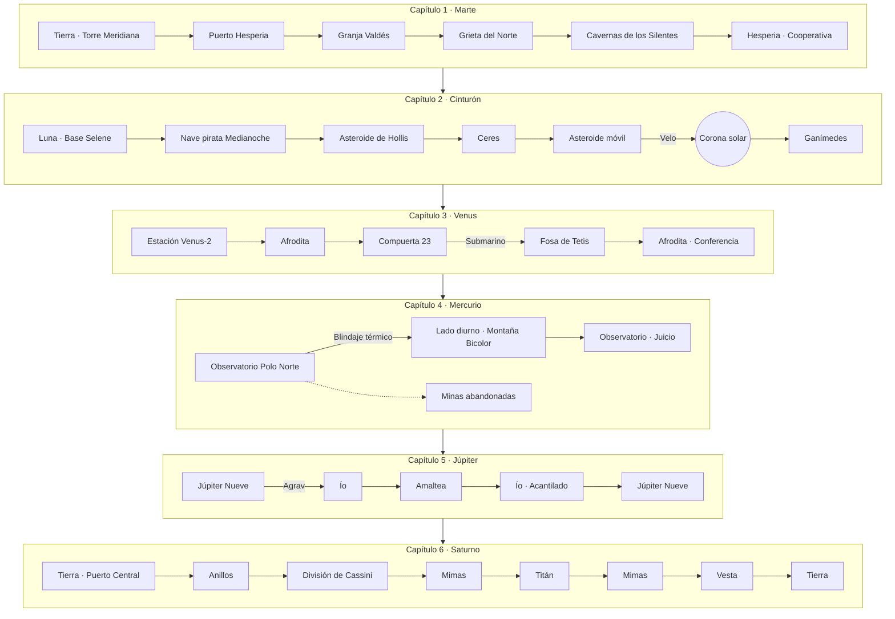

# 08 — MAPA DE NAVEGACIÓN DE LA SAGA

Grafo completo de nodos (locaciones) y tramos (viajes) de los seis capítulos, con las condiciones de acceso. Todos los nodos están **dentro del Sistema Solar**: Vega y los mundos exteriores sólo se mencionan.

## 1. Grafo general

## 2. Tabla de tramos

| Tramo | Origen → Destino | Duración objetivo | Tipo de pilotaje | Evento principal | Requisito |
|---|---|---|---|---|---|
| C1_VIA01 | Tierra → Puerto Hesperia | 12 min | Crucero interplanetario | Lluvia de micrometeoritos | — |
| C1_VIA02 | Hesperia → Granja Valdés | 4 min | Vuelo rasante | Cañón estrecho | `F_GOLIAT_RECLUTADO` |
| C1_VIA03 | Granja → Grieta del Norte | 3 min | Vehículo de superficie saboteado | Control inestable | — |
| C1_VIA04 | Grieta → Cavernas | 3 min | Descenso vertical | Pozo estrecho | — |
| C1_VIA05 | Cavernas → Hesperia | 5 min | Vuelo atmosférico | Tormenta eléctrica (tutorial del Velo) | `F_VELO` |
| C2_VIA01 | Luna → Cinturón | 8 min | Nave «automática» (sin maniobras bruscas) | Abordaje pirata | — |
| C2_VIA02 | *Medianoche* → Asteroide de Hollis | 3 min | Pasajero (cámara libre) | — | — |
| C2_VIA03 | Hollis → Ceres | 6 min | Crucero | Llamada de Corvo | — |
| C2_VIA04 | Ceres → Zona Prohibida | 7 min | Campo de asteroides | Cable magnético | — |
| C2_VIA05 | Base → Ganímedes | 9 min | Asistencia gravitatoria solar | Paso por la corona | `F_VELO` |
| C3_VIA01 | Tierra → Estación Venus-2 | 10 min | Crucero | Sesión informativa | — |
| C3_VIA02 | Estación → Afrodita | 5 min | Descenso atmosférico / amerizaje | Pilotos en blanco | — |
| C3_VIA03 | Afrodita → Fosa de Tetis | 8 min | Submarino | Manto Escarlata | `F_SUB` |
| C3_VIA04 | Fosa → Afrodita | 5 min | Submarino | — | `F_SUB` |
| C4_VIA01 | Tierra → Mercurio | 10 min | Crucero (radiación creciente) | — | — |
| C4_VIA02 | Observatorio → lado diurno | 8 min | Superficie, gestión térmica | Salida del Sol | `F_TERMICO` |
| C4_VIA03 | Lado diurno → Observatorio | 6 min | Nave dañada, gestión de energía | Noticia de la muerte de Urquiza | — |
| C5_VIA01 | Tierra → Júpiter Nueve | 12 min | Crucero | — | — |
| C5_VIA02 | Júpiter Nueve → Ío | 10 min | Agrav (nave *Ícaro*) | Eclipse | `F_AGRAV` |
| C5_VIA03 | Ío → Amaltea | 9 min | Agrav de emergencia | Caída hacia Júpiter | `F_AGRAV` |
| C5_VIA04 | Amaltea → Ío | 4 min | Salto corto | Confesión de Calder | — |
| C5_VIA05 | Ío → Júpiter Nueve | 6 min | Crucero | Planificación de la trampa | — |
| C6_VIA01 | Tierra → Saturno | 14 min | Persecución bajo la eclíptica | Explosión del Agente X | — |
| C6_VIA02 | Anillos → Cassini | 7 min | Polo sur + campo de hielo | Cruce de la división de Cassini | `F_AGRAV` |
| C6_VIA04 | Mimas → Titán | 6 min | Pasajero (pilota un robot vegano) | — | — |
| C6_VIA05 | Titán → Mimas | 5 min | Pasajero | Silencio de GOLIAT | — |
| C6_VIA06 | Mimas → Vesta | 8 min | Pasajero + escena alterna en la Tierra | — | — |
| C6_VIA07 | Vesta → Tierra | 6 min | Crucero (créditos) | — | — |

> El tramo Cassini → Mimas (aterrizaje perforando el hielo) está incluido en el último hito de C6_VIA02, por eso no existe un C6_VIA03.

## 3. Distribución de tiempo de diálogo
- **Tramos:** 28 · **Tiempo total de pilotaje:** ~197 min.
- Cada tramo tiene 5 o más hitos con diálogo y un *pool* `R` de 1 a 4 líneas, más los *pools* de reserva del archivo `07`. Con la regla de 15 s de inactividad, el silencio máximo entre dos líneas es de unos 15 s más la duración de la línea.
- El exportador (`herramientas/exportar_dialogos.py`) informa las palabras y la duración estimada de audio por capítulo y por tipo de bloque, para presupuestar la grabación.
